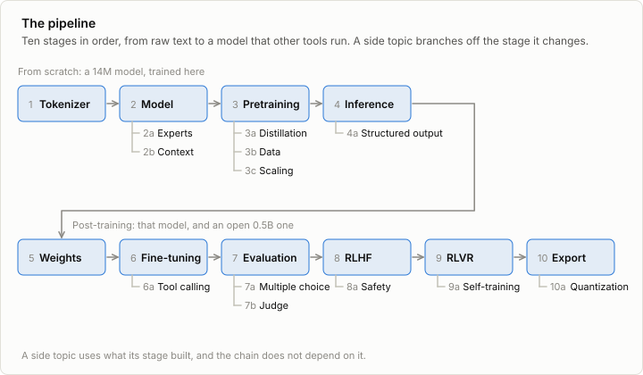

# minllm

A minimal pipeline for making a language model, small enough to run on a
laptop and written to be read. It goes from raw text to a tokenizer, a
pretrained model, an inference engine, a fine-tuned chat model, and a model
post-trained with reinforcement learning, first from human preferences (RLHF)
and then from verifiable rewards (RLVR), and ends with that model in the
format that other tools run.

These ten stages are the pipeline, and each builds on the one before. Side
topics branch off a single stage for whoever wants to go further there: a
mixture of experts in place of the model's MLP, and quantization of the
exported file. The pipeline does not depend on them.



The only machine learning dependency is PyTorch, for tensors and automatic
differentiation. Everything on top of it is written here, in a few hundred
lines per stage: the tokenizer, the model, the training loop, the inference
engine, fine-tuning with LoRA, the evaluation, and the RL algorithms. There
is no `transformers`, `tokenizers`, `peft`, `trl` or `vllm` underneath.

## Stages

Each stage has a note that explains it, code that implements it, and tests
that check what the note claims.

| | Stage | What gets built |
|---|---|---|
| 1 | [Tokenizer](docs/01-tokenizer.md) | Byte-level BPE: training, encoding, decoding, special tokens |
| 2 | [Model](docs/02-model.md) | Decoder-only transformer with RMSNorm, RoPE, SwiGLU and grouped-query attention |
| 3 | [Pretraining](docs/03-pretraining.md) | Data pipeline, AdamW, learning rate schedule, checkpoints: a model that writes stories |
| 4 | [Inference](docs/04-inference.md) | KV cache, sampling strategies, batches of unequal prompts, stop conditions |
| 5 | [Pretrained weights](docs/05-pretrained.md) | Qwen2.5-0.5B-Instruct loaded into the same model code: a safetensors reader, its tokenizer, the chat format, and tests against the reference implementation |
| 6 | [Fine-tuning](docs/06-finetuning.md) | Conversations as data, a loss on the replies only, full fine-tuning and LoRA |
| 7 | [Evaluation](docs/07-evaluation.md) | Scoring replies to held-out prompts, confidence intervals, and paired comparison of two models |
| 8 | [RLHF](docs/08-rlhf.md) | Preference comparisons, a reward model, and three ways to use it: rejection sampling, PPO with a KL penalty, and DPO, which skips the reward model |
| 9 | [RLVR](docs/09-rlvr.md) | The reward model replaced by a program that checks the answer: rollouts, verifiers, and GRPO |
| 10 | [The practitioner's stack](docs/10-stack.md) | Export to the format other tools read, a check against transformers, a run in MLX, an OpenAI-compatible server, and a map from each stage to the library used for it |

### Side topics

Each one changes what a single stage built, with a note, code and tests of
its own.

| | Side topic | Branches from | What it adds |
|---|---|---|---|
| 2a | [Mixture of experts](docs/02a-moe.md) | 2, the model | A router and eight expert MLPs in place of the MLP of every block, the load-balancing loss, three ways to hand tokens to experts, and a look at what the routers learn |
| 10a | [Quantization](docs/10a-quantization.md) | 10, the export | Weights as 4-bit or 8-bit codes with a scale and an offset per group, what each bit width costs in loss and on the task, and a packed file that MLX runs as it is |

## What came out

The numbers are measured on one laptop, and the runs behind them are logged
in [`runs/`](runs/). The notes explain each one.

| Stage | Result |
|---|---|
| 3 | A 14M model trained from scratch writes coherent children's stories after 20 minutes. Compiling the model and 16-bit arithmetic make a training step about 4 times faster. |
| 4 | A KV cache is 16 times faster for 64 sequences of 255 tokens, and no faster at all for a single one, where overhead dominates. |
| 5 | The same model code loads Qwen2.5-0.5B-Instruct: identical token ids, logits within 0.001 of the reference, identical greedy output. |
| 6, 7 | Fine-tuning teaches the story model to follow an instruction: requested words used rise from 6.5% to 39.6%. Fine-tuning the 0.5B model on GSM8K's solutions lowers its loss and its accuracy, from 46.8% to 36.6%: it learned to imitate terse solutions. A token limit set too low had hidden five of those ten points. |
| 8 | A reward model trained on 3,500 noisy comparisons orders 84% of held-out pairs the way the annotator's hidden taste does. PPO with a KL penalty raises that taste from +0.21 to +1.27, and DPO to +1.06 in 80 seconds. Without the penalty the taste is highest and the stories stop making sense. |
| 9 | GRPO takes the story model from 40% to 94% of requested words in 15 minutes, by repeating them until the token limit. A stricter verifier gets endings and the same nonsense, and a KL penalty gets stories. On GSM8K, 22 minutes of GRPO add 5.9 points on the test set (95% interval 3.2 to 8.5). |
| 10 | The from-scratch model, exported, runs in MLX and writes the same story token for token. |

Two lessons recur. A loss or a reward is satisfied by whatever satisfies
it, which is not always what was meant: stages 7, 8 and 9 each show a
different case. And the way to notice is to read what the model wrote.

From the side topics:

| Side topic | Result |
|---|---|
| 2a | A mixture of eight experts per block, two of them active, has the dense model's arithmetic per token and three times its parameters. Step for step it learns more: a validation loss of 1.423 against 1.465 after 6,000 steps. Minute for minute it learns less: 1.491 against 1.465 after 20 minutes. Without the load-balancing loss, 24 of its 64 experts go unused. On this GPU it generates at a sixth of the speed of a dense model with the same parameters, and the gap closes as the models get wider. Exported, it loads as a Mixtral and gives the same logits. |
| 10a | Stored at 8 bits per weight, the 0.5B model is half the size and solves as many GSM8K problems as before (47.3% against 46.8%), and at 6 bits still as many. At 4 bits, in 278 MB, it solves 31.9%, while its replies read as fluently as ever and its held-out loss only rises from 0.83 to 0.92. This repository's own code runs the packed model 14 times slower. MLX reads the same file and runs it 2.1 times faster, in a third of the memory. |

## Quick start

Requires [uv](https://docs.astral.sh/uv/).

```sh
git clone https://github.com/changkun/minllm && cd minllm
uv sync
uv run pytest

uv run scripts/download_data.py      # TinyStories: 22 MB validation, 512 MB of training text
uv run scripts/train_tokenizer.py    # stage 1, 5 seconds
uv run scripts/encode_data.py        # text to token ids, 35 seconds
uv run scripts/train.py              # stage 3, 20 minutes
uv run scripts/sample.py             # read what it writes

uv run scripts/download_qwen.py      # stage 5: an open 0.5B model, 1 GB
uv run scripts/chat.py               # talk to it, on this repository's model code
```

The later stages build on these. Each note lists its commands, and in short:

```sh
uv run scripts/finetune.py --task words                 # stage 6, 11 minutes
uv run scripts/finetune.py --task gsm8k --lora 16       # 10 minutes
uv run scripts/evaluate.py --model out/sft-words --task words     # stage 7

uv run scripts/make_preferences.py                      # stage 8
uv run scripts/train_reward.py
uv run scripts/ppo.py                                   # 7 minutes
uv run scripts/dpo.py

uv run scripts/grpo.py --task words                     # stage 9, 15 minutes
uv run scripts/grpo.py --task gsm8k --max-new-tokens 256          # 22 minutes

uv run scripts/export.py --model out/sft-words          # stage 10
uv run scripts/serve.py --model out/sft-words
```

And the side topics:

```sh
uv run scripts/train.py --n-experts 8 --mlp-dim 512 --out out/moe  # 2a, 31 minutes
uv run scripts/analyze_moe.py

uv run scripts/quantize.py --model qwen --bits 4        # 10a: 988 MB become 278
uv run scripts/evaluate.py --model out/qwen-q4 --task gsm8k
```

Timings are from a MacBook Pro with an M5 Pro and 64 GB of memory, using the
Apple GPU. The code picks an NVIDIA GPU, the Apple GPU or the CPU, in that
order; set `MINLLM_DEVICE=cpu` to override. CUDA has not been tested. On an
Apple GPU the process is capped at half of the recommended memory, so that a
batch that is too large fails instead of swapping the machine.

## Two models

The stages use two models, both running on the code in
[`minllm/model.py`](minllm/model.py).

The first is trained from scratch here: 14M parameters, a vocabulary of 4,096
tokens, trained on [TinyStories](https://arxiv.org/abs/2305.07759). After 20
minutes of training it writes fluent children's stories. It carries stages 1
to 4 and stays the testbed afterwards: fine-tuning, RLHF and RLVR are all run
on it, where an experiment takes minutes and can be repeated.

The second is Qwen2.5-0.5B-Instruct, an open pretrained model with 494M
parameters, loaded into the same code from stage 5 on. Post-training on a real
task needs a model that already knows something: RLVR improves a model on a
task it sometimes gets right, and a model trained on a laptop from children's
stories does not do arithmetic at any rate worth reinforcing. The 0.5B model
solves 47% of GSM8K's test problems as published. On the laptop it generates
3,100 tokens per second in a batch and trains at 4,000, which is enough for
fine-tuning in 10 minutes and a GRPO run in 22.

## Layout

```
minllm/      the library, one concept per file
scripts/     one entry point per step of the pipeline
tests/       checks for the claims the notes make
docs/        one note per stage, with figures drawn by scripts/make_figures.py
runs/        logs and benchmarks, the source of every number and figure in the notes
data/, out/  downloads and checkpoints, not in git
```

## Related work

- [nanoGPT](https://github.com/karpathy/nanoGPT) and
  [minbpe](https://github.com/karpathy/minbpe) by Andrej Karpathy set the
  standard for teaching by small, complete code. Stages 1 to 3 follow their
  shape with a current architecture.
- [nanochat](https://github.com/karpathy/nanochat), also by Karpathy, is a
  full pipeline from tokenizer to chat UI, sized for a rented multi-GPU node.
  minllm is sized for a laptop and puts more weight on the post-training
  stages.
- [LLMs-from-scratch](https://github.com/rasbt/LLMs-from-scratch) by Sebastian
  Raschka covers pretraining and fine-tuning in book form.
- [The RLHF Book](https://rlhfbook.com/) by Nathan Lambert is the reference
  for the post-training stages, 6 to 9, which follow its order: instruction
  tuning, reward models, rejection sampling, policy gradients, direct
  alignment, and then RLVR.

## License

[MIT](LICENSE)
