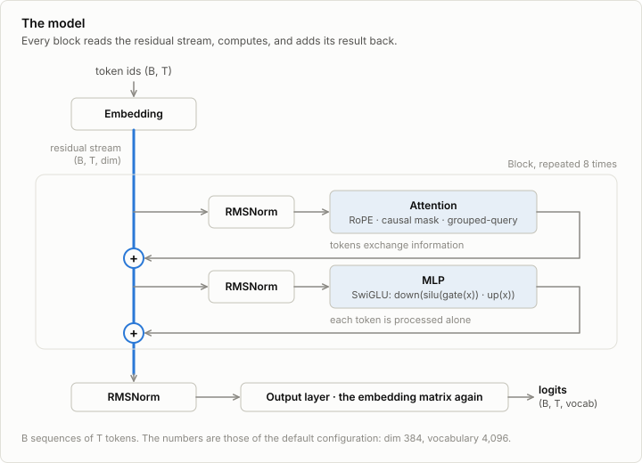
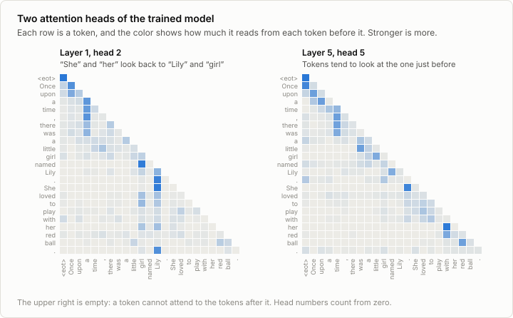

# 2. Model

Code: [`minllm/model.py`](../minllm/model.py) ·
Tests: [`tests/test_model.py`](../tests/test_model.py)

The model is a function from a sequence of token ids to, at every position, a
probability distribution over the token that comes next. Training adjusts its
weights so that the tokens which actually follow get high probability.
Generation samples from the distribution, appends the sample, and asks again.

## The forward pass, by shape

With batch size `B`, sequence length `T`, width `dim` and vocabulary `V`:

```
idx                      (B, T)         token ids
embed(idx)               (B, T, dim)    one learned vector per token
N x Block                (B, T, dim)    each block adds to the stream
norm                     (B, T, dim)
lm_head                  (B, T, V)      a score (logit) for every possible next token
```



The tensor of shape `(B, T, dim)` that runs through the blocks is the
*residual stream*. A block never replaces it. It reads a normalized copy,
computes something, and adds the result back:

```python
x = x + self.attn(self.attn_norm(x), cos, sin)   # tokens exchange information
x = x + self.mlp(self.mlp_norm(x))               # each token is processed on its own
```

Attention is the only place where positions interact. Everything else acts on
each token's vector independently.

## Attention

Each token emits a query, a key and a value. The score between a query and a
key says how much that token wants to read from the other one, and the output
is the average of the values, weighted by the scores after a softmax:

```
weights = softmax(q kᵀ / sqrt(head_dim) + mask)      (T, T), rows sum to 1
out     = weights v
```

The mask is minus infinity above the diagonal, so a token can read from itself
and from earlier tokens only. This is what makes the model *causal*, and it
has a consequence that training relies on: one forward pass over `T` tokens
yields `T` predictions, each made without sight of its own answer.
`test_causal` checks it by changing one token and confirming that no earlier
prediction moves.

The computation runs in `n_heads` independent copies on slices of width
`head_dim = dim / n_heads`, so different heads can attend to different things.
Here are two heads of the model trained in the next stage, on one sentence:



Nobody told these heads what to do. In layer 1, head 2, the word "She" puts
96% of its attention on "Lily", and "her" looks back to "Lily" and "girl":
the head finds whom a pronoun refers to. Layer 5, head 5 tends to look at the
token just before. Both patterns came out of predicting the next token.
(`scripts/dump_attention.py` extracts the weights.)

`Attention.forward` calls PyTorch's `scaled_dot_product_attention` for speed;
`test_attention_matches_the_formula` spells the same computation out with
explicit loops and checks that the results agree.

## What changed since GPT-2

nanoGPT implements GPT-2 (2019). Open models released since 2023 share four
changes to the block, and this model has all four.

**RMSNorm instead of LayerNorm.** LayerNorm subtracts the mean, divides by the
standard deviation, then applies a learned gain and bias. RMSNorm keeps only
the rescaling: divide by the root mean square, multiply by a gain. It is
cheaper, and the dropped parts turned out not to matter. As in GPT-2, the norm
is applied to the input of each sublayer and not to the stream itself.

**Rotary position embeddings (RoPE) instead of learned ones.** Attention as
written above ignores order: shuffle the tokens and each one computes the same
output. GPT-2 fixes this by adding a learned vector per position to the
embeddings, which ties the model to the positions seen in training. RoPE
instead rotates each query and key by an angle proportional to its position,
just before the dot product. Since rotating two vectors by `m` and `n`
changes their dot product only through `m - n`, the score depends on the
*distance* between two tokens, not on where they sit. The rotation acts on
pairs of dimensions, each pair at its own speed, from one radian per token
down to about `1/theta` radians per token. `test_rope_is_relative` checks the
property: the score between positions 5 and 2 equals the score between 45
and 42. The side topic [2b](02b-context.md) reads the model past the window
it was trained on, where the slow pairs reach angles it has never seen.

**SwiGLU instead of a GELU MLP.** The classic MLP is `down(act(up(x)))`.
SwiGLU uses two projections and lets one gate the other:
`down(silu(gate(x)) * up(x))`. Three matrices instead of two, so the hidden
width is set to about `8/3 * dim` rather than `4 * dim` to keep the parameter
count the same.

**Grouped-query attention (GQA).** Standard attention has as many key/value
heads as query heads. GQA has fewer: here 6 query heads share 2 key/value
heads, three each. During generation, the keys and values of all previous
tokens are kept in memory (the KV cache of stage 4), and GQA shrinks that
memory by the same factor. For a model this small it is a detail. For a model
serving long contexts it decides how many requests fit on a GPU.

The model also has no bias terms and no dropout, as is common now.

## Weight tying and initialization

The embedding matrix maps a token to a vector, and the output layer maps a
vector to a score per token. They have the same shape `(V, dim)`, and with
`tie_embeddings` they are the same matrix: a token's score is the dot product
of the final vector with that token's embedding. This saves `V * dim`
parameters.

Weights start as small Gaussian noise (standard deviation 0.02), and the
matrices that write into the residual stream start smaller by a factor of
`sqrt(2 * n_layers)`, so that the sum of all the blocks' contributions starts
at the scale of a single one. The effect is that an untrained model predicts
an almost uniform distribution, and its loss is close to `ln(V)`.
`test_untrained_model_is_uniform` checks this, and it is the first number to
look at when a training run starts: for `V = 4096`, expect a value just above
`ln(4096) = 8.32`. A much larger initial loss means the initialization is off.

## Size

The default `Config` has 14.2M parameters:

| Part | Shape | Parameters |
|---|---|---|
| Embedding, shared with the output layer | 4096 × 384 | 1,572,864 |
| Attention, per block | q, o: 384 × 384; k, v: 128 × 384 | 393,216 |
| MLP, per block | 3 matrices of 384 × 1024 | 1,179,648 |
| Norm gains, per block | 2 × 384 | 768 |
| 8 blocks | | 12,589,056 |
| Final norm | 384 | 384 |
| Total | | 14,162,304 |

`test_shapes_and_params` does this count for a small configuration.

Two thirds of the parameters are in the MLPs. The share is about the same in
large models. The side topic [2a](02a-moe.md) replaces the MLP by a mixture
of experts, which is how many large models hold more parameters than they use
for any one token.

The same code describes published models with other numbers:

| | minllm default | Qwen2.5-0.5B | Qwen3-0.6B |
|---|---|---|---|
| `vocab_size` | 4,096 | 151,936 | 151,936 |
| `dim` | 384 | 896 | 1,024 |
| `n_layers` | 8 | 24 | 28 |
| `n_heads` / `n_kv_heads` | 6 / 2 | 14 / 2 | 16 / 8 |
| `mlp_dim` | 1,024 | 4,864 | 3,072 |
| `rope_theta` | 10,000 | 1,000,000 | 1,000,000 |
| Parameters | 14M | 494M | 596M |

Stage 5 loads Qwen2.5. The remaining differences are small: Qwen2.5 has bias
terms on q, k and v, which stage 5 adds as the flag `qkv_bias`, and Qwen3
normalizes queries and keys and sets the head width independently of `dim`,
which is an exercise there.

## Run it

There is nothing to train yet. Build a model and look at it:

```sh
uv run pytest tests/test_model.py -v
uv run python -c "
import torch
from minllm.model import Config, Transformer
model = Transformer(Config())
print(f'{model.num_params():,} parameters')
logits, loss = model(torch.randint(0, 4096, (2, 16)), torch.randint(0, 4096, (2, 16)))
print(logits.shape, loss.item())
"
```

`test_overfits_one_batch` is the smoke test for everything in this file. It
trains a tiny model on four random sequences until the loss is near zero. If
any part of the forward pass were broken in a way that blocks learning, the
model could not memorize them.

## Exercises

1. Remove the causal mask (`is_causal=False`) and run the tests.
   `test_overfits_one_batch` still passes, and a training run would show a
   falling loss. Which test catches the bug, and why would the trained model
   be useless for generation?
2. Make `apply_rope` return `x` unchanged. Which tests fail, and which still
   pass? What can a model without position information still learn?
3. Set `n_kv_heads=6`. How many parameters does the model gain? How much
   larger does the KV cache get?
4. Initialize all weights with standard deviation 0.2 instead of 0.02 and
   look at the initial loss. Explain the number.
5. With tied embeddings, an untrained model gives the *current* token a
   slightly higher score than the others. Verify it, and explain it from the
   forward pass.

## In practice

Hugging Face `transformers` holds the reference implementation of every
published architecture, and its model files are a few hundred lines of the
same operations as here, plus the caching and configuration options this file
leaves out. Inference engines (vLLM, llama.cpp, MLX) each reimplement the
forward pass for speed. The differences between most of today's open models
are numbers in a config file and small changes to the block, such as Qwen3's
normalized queries and keys. Larger changes, such as the latent attention of
DeepSeek's models, are rarer.

## References

- Vaswani et al. (2017), [Attention Is All You Need](https://arxiv.org/abs/1706.03762). The transformer: attention as the only way in which positions exchange information, with residual connections, normalization and an MLP around it.
- Radford et al. (2018), [Improving Language Understanding by Generative Pre-Training](https://cdn.openai.com/research-covers/language-unsupervised/language_understanding_paper.pdf), OpenAI. GPT. The decoder alone, trained to predict the next token, as a model in its own right.
- Xiong et al. (2020), [On Layer Normalization in the Transformer Architecture](https://arxiv.org/abs/2002.04745). Why the norm belongs in front of each sublayer and not behind it.
- Zhang and Sennrich (2019), [Root Mean Square Layer Normalization](https://arxiv.org/abs/1910.07467). RMSNorm: layer normalization without the centering and the bias.
- Su et al. (2021), [RoFormer: Enhanced Transformer with Rotary Position Embedding](https://arxiv.org/abs/2104.09864). Rotary position embeddings: positions as rotations of the queries and keys.
- Shazeer (2020), [GLU Variants Improve Transformer](https://arxiv.org/abs/2002.05202). SwiGLU, among other gated variants of the MLP.
- Shazeer (2019), [Fast Transformer Decoding: One Write-Head is All You Need](https://arxiv.org/abs/1911.02150). Multi-query attention: all query heads share one key and value head.
- Ainslie et al. (2023), [GQA: Training Generalized Multi-Query Transformer Models from Multi-Head Checkpoints](https://arxiv.org/abs/2305.13245). Grouped-query attention, the middle ground between that and full multi-head attention.
- Press and Wolf (2016), [Using the Output Embedding to Improve Language Models](https://arxiv.org/abs/1608.05859). Tying the output layer to the input embedding.
- Touvron et al. (2023), [LLaMA: Open and Efficient Foundation Language Models](https://arxiv.org/abs/2302.13971). LLaMA, which put RMSNorm in front of the sublayers, SwiGLU and rotary embeddings together into the block that open models have used since.
- Qwen Team (2024), [Qwen2.5 Technical Report](https://arxiv.org/abs/2412.15115). The model family whose layout this code matches, and whose smallest instruction-tuned member is loaded in stage 5.
- Karpathy, [nanoGPT](https://github.com/karpathy/nanoGPT). The smallest complete GPT-2, and the standard this repository holds itself to for readability.
