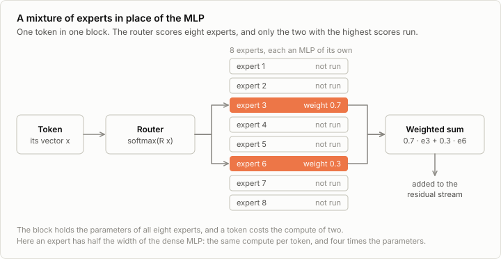
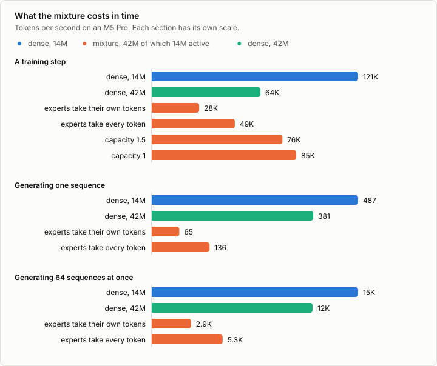
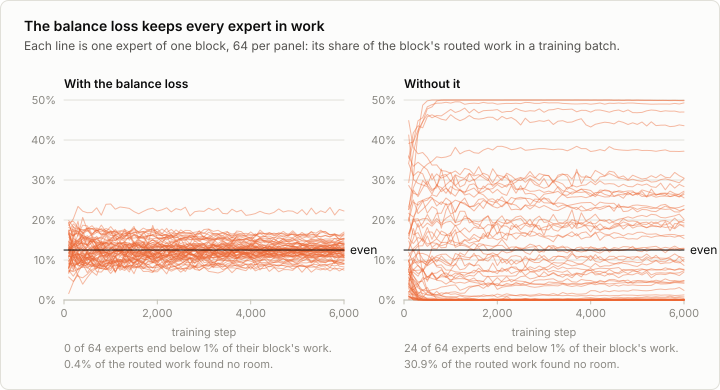
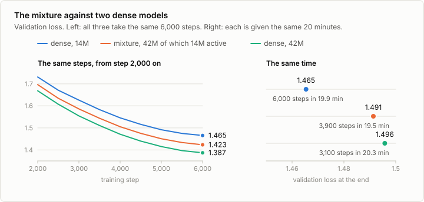
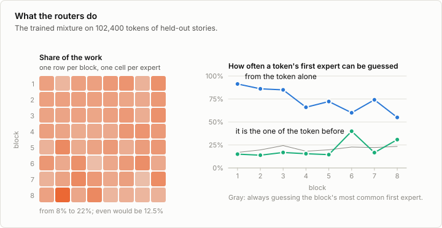

# 2a. Mixture of experts

Code: [`minllm/model.py`](../minllm/model.py) (`MoE`),
[`minllm/export.py`](../minllm/export.py) ·
Scripts: [`scripts/train.py`](../scripts/train.py),
[`scripts/bench_moe.py`](../scripts/bench_moe.py),
[`scripts/analyze_moe.py`](../scripts/analyze_moe.py) ·
Tests: [`tests/test_moe.py`](../tests/test_moe.py) ·
Logs: [`runs/moe/`](../runs/moe/)

The model of stage 2 is dense: every weight takes part in computing every
token. Many of the largest open models are built differently. Mixtral,
DeepSeek-V3, the large Qwen3 models and gpt-oss are mixtures of experts
(MoE): they hold many more parameters than they use for any one token.

This is a side topic of [stage 2](02-model.md), not a step of the pipeline.
It replaces one part of the block. To see what that does to training, to
speed and to export it uses the training loop of stage 3, the sampler of
stage 4 and the export of stage 10, so it is best read after those. It uses
only the model trained from scratch: the open pretrained mixtures, such as
OLMoE with about 7 billion parameters, are too large to train on this
laptop.

## The idea

Two thirds of the model's parameters are in its MLPs, and a dense model runs
all of them for every token. A mixture of experts puts several MLPs, the
experts, where one was, and adds a router that decides for each token which
few of them to run.



The parameters of the block grow with the number of experts. The compute per
token grows only with the number that run. That is the whole trade: a model
can know more without every token paying for all of it.

`MoE` in `model.py` replaces `MLP` when `n_experts` is above zero. Routing is
four lines:

```python
probs = F.softmax(self.router(x), dim=-1)        # one probability per expert
top, chosen = probs.topk(self.n_active)          # the token's likeliest experts
weights = top / top.sum(-1, keepdim=True)        # their weights sum to one
y = sum(weights[e] * experts[e](x) for e in chosen)
```

The router is one linear layer from the token's vector to a score per expert,
3,072 numbers per block here. It has no supervision of its own. It learns
from the same loss as everything else, through the weights it gives the
experts it chose.

Three models are compared here:

| | Dense | Mixture | Dense, wide |
|---|---|---|---|
| MLP in each block | width 1,024 | 8 experts of width 512, 2 active | width 4,096 |
| Parameters | 14.2M | 42.5M | 42.5M |
| Used for one token | 14.2M | 14.2M | 42.5M |

The mixture is built to cost what the dense model of stage 3 costs per token:
two experts of half the width. It holds three times the parameters. Published
mixtures carry both numbers in their names, as in Qwen3-235B-A22B: 235
billion parameters, 22 billion of them active.

The wide model is the other reference, and for a reason that the code makes
visible. Run every expert on every token, multiply each result by its weight,
and the mixture is exactly an MLP of width 4,096 whose hidden units come in
eight groups: for each token the router switches six groups off and scales the
other two. The wide model is that same MLP with nothing switched off. So the
comparison asks two things: what do the extra parameters buy over the dense
model, and what does switching three quarters of them off cost against the
wide one.

## Handing tokens to experts

"Only the chosen experts run" is simple to say for one token. A training step
has 16,384 tokens, each with its own pair of experts, and there are three ways
to organize the work.

**Every expert takes every token.** Run all eight on everything and multiply
by the weights, most of which are zero. This is exact and simple, and it
throws the saving away: it is the arithmetic of the wide model.

**Every expert takes its own tokens.** For each expert, collect the tokens
that were routed to it, run them, and add the results back at their places.
This is exact, and it is the arithmetic of the small model. But the number of
tokens an expert gets now changes from batch to batch, so no tensor in the
loop has a shape that is known in advance.

**Every expert takes a fixed number of tokens.** Give each expert room for
its even share of the work times a factor, the *capacity*. An expert that
more tokens were routed to than it has room for drops the ones that weigh it
least, and an expert with room to spare fills it with tokens of weight zero.
The shapes are fixed again. The price is that some routed work is not done.

`MoE.forward` is one loop with one setting:

```python
for i, expert in enumerate(self.experts):
    if self.capacity is None:
        rows = weights[:, i].nonzero().squeeze(-1)    # exactly the tokens routed to expert i
        w = weights[rows, i]
    else:
        w, rows = weights[:, i].topk(room)            # a fixed number: those that weigh it most
    out = out.index_add(0, rows, w[:, None] * expert(x[rows]))
```

With a capacity of `n_experts / n_active`, here 4, every expert has room for
every token, which is the first way. `test_forward_matches_the_formula`
checks the loop against the plain sum over all experts, and
`test_capacity_drops_the_overflow` checks which tokens a full expert drops.



| A training step of 64 × 256 tokens | Parameters | Tokens per second |
|---|---|---|
| Dense | 14.2M | 121k |
| Dense, wide | 42.5M | 64k |
| Mixture, experts take their own tokens | 42.5M | 28k |
| Mixture, experts take every token | 42.5M | 49k |
| Mixture, capacity 1.5 | 42.5M | 76k |
| Mixture, capacity 1 | 42.5M | 85k |

All of them are compiled and run in bfloat16, as in stage 3.
`scripts/bench_moe.py` measures every case three times, each time in a
process of its own, and keeps the fastest. The laptop was in use meanwhile,
and single measurements of a case differed by 10 to 20%.

**The way that does the least arithmetic is the slowest.** Stage 3 found that
compiling the model makes a training step much faster on this GPU, because
it fuses many small operations into few large ones. Shapes that depend on
the data defeat that. The compiler has to cut the step apart at every
operation that finds an expert's tokens, because it cannot know how many
there will be, and it fuses nothing across a cut. What is left is many small
pieces, and the overhead of running them one after the other is what the step
then consists of.

**With fixed shapes the mixture trains at 76k tokens per second.** That is
faster than the wide model, which has the same parameters, and over a third
slower than the dense model, which has the same arithmetic per token. Even at
a capacity of 1, where the experts do exactly the dense model's amount of
work, 30% of the speed is gone. Routing has a cost of its own: scoring,
ranking, collecting and scattering 16,384 tokens are operations that the
dense model does not have.

A mixture saves arithmetic and adds bookkeeping. Whether that saves time
depends on which of the two is larger.

A capacity has two costs. The first is the work that is dropped, which in the
runs below is 0.4% of what the routers ask for, as long as the load is even.
The second is less obvious. With a capacity, tokens compete for room, so what
the model computes for a token depends on the other tokens of the batch,
later ones included. In training that is a little noise. In generation it
would be wrong, and it would break the cache of stage 4, which relies on a
token's result never changing.
`test_causal_unless_tokens_compete_for_room` shows the leak. So `train.py`
uses a capacity only in training steps. It evaluates with room for every
token, and generation gives every expert its own tokens: both are exact.

The first large mixtures, GShard and the Switch Transformer, were trained
with a capacity, in frameworks that need fixed shapes. The reference
implementation of Mixtral in transformers gives every expert its own tokens.

## Training: the balance loss

Nothing in the next-token loss asks the router to use all of its experts, and
there is a pull the other way. An expert that gets more tokens gets more
training, becomes more useful, and so gets more tokens. In the extreme a few
experts do all the work, and the rest are parameters that are stored and
never used.

The usual counterweight is a second term in the loss. For one block and one
batch, let `share` be the part of the routed work that went to each expert,
and `probs` the probabilities the router gave. The load-balancing loss of the
Switch Transformer is

```python
balance = n_experts * (share * probs.mean(0)).sum()
```

It is 1 when every expert gets the same share, and larger the more
probability sits on the experts that are busy already. `share` is a count and
carries no gradient. The gradient runs through `probs` and lowers the
probability of the busy experts. `test_balance_loss` checks the two values on
a router built by hand, and `test_balance_loss_spreads_the_tokens` follows
the gradient for twenty steps and watches a lopsided router even out.

`train.py` adds the term with a weight of 0.01, and logs the cross-entropy
alone, so that the loss of a mixture compares with the loss of a dense model:

```python
_, loss = model(x, y)
objective = loss + 0.01 * model.balance_loss()
objective.backward()
```

Two runs differ in nothing but that weight:

```sh
uv run scripts/train.py --n-experts 8 --mlp-dim 512 --out out/moe
uv run scripts/train.py --n-experts 8 --mlp-dim 512 --balance 0 --out out/moe-no-balance
```



With the balance loss, each of the 64 experts gets between 5% and 24% of its
block's work in every batch that was logged after step 500.

Without it, the routers pick favorites within the first few hundred steps
and never revise them. 20 experts are below 1% by step 350, and 24 at the
end. Block 3 sends every token to the same two experts: it has become a dense
MLP with six unused copies next to it. Only the first block stays spread out
by itself.

| | Validation loss | Experts below 1% | Routed work dropped |
|---|---|---|---|
| Mixture, with the balance loss | 1.423 | 0 of 64 | 0.4% |
| Mixture, without | 1.453 | 24 of 64 | 31% |
| Dense, for reference | 1.465 | | |

The collapsed mixture gives back most of what its extra parameters bought.
It also wastes its capacity: two experts that are asked to take everything
have room for a share and a half each, so 31% of the routed work is dropped
in every training step.

The balance loss does not make the model better at anything. It keeps a
failure of the training dynamics from happening, and the other results of
this note depend on it.

## The comparison

```sh
uv run scripts/train.py --n-experts 8 --mlp-dim 512 --out out/moe    # the mixture
uv run scripts/train.py --mlp-dim 4096 --out out/wide                # the wide dense model
```

Both take the 6,000 steps of the reference run of stage 3, on the same data
with the same batch size and learning rate.



| 6,000 steps | Parameters | Validation loss | Minutes | Tokens per second |
|---|---|---|---|---|
| Dense, the run of stage 3 | 14.2M | 1.465 | 19.9 | 84k |
| Mixture | 42.5M, 14.2M active | 1.423 | 30.5 | 57k |
| Dense, wide | 42.5M | 1.387 | 38.2 | 45k |

The speeds are those of the whole training loop, which is slower than the
bare step of the benchmark above, as it was in stage 3.

**Step for step, the extra parameters help, even though a token uses a third
of them.** The mixture is ahead of the dense model at every evaluation and
ends 0.042 lower. It does the same arithmetic per token. What it has more of
is places to put what it learns.

**Switching experts off has a price.** The wide model uses the same
parameters for every token and ends another 0.036 lower. The mixture gets
54% of what the wide model gains over the dense one.

**It also takes 58% of the wide model's extra time.** On this laptop the
mixture is not a way around the trade between size and speed. It is a point
between the two dense models, close to the line that joins them.

**In the same time, the smallest model wins.** The table gives every model
the same steps and lets the clock run. To give them the same time instead,
the mixture and the wide model were trained again with as many steps as fit
into the dense model's 20 minutes, each with its own learning-rate schedule
over those steps:

```sh
uv run scripts/train.py --n-experts 8 --mlp-dim 512 --steps 3900 --out out/moe-20min
uv run scripts/train.py --mlp-dim 4096 --steps 3100 --out out/wide-20min
```

| 20 minutes | Steps | Minutes | Validation loss |
|---|---|---|---|
| Dense, the run of stage 3 | 6,000 | 19.9 | 1.465 |
| Mixture | 3,900 | 19.5 | 1.491 |
| Dense, wide | 3,100 | 20.3 | 1.496 |

The order of the first table is reversed. All three models are still
improving when their time is up, so more steps are worth more than more
parameters, and the model that takes the most steps is ahead.
The mixture and the wide model end level. Stage 3 said that speed is model
quality, and this is that sentence seen from the other side.

The second pair of runs was needed. Reading the loss of the long runs at
their 20-minute mark would have given 1.51 and 1.55, because at that point
they are in the middle of a learning-rate schedule that was planned for more
steps. A comparison at a budget needs runs that were planned for the budget.

The mixture writes stories like the dense model's
(`uv run scripts/sample.py --ckpt out/moe/ckpt.pt`):

> Once upon a time, there was a little girl named Mia. She loved to bake with
> her mom. Every day, they would make a big, scary cake. Mia liked all the
> yummy things she made.
>
> One day, Mia and her mom decided to bake a big, yummy cake. They mixed all
> the ingredients together. They went to the kitchen and started to bake. The
> smell of the cake made Mia feel happy. […]

A difference of 0.04 in the loss is not something a reader of the stories
would notice.

## Generation

A mixture should be at its best in generation. For one new token it runs two
small experts, where the wide model runs an MLP four times the size of both
together. The lower two sections of the figure above show what happens
instead:

| Tokens per second, 200 new tokens | One sequence | 64 at once |
|---|---|---|
| Dense | 487 | 15,400 |
| Dense, wide | 381 | 12,000 |
| Mixture, experts take their own tokens | 65 | 2,900 |
| Mixture, experts take every token | 136 | 5,300 |

Alone, the mixture writes 65 tokens per second, a sixth of what the wide
model does with the same parameters. Stage 4 found the reason. For a single
token, this GPU spends its time on starting operations and not on the
arithmetic inside them. The mixture has many more operations per block: a
loop over eight experts, each of which finds its tokens, collects them, runs
its three matrices and scatters the result. Running all eight experts on
every token is twice as fast as running the two that were chosen, because it
skips the finding and collecting, and the arithmetic was never the cost.

**The saving grows with the model, and the bookkeeping does not.**
`bench_moe.py --scale` makes all three models wider. For one sequence:

| Width | Dense, wide | Mixture with the same parameters | Mixture against dense |
|---|---|---|---|
| ×1 | 42M: 381 tokens per second | 65 | 17% |
| ×2 | 165M: 205 | 61 | 30% |
| ×4 | 651M: 78 | 54 | 68% |

The mixture is almost as fast with 651M parameters as with 42M. Its time is
bookkeeping, which does not depend on how wide an expert is. The dense
model's time has become arithmetic, and it falls by about half or more with
every doubling. The gap closes from a factor of six to a factor of 1.5.

The published mixtures are up to a thousand times larger than the largest of
these, and can run on kernels that do the bookkeeping in one grouped
operation. There the arithmetic is everything, and running a small share of
it is a saving that nothing else offers.

So the results of this note have one cause. At 42M parameters on a laptop,
the mixture learns more per step than the dense model with its arithmetic,
learns less per minute, and generates more slowly than a dense model of its
full size. It saves arithmetic and adds bookkeeping, and at this size
arithmetic is cheap.

## What the routers do

`scripts/analyze_moe.py` runs 102,400 tokens of held-out stories through the
trained mixture and records where every token is routed.



On text the model has not seen, the busiest expert of any block gets 22% of
the work and the idlest 8%. An even split would give each 12.5%.

The right panel asks what a router goes by. Call the expert with the larger
weight a token's *first* expert.

**The first block is a lookup table.** Knowing only which token it is, the
first expert can be named 91% of the time. (The rule, each token's most
frequent first expert, is fitted on half of the text and scored on the other
half.) The router of block 1 sees little more than the token's embedding, and
it has cut the vocabulary into eight bins. The bins mean nothing one can
read: one expert gets *want*, *in*, *happy*, *park*, *she* and *bird*.

**Later blocks go by what the token is doing.** In block 8 the token alone
names the first expert 55% of the time, and the rest depends on the
context. The groups have become readable. These are the tokens that each
expert of block 8 gets most reliably, among those that occur at least 100
times:

| Expert | Tokens |
|---|---|
| 1 | *named*, `"`, *were*, `,`, *very*, *was* |
| 2 | *thought*, *put*, *saw*, *loved*, *wanted*, *took*, *learned* |
| 3 | *an*, *had*, *have*, *is*, *did*, *be*, *are* |
| 4 | `?"`, *smiled*, `,"`, `!"`, `."`, *ran*, *looked* |
| 5 | `."` and `.` before a new line, `<\|endoftext\|>`, *upon*, *One*, *I* |
| 6 | *will*, *time*, *said*, *then*, *day*, *can* |
| 7 | *there*, *little*, *boy*, *girl*, *small*, *big* |
| 8 | *their*, *my*, *your*, *his*, *Once*, *new*, *her* |

Expert 8 has the possessives, expert 3 the auxiliary verbs, expert 2 the
verbs of thinking and doing, expert 4 the ends of speech, and expert 5 the
ends of sentences and of stories. Experts 1 and 6 are harder to name. Nobody
defined these groups. They are grammatical roles, which is to say they sort
tokens by what kind of token comes next. The authors of Mixtral (Jiang et
al., 2024, arXiv:2401.04088) report the same of a model 1,000 times this
size: its experts follow syntax and not topic.

**In some blocks, neighbors share an expert.** In blocks 6 and 8, 40% and 31%
of the tokens have the first expert of the token before them, where 15% would
be chance. In the other blocks the two are unrelated.

## Export: a very small Mixtral

Stage 10 exported the dense model as a very small Llama. The mixture has a
reference class as well. Mixtral is the Llama block with a router and experts
in place of the MLP, and the routing rule used here is Mixtral's.
`export.py` writes the router under the name `gate` and stacks the matrices
of a block's experts into one tensor each, which is how transformers 5 stores
them.

```sh
uv run scripts/export.py --model out/moe
uv run --with transformers scripts/check_export.py --model out/moe
```

```
tokenizer: identical ids on 3 texts
chat template: identical prompt
logits: largest difference 9.54e-06 over 102,400 values
generation: identical for 24 tokens: "The little girl was so excited. […]"
```

(The output is saved in `runs/export/check-moe.txt`.)

This is the strongest check of this note. An independent implementation of
the routing, given this model's weights, computes the same numbers. Its loop
is the second of the three ways above: every expert takes its own tokens.

The export was not tried in MLX, vLLM or llama.cpp.

## Exercises

1. Train with one active expert of the full width, as the Switch Transformer
   does: `--n-experts 8 --n-active 1 --mlp-dim 1024`. The compute per token is
   the same and the parameters double again. Is the loss lower than with two
   experts of half the width?
2. Train with `--balance 0.1` and with `--balance 0.001`. How even are the
   shares in `expert_share`, and what does each do to the validation loss?
3. Train with `--capacity 1` and with `--capacity 4`. Compare the speed, the
   `dropped` column of the log, and the validation loss. What does the
   dropped work cost?
4. Add noise to the router's scores during training, before the top-k. Does
   the run without the balance loss still leave experts idle?
5. Give every block one more expert that every token uses, next to the two
   that are routed, as DeepSeek's models do. What does the shared expert take
   over, judged by what `analyze_moe.py` then says about the routed ones?
6. `lora.add` wraps the linear layers it finds by name, and finds none in a
   mixture: only the attention gets adapters. Extend it to the experts, and
   fine-tune `out/moe` on the words task of stage 6. Does an adapter on an
   expert see enough tokens to learn?
7. The table of widths is for generation. Run
   `bench_moe.py --scale 2 --batch-size 16 --only train` for training steps.
   Which of the ratios between the six rows have moved, and in which
   direction?

## In practice

The large open mixtures follow the same design with bigger numbers. Mixtral
8x7B has 46.7 billion parameters and uses 12.9 billion per token, two of
eight experts in each block. DeepSeek-V3 has 671 billion and uses 37 billion.
gpt-oss-120b has 117 billion and uses 5.1 billion, four of 128 experts. The
trend is towards many small experts and a small active share.

What changes at that scale:

- **The cost that is saved is compute, not memory.** Every expert has to be
  loaded, whichever tokens arrive. A mixture needs the memory of its total
  size and gives the speed of its active size. That is why models sized for a
  laptop are dense, and why a mixture such as Qwen3-30B-A3B is attractive on
  a machine that has the memory for 30 billion parameters and not the compute
  to run them all.
- **Routing variants.** DeepSeek's models add a shared expert that every
  token uses, so that the routed ones need not all relearn the common part,
  and DeepSeek-V3 balances the load mainly by adjusting a bias on the
  router's scores, where this note uses a loss term.
- **Kernels.** Some training frameworks sort the tokens by expert and run all
  experts in one grouped matrix multiplication, which gets the arithmetic of
  the second of the three ways above without its overhead. Across machines,
  experts are placed on different GPUs, and an expert that gets too many
  tokens then holds everything up. Balance is a matter of throughput there,
  not only of using the parameters.
- **Serving.** vLLM, llama.cpp and MLX run the published mixtures. The
  quantized files that people run locally are large for their speed, for the
  reason in the first point.

## References

- Jacobs, Jordan, Nowlan and Hinton (1991), [Adaptive Mixtures of Local Experts](https://doi.org/10.1162/neco.1991.3.1.79), Neural Computation 3(1). The idea: several networks, and a gate that learns which of them to use for an input.
- Shazeer et al. (2017), [Outrageously Large Neural Networks: The Sparsely-Gated Mixture-of-Experts Layer](https://arxiv.org/abs/1701.06538). Sparse gating in a large network: only the top few experts run for an input, with extra losses that keep the load balanced.
- Lepikhin et al. (2020), [GShard: Scaling Giant Models with Conditional Computation and Automatic Sharding](https://arxiv.org/abs/2006.16668). Mixtures of experts inside a transformer at scale, with a capacity per expert and an auxiliary loss for balance.
- Fedus, Zoph and Shazeer (2021), [Switch Transformers: Scaling to Trillion Parameter Models with Simple and Efficient Sparsity](https://arxiv.org/abs/2101.03961). The Switch Transformer: one expert per token, the capacity factor, and the load-balancing loss that this note uses.
- Jiang et al. (2024), [Mixtral of Experts](https://arxiv.org/abs/2401.04088). Mixtral: two of eight experts per token, the routing rule that this note implements and exports to, and the observation that experts follow syntax and not topic.
- Dai et al. (2024), [DeepSeekMoE: Towards Ultimate Expert Specialization in Mixture-of-Experts Language Models](https://arxiv.org/abs/2401.06066). Many small experts, and shared experts that every token uses.
- DeepSeek-AI (2024), [DeepSeek-V3 Technical Report](https://arxiv.org/abs/2412.19437). A mixture with 671 billion parameters of which 37 billion are active, balanced by a bias on the router's scores instead of a loss.
- Muennighoff et al. (2024), [OLMoE: Open Mixture-of-Experts Language Models](https://arxiv.org/abs/2409.02060). A small open mixture and a study of the design choices: how many experts, how many active, which routing.
- Gale et al. (2022), [MegaBlocks: Efficient Sparse Training with Mixture-of-Experts](https://arxiv.org/abs/2211.15841). Block-sparse kernels that give every expert its own tokens without fixed shapes, with nothing dropped.
