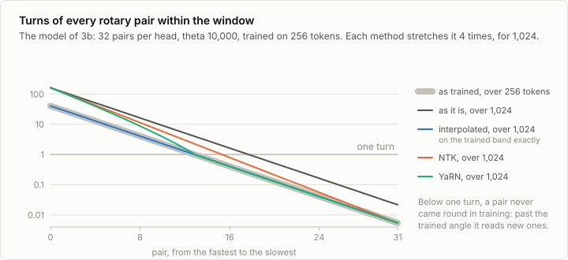
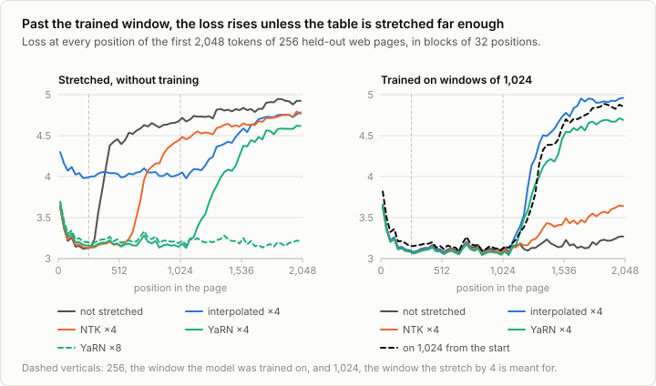
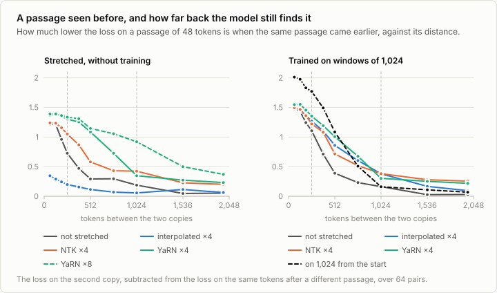

# 2b. Longer context

Code: [`minllm/model.py`](../minllm/model.py) (`rope_table`),
[`minllm/context.py`](../minllm/context.py) ·
Scripts: [`scripts/long_context.py`](../scripts/long_context.py),
[`scripts/train.py`](../scripts/train.py) (`--init`, `--rope-scaling`) ·
Tests: [`tests/test_context.py`](../tests/test_context.py) ·
Results: [`runs/context/`](../runs/context/)

This is a side topic of [stage 2](02-model.md), not a step of the
pipeline. The models here are trained on windows of 256 tokens. Nothing in
their weights depends on that length: attention takes any number of tokens,
and the rotary table of stage 2 can be computed for any position. Yet a
model used past the length it was trained on falls apart, and published
models are trained short and extended late. This note measures why, and
the three ways of stretching the table that are used for it.

## The model and the text

TinyStories cannot show what longer context is for. A story is about 200
tokens, and the stories before it in a window say nothing about it. The
story model of stage 3 also barely reuses what it has read: seeing a passage
once lowers its loss on the same passage 64 tokens later by 0.33.

So this note uses the other 14M model of the repository: the one that
[3b](03b-data.md) trained on cleaned Common Crawl, with the same shape and
training loop and a tokenizer of its own. Web pages are long: 71% of its
held-out text is in pages of more than 1,024 tokens, and 49% in pages of
more than 2,048. And this model reuses what it has read: the same passage
64 tokens later costs it 1.22 less.

## What the model has never seen

Rotary embeddings turn every pair of dimensions of a query and a key by an
angle that grows with the position, at a speed of its own: the first pairs
turn by a radian per token, the last by a ten-thousandth of that. In 256
tokens, the fastest pairs go round dozens of times and the model has seen
every angle they can take. The slowest pairs have not finished a single
turn. Past position 256 they reach angles that never occurred in training,
and the scores between queries and keys at those angles are whatever the
weights happen to give.



Three ways to keep the model on angles it knows:

- **Interpolation** (Chen et al., 2023) turns every pair s times slower, so
  that s times the trained length fits into the angles seen. Distant tokens
  look as they did; neighbours look s times closer than they are, which the
  fast pairs, which tell neighbours apart, notice.
- **NTK scaling** (bloc97, 2023) raises theta instead, by s^(d/(d-2)): the
  slowest pair turns s times slower and the fastest as before, the ones
  between in proportion.
- **YaRN** (Peng et al., 2023) decides per pair. Those that turn many times
  within the trained window are left alone, those that turn less than once
  are interpolated, and a ramp lies between. It also sharpens attention a
  little, by 0.1 ln s + 1, because the scores spread over more tokens.

`rope_table` computes all three from a `rope_scaling` in the config, as
transformers computes them, and the export writes it under the names
transformers reads.

## Two measurements

`scripts/long_context.py` reads the first 2,048 tokens of 256 held-out pages
that are longer than that, and averages the loss at every position. A model
that copes with a long window keeps its loss level along it, or lowers it
as it reads more of the page.

A level loss does not show that the model uses what is far back: most of
what predicts the next word is near it. So the script also hides a passage
of 48 tokens in a page, puts other pages after it, and repeats the passage
at distances of 64 to 1,984 tokens. What the first copy is worth is the loss
on the second minus the loss on the same tokens after a different passage,
over 64 such pairs. This is the probe of induction heads (Olsson et al.,
2022), and a small "needle in a haystack".

## Without training



As it is, the model keeps its loss for the 256 tokens it was trained on,
3.20 over positions 32 to 256, and breaks right after them: 4.36 over 256 to
1,024, worse than over the first 32 tokens of a page, 3.62.

Each stretch by 4 does something different:

- **Interpolation** keeps the loss level to 1,024, but at 4.03, and is as
  bad within the first 256 tokens. Every neighbour looks four times closer
  than it is, and the model can no longer tell neighbours apart.
- **NTK** leaves the fast pairs alone and keeps the first 256 tokens as they
  were, 3.22. The pairs between turn too fast for 1,024, and the loss starts
  to climb at about 600 tokens.
- **YaRN** keeps the loss level to exactly 1,024, 3.18 over 256 to 1,024, and
  breaks after it. Stretched by 8, it keeps it level to 2,048, 3.20 over
  1,024 to 2,048, at a cost of 0.09 over the first 256 positions.



The passage shows how far each model reaches. As it is, a passage 64
tokens back is worth 1.22, and 512 tokens back 0.29. YaRN by 4 finds it 512
tokens back for 1.09, and YaRN by 8 finds it 1,024 tokens back for 0.92,
without a step of training. Interpolation finds little at any distance,
0.35 at 64.

## After 500 steps at 1,024

Each stretch by 4 then trains for 500 steps on windows of 1,024 tokens: 8.2M
tokens, a sixth of what the model was trained on, 5 to 6 minutes each. So
does the table as it is, computed further without a stretch. Before the
first step, YaRN's loss on windows of 1,024 is 3.25, NTK's 3.64,
interpolation's 4.07, and the table as it is 4.19: YaRN starts closest.

After 500 steps, all four keep the loss level to 1,024, between 3.09 and
3.12 over positions 256 to 1,024, a little below their 3.17 to 3.19 over
positions 32 to 256: the further text helps a little. YaRN ends lowest,
3.158 on the windows of 1,024 against 3.179 for the table as it is.

They differ in how far they reach. A passage 512 tokens back is worth 1.01
to YaRN, 0.86 to interpolation, 0.72 to NTK, and 0.39 to the model trained
without a stretch. That model also keeps its loss level past 1,024, 3.17
over 1,024 to 2,048, where the stretched ones rise again, as a stretch by 4
must: NTK to 3.40, YaRN to 4.19 and interpolation to 4.44. It keeps the
loss level by using little of what is far back: a passage 1,536 tokens back
is worth 0.03 to it.

## Long from the start

The other way is to train on windows of 1,024 from the first step:
`out/web-clean-1024`, the model of 3b trained again on the same 49M tokens,
in 3,000 steps of 16 windows of 1,024 where 3b took 64 windows of 256.

It ends with a higher loss than the model extended late: 3.240 on windows
of 1,024 against YaRN's 3.158, and 3.28 against 3.17 over positions 32 to
256. The extended model has also read 8.2M tokens more, 17%. What the long
windows from the start buy is copying. A passage 64 tokens back is worth
2.01 to this model, against 1.55 to YaRN, and 512 tokens back 1.09 against
1.01. From 768 tokens on, the stretched model reaches further, and past
1,024 both break, 4.30 for this one.

So with this model and text, short windows first and a short stretch at the
end reach the lower loss, with 17% more tokens, and long windows from the
start copy better over short distances. Published models are trained in
the first order: most of their tokens on short windows, where attention is
cheap, and a stretch at the end.

## Run it

```sh
uv run scripts/long_context.py --model out/web-clean                      # the table computed further
uv run scripts/long_context.py --model out/web-clean --scaling yarn:4     # stretched 4 times, without training
uv run scripts/train.py --init out/web-clean --data data/web/clean --tokenizer out/web/tokenizer.json \
    --seq-len 1024 --rope-scaling yarn:4 --steps 500 --batch-size 16 --lr 3e-4 --warmup 20 --out out/ctx-yarn
uv run scripts/long_context.py --model out/ctx-yarn
uv run scripts/train.py --data data/web/clean --tokenizer out/web/tokenizer.json \
    --seq-len 1024 --batch-size 16 --steps 3000 --out out/web-clean-1024              # long from the start
uv run scripts/long_context.py --model out/web-clean-1024
uv run scripts/long_context.py --model out/base --data data/tinystories --tokenizer out/tokenizer.json \
    --length 256 --distances 64,128,192                                             # the story model, within its window
```

The other stretches are `--scaling linear:4`, `ntk:4` and `yarn:8`, and
`--rope-scaling` takes the same values for training; `--name` keeps the
results of several trained models apart.

The model and text of [3b](03b-data.md) come first: its Run it section makes
them.

## Exercises

1. Stretch the table by 8 and read 2,048 tokens without training; then
   train 500 steps on windows of 2,048. How close does each come to the
   stretch by 4 on 1,024?
2. Train a model from scratch on 256 tokens with theta 500,000, as Llama 3
   uses, and read it past 256. Does a slower table go further before it
   breaks, and what does it cost at 256?
3. Take YaRN's sharpening of attention out (a gain of 1) and measure again.
   What does it buy, without training and after?
4. Train the stretched model for 50, 100, 250 and 1,000 steps at 1,024.
   How few steps are enough?
5. Time a training step at windows of 256, 512, 1,024 and 2,048 tokens with
   the same number of tokens per step. From which length on does attention
   cost more than the rest of the model?

## In practice

- **Trained short, extended late.** Published models do most of their
  pretraining on windows of a few thousand tokens, and then a stage of
  continued pretraining on long documents at longer windows: Llama 3 from
  8,192 tokens to 128K in several steps (Grattafiori et al., 2024), Qwen2.5
  to 32,768, read further with YaRN (Qwen, 2024). Most of the compute goes
  to the short windows, where attention is cheap.
- **A slower table from the start.** Llama 3 sets theta to 500,000 and
  Qwen2.5 to 1,000,000, against 10,000 here: their slow pairs barely turn
  within the trained window, which leaves room for the stretch later.
- **Long context is measured on tasks.** The loss along long documents
  shows that a model does not break. Benchmarks such as a fact hidden in a
  long text ("a needle in a haystack") show whether it finds things there,
  which is the passage probe of this note at a larger scale.
- **Attention's cost grows with the square of the window.** Kernels such
  as FlashAttention, which never store the whole attention matrix, and the
  splitting of one sequence across GPUs make windows of 100K tokens and
  more trainable.

## References

- Su et al. (2021), [RoFormer: Enhanced Transformer with Rotary Position Embedding](https://arxiv.org/abs/2104.09864). Rotary position embeddings.
- Chen et al. (2023), [Extending Context Window of Large Language Models via Positional Interpolation](https://arxiv.org/abs/2306.15595). Interpolation: positions scaled into the trained range, and a short fine-tuning after.
- bloc97 (2023), [NTK-Aware Scaled RoPE allows LLaMA models to have extended (8k+) context size without any fine-tuning](https://www.reddit.com/r/LocalLLaMA/comments/14lz7j5/ntkaware_scaled_rope_allows_llama_models_to_have/). Raising theta instead of scaling positions.
- Peng et al. (2023), [YaRN: Efficient Context Window Extension of Large Language Models](https://arxiv.org/abs/2309.00071). Interpolation per pair, and the sharpened attention.
- Press, Smith and Lewis (2021), [Train Short, Test Long: Attention with Linear Biases Enables Input Length Extrapolation](https://arxiv.org/abs/2108.12409). Why models fail past their trained length, and a position encoding that does not.
- Olsson et al. (2022), [In-context Learning and Induction Heads](https://arxiv.org/abs/2209.11895). The heads that find an earlier occurrence of the current text and copy what followed, which the passage probe relies on.
- Xiong et al. (2023), [Effective Long-Context Scaling of Foundation Models](https://arxiv.org/abs/2309.16039). Extending a trained model by continued pretraining on longer windows, and how much of it is needed.
- Grattafiori et al. (2024), [The Llama 3 Herd of Models](https://arxiv.org/abs/2407.21783). Theta of 500,000, and the context extended from 8K to 128K tokens in stages at the end of pretraining.
- Qwen (2024), [Qwen2.5 Technical Report](https://arxiv.org/abs/2412.15115). The context of the model of stage 5 extended to 32,768 tokens in pretraining, and read further with YaRN.
