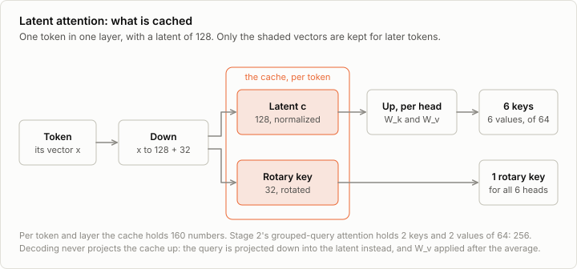
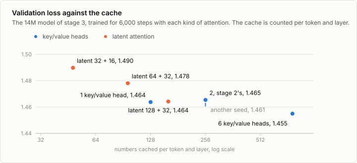
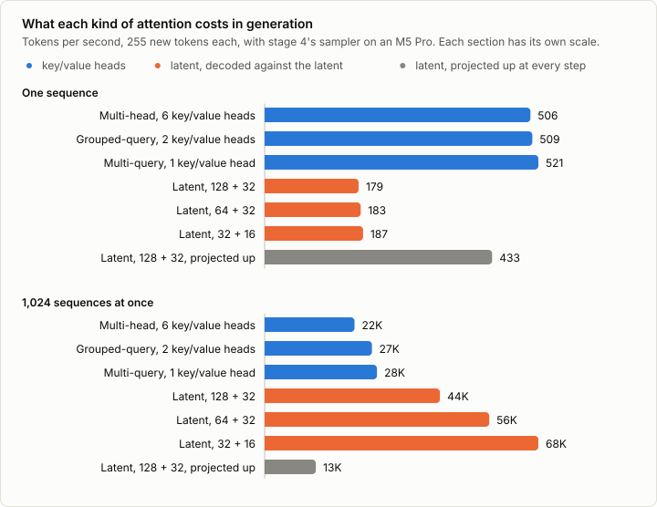

# 2c. Latent attention

Code: [`minllm/model.py`](../minllm/model.py) (`LatentAttention`) ·
Scripts: [`scripts/train.py`](../scripts/train.py),
[`scripts/bench_attention.py`](../scripts/bench_attention.py) ·
Tests: [`tests/test_latent.py`](../tests/test_latent.py) ·
Logs: [`runs/attention/`](../runs/attention/)

This is a side topic of [stage 2](02-model.md), not a step of the pipeline.
Stage 2's attention keeps, for every token, a key and a value for each of
its 2 key/value heads, and stage 4 keeps those of every token written so far
in the cache. Grouped-query attention made that cache smaller by giving the
6 query heads fewer key/value heads to share. DeepSeek's models since
DeepSeek-V2 shrink it another way: they cache a short latent vector per
token, and make every head's key and value from it. This is multi-head
latent attention (MLA).

It changes the attention of stage 2, and is measured with the training loop
of stage 3 and the sampler of stage 4, so it is best read after those.

## Two ways to cache less

Per token and per layer, the cache of stage 4 holds

```
2 (keys and values) × key/value heads × head_dim
```

numbers. Stage 2's model has 6 query heads of 64 dimensions. With a key and
a value per query head, full multi-head attention, that is 768 numbers. With
2 key/value heads, as stage 2 has it, 256. With one, multi-query attention,
128. Fewer heads means fewer different keys: in multi-query attention every
head compares its query with the same key.

Latent attention keeps a key and a value per head and caches neither. It
compresses the token into a latent `c` of a few numbers, and projects every
head's key and value up from it:

```
c   = norm(W_down x)        # the latent, kv_latent numbers: all that is cached
k_h = W_k,h c               # head h's key
v_h = W_v,h c               # and value
```

With a latent of 128 numbers the cache holds 128 per token where full
multi-head attention holds 768, and every head still has keys of its own.

## Decoding against the latent

Kept as it is, this saves memory and costs time: every step of decoding would
have to project every cached latent up into 6 keys and 6 values again. It
does not have to. A query meets a key in a dot product, and the up-projection
can move to the other side of it:

```
q_h · k_h = q_h · (W_k,h c) = (W_k,hᵀ q_h) · c
```

So the new token's query is projected down into the latent once, and compared
with the cached latents as they are. The values work the same way from the
other end: the attention weights average the latents, and `W_v,h` is applied
to the average. In `LatentAttention.forward`, when one new token meets a
cache:

```python
q = torch.cat([torch.einsum("bhtd,hdl->bhtl", q, w_k), q_rot], dim=-1).reshape(B, H * T, -1)
scores = q @ torch.cat([latent, k_rot], dim=-1)[:, 0].transpose(1, 2) * scale  # (B, heads, S)
y = scores.float().softmax(dim=-1).to(latent.dtype) @ latent[:, 0]  # (B, heads, latent)
y = torch.einsum("bhtl,hdl->bhtd", y.view(B, H, T, -1), w_v)
```

Every head now attends over the same cached vectors, as in multi-query
attention, only longer. The heads become the rows of one matrix product, and
the cache is read once for all of them. Training and the prefill of a prompt
take the plain path, which projects the latents up, since there every key
is new anyway. `test_cache_gives_the_same_logits` checks that both paths
give the logits of a single pass.

## Where the position goes

Rotary embeddings, from stage 2, turn a key by an angle that depends on its
position. Turned after the up-projection, the key of token `j` is
`R_j W_k,h c_j`, and the query would meet it as `(W_k,hᵀ R_jᵀ q_h) · c_j`:
a rotation that differs for every cached token now sits between the query
and the latent, and folding `W_k,h` into the query once no longer works.

MLA therefore splits every query and key in two. A content part of
`head_dim` numbers, whose key comes from the latent and is never rotated,
and a rotary part of `rope_dim` numbers that carries the position. The rotary
key is made from the token directly, rotated, cached beside the latent, and
shared by all heads, as in multi-query attention. A head's score is the sum
of the two dot products. The cache per token and layer is `kv_latent +
rope_dim` numbers: 160 for a latent of 128 and a rotary part of 32.

Before the latent is cached it passes an RMSNorm of its own, as in
DeepSeek-V2.



## The comparison

Stage 3's model was trained once more with each kind of attention, for the
6,000 steps of its reference run, on the same data with the same batch size
and learning rate:

```sh
uv run scripts/train.py --n-kv-heads 6 --out out/mha                    # full multi-head
uv run scripts/train.py --n-kv-heads 1 --out out/mqa                    # multi-query
uv run scripts/train.py --kv-latent 128 --out out/mla-128               # a rotary part of 32, the default
uv run scripts/train.py --kv-latent 64 --out out/mla-64
uv run scripts/train.py --kv-latent 32 --rope-dim 16 --out out/mla-32
uv run scripts/train.py --seed 1 --out out/base-seed1                   # stage 3's run, with another seed
```

The run of stage 3 itself, `out/base`, is the model with 2 key/value heads.



| 6,000 steps | Parameters | Cached per token and layer | Validation loss |
|---|---|---|---|
| 6 key/value heads, full multi-head | 15.7M | 768 | 1.455 |
| 2 key/value heads, stage 2's | 14.2M | 256 | 1.465 |
| the same, another seed | 14.2M | 256 | 1.461 |
| 1 key/value head, multi-query | 13.8M | 128 | 1.464 |
| Latent 128 + 32 | 15.2M | 160 | 1.464 |
| Latent 64 + 32 | 14.7M | 96 | 1.478 |
| Latent 32 + 16 | 14.0M | 48 | 1.490 |

The seed sets the first weights and the order of the batches. The two runs
that differ only in it end 0.004 apart, so smaller differences than that
say nothing.

**Keys of its own did not help any head here.** The latent of 128 ends at
1.464, as do multi-query attention and stage 2's grouped-query attention,
within the two seeds. Its cache of 160 numbers is between theirs, it has
1.1M parameters more than grouped-query attention, and it learns the same.

**Full multi-head attention learns the most.** It ends 0.006 to 0.010 below
those three, with 6 key/value heads and a cache of 768 numbers, and with the
most parameters.

**A smaller latent learns less.** Multi-query attention cannot keep fewer
than 128 numbers, one key and one value of 64, without making the heads
narrower. A latent can: at 96 numbers it ends at 1.478, at 48 at 1.490. That
is a cache 16 times smaller than full multi-head attention's, for 0.035 in
the loss.

In loss, then, latent attention buys nothing here that multi-query attention
does not buy with a smaller cache. With 6 heads, sharing their keys cost
nothing measurable, so there was nothing for keys of their own to win back.

At DeepSeek-V2's scale, sharing did cost. In its ablations, 7B dense models
trained on 1.33T tokens scored 45.2% on MMLU with full multi-head attention,
41.2% with grouped-query attention of 8 groups and 37.9% with multi-query
attention. Latent attention did better still: mixtures of experts of 16B
parameters on the same tokens scored 50.0% on MMLU with it against 48.7%
with full multi-head attention, and of 250B on 420B tokens 59.0% against
57.5%, with 14% and 4% of its cache.

For latent attention to gain here, the model would first need something to
lose by sharing keys: enough parameters and training that multi-query
attention falls measurably behind full multi-head attention, as it did at 7B
parameters and 1.33T tokens. That is far beyond this laptop. At this size a
wider latent can only close the 0.009 by which full multi-head attention is
ahead, which exercise 1 measures.

## Generation

`scripts/bench_attention.py` writes 255 tokens with every model and stage
4's cached sampler, for 1 to 1,024 sequences at once, and with the latent of
128 once more projected up at every step:



| Tokens per second | 1 sequence | 64 | 256 | 1,024 |
|---|---|---|---|---|
| 6 key/value heads | 506 | 13,700 | 20,000 | 22,400 |
| 2, stage 2's | 509 | 15,000 | 23,100 | 26,800 |
| 1 key/value head | 521 | 15,400 | 23,900 | 28,000 |
| Latent 128 + 32 | 179 | 10,700 | 29,100 | 43,800 |
| Latent 64 + 32 | 183 | 11,400 | 35,300 | 56,100 |
| Latent 32 + 16 | 187 | 11,300 | 39,700 | 68,300 |
| Latent 128 + 32, projected up at every step | 433 | 9,800 | 12,600 | 12,800 |

**Alone, latent attention is slow.** One sequence gets 179 tokens per
second, against 509 with stage 2's attention. Its 255 tokens take 1.43
seconds, and those of 64 sequences 1.53: the time is the fixed cost of the
operations, not their arithmetic. Decoding against the latent runs more
operations in every layer than plain attention, and stage 4 found that for a
single sequence this GPU spends its time starting operations. Projected up
at every step, which takes fewer of them, the same model gets 433.

**With many sequences it is the fastest.** From 256 sequences on, latent
attention is ahead, and at 1,024 the latent of 128 gets 43,800 tokens per
second, 1.6 times as many as stage 2's attention. The smaller latents are
faster still, 68,300 for 32 + 16. Projected up at every step, the latent of
128 gets 12,800, less than a third: at decoding, the fold is what makes the
latent pay.

**Not because its cache is the smallest.** Multi-query attention keeps 128
numbers to the latent's 160, and is hardly faster than full multi-head
attention, 28,000 tokens per second against 22,400. Stage 2's attention
copies the shared keys and values out to every query head at each step
(`repeat_interleave` in `Attention.forward`), so it computes over as many
keys as full multi-head attention does, and its smaller cache saves memory
but not time. The latent path reads its cache once for all the heads, in one
matrix product. Exercise 6 gives grouped-query attention the same
arrangement.

On this laptop, then, latent attention trades: the loss of grouped-query
attention, a third of its speed for one sequence, and 1.6 times its speed
for 1,024. For one sequence the time goes to starting operations, so the way
out is fewer of them: one kernel for the attention against the cached
latents, as DeepSeek's FlashMLA is for decoding on Nvidia GPUs.

## Run it

The data, tokenizer and model of [stage 3](03-pretraining.md) come first:
the runs above train on its data, and the benchmark measures its model as
the one with 2 key/value heads. The six runs of the comparison took 16 to 20
minutes each here, and the benchmark 15:

```sh
uv run scripts/bench_attention.py
uv run scripts/make_figures.py          # the figures of this note
```

`bench_attention.py --models out/mqa out/mla-128` measures some of the
models, and `--repeats 1` each once, which is three times faster and
noisier.

## Exercises

1. Train a latent of 384 + 32, a little over half of full multi-head
   attention's cache. Does it reach full multi-head attention's 1.455?
2. Train with `--rope-dim 8`, and with the rotary part left out entirely,
   so that the latent alone makes the keys. What does the position cost in
   loss when it has so little room?
3. DeepSeek-V2 also compresses the queries through a latent of their own,
   to save memory in training. Add it, and compare the loss and the
   training speed.
4. Turn `out/base` into a model with latent attention without training it
   from scratch: factor each layer's key and value projections into a
   down-projection and up-projections, with a singular value decomposition,
   and fine-tune for a few hundred steps. Every key of `out/base` is
   rotated, which is the hard part. How close does it come to the latent of
   128 trained from the start?
5. Count the multiplications of one decoding step for grouped-query and for
   latent attention at a context of 256 tokens, and at 32,768. Where does
   each spend them?
6. Make grouped-query attention read its shared keys and values once when
   it decodes: in place of `repeat_interleave`, fold the query heads of a
   group into rows, as the latent path does. Measure it against the latent
   of 128 with `bench_attention.py`.

## In practice

- **DeepSeek's models** use MLA from DeepSeek-V2 on, among them DeepSeek-V3
  and R1, and so do models built on their design, such as Kimi K2.
- **Most other open models** use grouped-query attention, as Qwen2.5 and the
  model here do. It needs no change to the attention computation, which
  every inference engine has made fast.
- **Engines** run MLA with kernels of its own. DeepSeek published FlashMLA,
  first a kernel for decoding with it, and vLLM and SGLang serve its models.
- **At DeepSeek's scale** the saving is far larger than here. DeepSeek-V2 has
  128 heads of 128 dimensions and caches a latent of 512 and a rotary key of
  64: 576 numbers per token and layer, where full multi-head attention would
  cache 32,768. Its authors put that at the cache of grouped-query attention
  with 2.25 groups.
- **Converting a trained model.** A model trained with multi-head or
  grouped-query attention can be turned into one with latent attention after
  the fact, and fine-tuned briefly to recover, as papers of 2025 did for
  Llama models among others.

## References

- DeepSeek-AI (2024), [DeepSeek-V2: A Strong, Economical, and Efficient Mixture-of-Experts Language Model](https://arxiv.org/abs/2405.04434). Multi-head latent attention: the cache as a latent, the up-projections folded into the query and the output, and a rotary key of its own.
- DeepSeek-AI (2024), [DeepSeek-V3 Technical Report](https://arxiv.org/abs/2412.19437). The same attention in DeepSeek's later models.
- Kimi Team (2025), [Kimi K2: Open Agentic Intelligence](https://arxiv.org/abs/2507.20534). Latent attention outside DeepSeek, with 64 heads.
- Shazeer (2019), [Fast Transformer Decoding: One Write-Head is All You Need](https://arxiv.org/abs/1911.02150). Multi-query attention: one key and value head for all query heads.
- Ainslie et al. (2023), [GQA: Training Generalized Multi-Query Transformer Models from Multi-Head Checkpoints](https://arxiv.org/abs/2305.13245). Grouped-query attention, which stage 2 uses.
- Meng et al. (2025), [TransMLA: Multi-Head Latent Attention Is All You Need](https://arxiv.org/abs/2502.07864). A model trained with grouped-query attention, converted to latent attention.
- Ji et al. (2025), [Towards Economical Inference: Enabling DeepSeek's Multi-Head Latent Attention in Any Transformer-based LLMs](https://arxiv.org/abs/2502.14837). The same from multi-head attention, with a short fine-tuning.
- DeepSeek-AI (2025), [FlashMLA](https://github.com/deepseek-ai/FlashMLA). Kernels for latent attention, first released in February 2025 for decoding.
