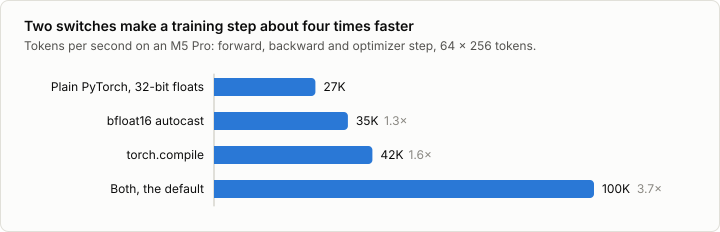
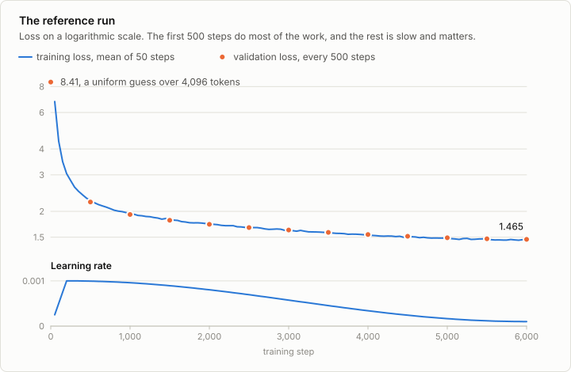

# 3. Pretraining

Code: [`scripts/train.py`](../scripts/train.py),
[`scripts/encode_data.py`](../scripts/encode_data.py),
[`scripts/sample.py`](../scripts/sample.py),
[`minllm/data.py`](../minllm/data.py) ·
Log of the reference run: [`runs/base/log.jsonl`](../runs/base/log.jsonl)

Pretraining gives the model its knowledge of language. The task is the
simplest one there is: read some text, predict the next token. Nobody labels
anything. The text is its own supervision, which is why this stage can use
more data than any other.

## The objective

The model outputs a probability for every token in the vocabulary. The loss
for one position is the negative log of the probability it gave to the token
that actually came next, and the training loss is the mean over all positions:

```
loss = -mean(log p(next token | tokens so far))
```

This is the cross-entropy, in nats. Two readings make the number concrete:

- `exp(loss)` is the *perplexity*: the model is as uncertain as if it chose
  uniformly among that many tokens. An untrained model has loss `ln(4096) =
  8.32`, a choice among all 4,096. At loss 1.5, it is choosing among 4.5.
- The loss can never reach zero on real text, because text is not
  deterministic. After "Once upon a time, there was a little", several
  continuations are right. The floor is the entropy of the language itself.

## The data

`encode_data.py` turns each split into one long array of token ids, with
`<|endoftext|>` in front of every story:

```
<|endoftext|> Once upon a time ... happy. <|endoftext|> One day, Tom ...
```

A training example is a window of `seq_len + 1` consecutive tokens cut from a
random offset. The first `seq_len` tokens are the input `x`, and the last
`seq_len` are the target `y`, so `y[t] = x[t + 1]`:

```
x:  <|endoftext|>  Once   upon   a      time
y:  Once           upon   a      time   ,
```

Because attention is causal, the prediction at position `t` depends only on
`x[0..t]`. One window of 256 tokens is therefore 256 training examples from a
single forward pass, with contexts of every length from 1 to 256. Windows
start in the middle of stories and run across story boundaries, which teaches
the model to continue from any point and to start a new story after
`<|endoftext|>`.

## One step

The loop in `train.py` is these lines, repeated:

```python
x, y = get_batch(train_tokens, batch_size, seq_len, device)
_, loss = model(x, y)                # how wrong are the predictions?
optimizer.zero_grad()
loss.backward()                      # in which direction should each weight move?
clip_grad_norm_(model.parameters(), 1.0)
optimizer.step()                     # move it
```

`loss.backward()` computes the gradient: for each of the 14 million weights,
how the loss would change if that weight grew a little. PyTorch derives this
from the forward pass by the chain rule. Automatic differentiation, the tensor
operations and the AdamW update rule are what this repository takes from
PyTorch; the rest of the loop is written out.

**AdamW** turns gradients into updates. Plain gradient descent would subtract
`lr * gradient`. Adam keeps a running average of each weight's gradient and of
its square, and steps by their ratio, so every weight moves at a similar pace
whether its gradients are large or tiny. The W is weight decay: each step also
shrinks the matrices slightly towards zero.

**The learning rate schedule** has two parts. It ramps up over the first 200
steps, because Adam's running averages start empty and the first gradients of
a random model point in erratic directions. Then it follows a cosine down to a
tenth of the peak: large steps early to make progress, small steps late to
settle.

**Gradient clipping** rescales the gradient when its norm exceeds 1, so that a
single unusual batch cannot throw the weights far.

## Evaluation

The training loss is measured on batches the model is being fitted to. The
honest number is the loss on held-out stories, which `train.py` computes every
500 steps on the same 40 validation batches each time, so that successive
values are comparable.

If the validation loss stalls or rises while the training loss keeps falling,
the model is memorizing its training set instead of learning the language. The
reference run cannot do that: it draws 98M tokens from a pool of 131M, so it
sees most windows at most once. Exercise 5 makes it happen on purpose.

## Speed

How much a model learns in a given time is tokens per second times time, so
speed is model quality. Two switches matter, and neither changes what is
computed:



| Default model, batch of 64 × 256 tokens | Tokens per second |
|---|---|
| Plain PyTorch, 32-bit floats | 27k |
| With `autocast` to bfloat16 | 35k |
| With `torch.compile` | 42k |
| With both (the default) | 100k |

These are the forward pass, backward pass and optimizer step alone, on an M5
Pro, measured by `scripts/bench_train.py`. A laptop is not a steady
instrument: over three runs of this benchmark the plain version measured 23k
to 28k and the default 91k to 120k, and the factor between them stayed
between 3.7 and 4.3. The full loop with data loading, gradient clipping and
logging ran at 76k to 96k tokens per second over the reference run, with a
median of 84k.

`torch.compile` traces the model and fuses its operations. Run one at a time,
each small operation (a norm, a rotation, an addition) reads and writes
whole tensors in memory, and on this GPU that overhead is a large share of a
step.

`autocast` runs the arithmetic in 16-bit floats, bfloat16, while the weights
and their updates stay in 32 bits. bfloat16 keeps the exponent range of a
32-bit float and gives up precision, between 2 and 3 significant decimal
digits instead of 7, which the noise of training covers. On this machine a
bfloat16 matrix multiplication is four times as fast as a 32-bit one.

Both were checked against the plain version: after 300 steps from the same
seed, the validation loss is 2.5092 without them and 2.5101 with them.

## The reference run

```sh
uv run scripts/encode_data.py
uv run scripts/train.py
```

6,000 steps of 16,384 tokens each, 98M tokens in all, took 19.9 minutes.



| Step | Tokens seen | Minutes | Validation loss | Perplexity |
|---|---|---|---|---|
| 0 | 0 | 0.0 | 8.408 | 4,482.4 |
| 500 | 8M | 1.5 | 2.219 | 9.2 |
| 1,000 | 16M | 3.1 | 1.932 | 6.9 |
| 2,000 | 33M | 6.5 | 1.731 | 5.6 |
| 3,000 | 49M | 9.8 | 1.626 | 5.1 |
| 4,000 | 66M | 13.1 | 1.546 | 4.7 |
| 5,000 | 82M | 16.4 | 1.491 | 4.4 |
| 6,000 | 98M | 19.9 | 1.465 | 4.3 |

The first 90 seconds take the loss from 8.4 to 2.2. The other 18 minutes take
it from 2.2 to 1.47, and that second, slower part is where the stories start
to make sense. The sample printed at four of the evaluations, each continuing
"Once upon a time":

- **Step 0.** `Samonest pow comb stepped green gi touch wouldn wouldn` Tokens
  drawn almost uniformly.
- **Step 500.** `, there was a little girl named Lily. She loved to collect
  things. One day, she found a big box. She opened it and found lots of toys.
  Lily wanted to show them to her toy store. Lily started to get thermometer.`
  The opening formula, names and grammar arrive first. The sentences do not
  yet follow from each other.
- **Step 2,000.** `, there was a little girl called Lucy. She was three years
  old and loved to explore the world. One day, when she was out on a hot day,
  she was feeling worried. She was getting her mom's help and said she could go
  outside and play.` Each sentence is fine, and the thread between them is
  loose.
- **Step 6,000.** `, there was a little girl named Lucy. She had a big, open
  box. Inside the box, there was a beautiful apron. Lucy loved to wear the
  apron to help her mom in the garden. One sunny day, Lucy met a friendly ant.`

After the run, `uv run scripts/sample.py` writes whole stories. Your own run
will write different ones.

> Once upon a time, there was a little bird named Tim. Tim loved to sing and
> play all day. One day, Tim noticed that his tree was not strong. It was
> weak, and it could not spread like the other birds.
>
> Tim was sad. He wanted to fix his weak tree. He tried to tie a knot at the
> top of the tree, but it was still weak. So, he asked his friends for help.
>
> His friends helped him tie the knot. They all worked and fixed the tree. The
> tree became strong again, and every day, Tim sang a beautiful song. Everyone
> was happy, and Tim was happy too.

And with a prompt from outside the usual openings,
`--prompt "The tiny robot was sad because" --temperature 0.5`:

> The tiny robot was sad because it had no friends. It wanted to be with its
> friends, but it was scared of it. Every day it would go out and look for
> someone to play with. The people in the town would be very nice to the
> robot.
>
> One day, the robot saw a little girl crying. She had lost her toy. The robot
> wanted to help the girl, so it went to the girl and asked if it could be her
> friend. She said yes, and they played together.

The model has the grammar, the dialogue conventions and the shape of a story:
a character, a problem, help from a friend, a happy end. It keeps a name and a
goal across paragraphs. What it lacks shows in single sentences: a tree that
"could not spread like the other birds", a robot with no friends that wants
"to be with its friends". Twenty minutes buy fluency, and sense takes longer.

The training loss over the last 200 steps is 1.45 and the validation loss is
1.47. The two are level, so the model is not memorizing, and the curve is
still falling: more steps, more data or a larger model would each lower it
further.

## Checkpoints

Every evaluation writes `out/base/ckpt.pt`: the configuration, the weights,
the optimizer state and the step. `--resume` continues from it. The file is
three times the size of the weights (170 MB for 57 MB of weights), because
Adam's two running averages are as large as the model.

`train.py` refuses to start over an existing checkpoint. Pass `--out` to keep
several runs side by side.

## Exercises

1. Run 300 steps with `--no-compile --no-amp` and compare the speed and the
   loss to the default. Then try each switch alone.
2. Train with `--lr 1e-2` and with `--lr 1e-4` for 1,000 steps. What does the
   loss do in each case?
3. Set `--warmup 1`. Compare the first 200 steps to the default.
4. Fix a budget of five minutes. Which wins: `--dim 256 --n-layers 4
   --n-heads 4 --mlp-dim 688` with more steps, or the default with fewer?
   What about at one hour?
5. Train on a corpus of only 2M tokens and plot the training and validation
   loss from `log.jsonl`. What happens, and from which step on?

   ```sh
   mkdir -p data/small && cp data/tinystories/valid.bin data/small/
   head -c 4000000 data/tinystories/train.bin > data/small/train.bin
   uv run scripts/train.py --data data/small --steps 3000 --out out/small
   ```
6. Fetch the whole corpus with `download_data.py --train-mb 0`, encode it, and
   train for 30,000 steps overnight.
7. Write AdamW yourself as a function of the weights, their gradients and two
   running averages, in about 15 lines, and check that 100 steps of it match
   `torch.optim.AdamW`.

## In practice

The loop is the same at any scale. What changes around it:

- **Data.** Trillions of tokens of filtered and deduplicated web text, code and
  books, streamed from shards rather than held in one file.
- **Parallelism.** The batch is split across many GPUs, the gradients are
  averaged, and the model itself may be split when it does not fit on one.
- **Precision and kernels.** bfloat16 autocast, compiled models and fused
  attention kernels are the default everywhere, for the reasons measured above.
- **Budget.** Hyperparameters are tuned on small models and transferred,
  because the full run happens once.

Large pretraining runs typically use a custom loop like this one. Hugging Face
`Trainer` and `accelerate` wrap the same steps, mostly for fine-tuning.

The side topic [3a](03a-distillation.md) runs this loop with a second model
as a teacher: the student learns from the teacher's predictions and not only
from the text.

## References

- Bengio, Ducharme, Vincent and Jauvin (2003), [A Neural Probabilistic Language Model](https://www.jmlr.org/papers/v3/bengio03a.html), Journal of Machine Learning Research 3. Predicting the next word with a neural network that learns a vector for every word.
- Radford et al. (2019), [Language Models are Unsupervised Multitask Learners](https://cdn.openai.com/better-language-models/language_models_are_unsupervised_multitask_learners.pdf), OpenAI. GPT-2: what a model trained on nothing but next-token prediction can do when the data and the model are large.
- Kingma and Ba (2014), [Adam: A Method for Stochastic Optimization](https://arxiv.org/abs/1412.6980). Adam: a step size per weight, from running averages of the gradient and of its square.
- Loshchilov and Hutter (2017), [Decoupled Weight Decay Regularization](https://arxiv.org/abs/1711.05101). AdamW: weight decay applied to the weights directly, apart from the gradient.
- Loshchilov and Hutter (2016), [SGDR: Stochastic Gradient Descent with Warm Restarts](https://arxiv.org/abs/1608.03983). The cosine learning rate schedule.
- Pascanu, Mikolov and Bengio (2012), [On the difficulty of training Recurrent Neural Networks](https://arxiv.org/abs/1211.5063). Clipping the norm of the gradient.
- Micikevicius et al. (2017), [Mixed Precision Training](https://arxiv.org/abs/1710.03740). Training in 16-bit floats with the weights kept in 32 bits.
- Eldan and Li (2023), [TinyStories: How Small Can Language Models Be and Still Speak Coherent English?](https://arxiv.org/abs/2305.07759). TinyStories: a corpus small and simple enough for a model of a few million parameters to write coherent text.
- Kaplan et al. (2020), [Scaling Laws for Neural Language Models](https://arxiv.org/abs/2001.08361). How the loss falls with model size, data and compute, as power laws.
- Hoffmann et al. (2022), [Training Compute-Optimal Large Language Models](https://arxiv.org/abs/2203.15556). For a fixed amount of compute, how to divide it between a larger model and more data.
- Karpathy, [nanoGPT](https://github.com/karpathy/nanoGPT). A training loop of this shape, for GPT-2.
