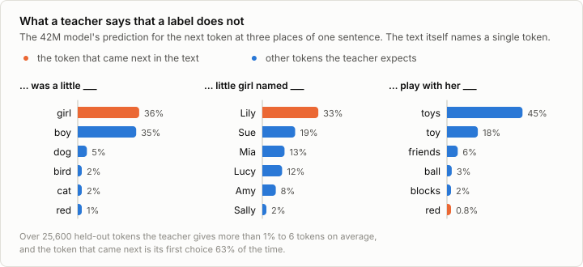
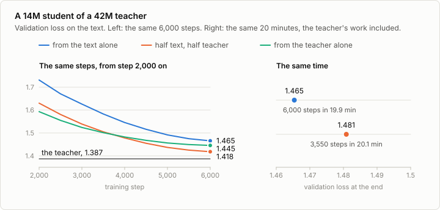

# 3a. Distillation

Code: [`minllm/distill.py`](../minllm/distill.py) ·
Scripts: [`scripts/train.py`](../scripts/train.py) (`--teacher`),
[`scripts/dump_targets.py`](../scripts/dump_targets.py) ·
Tests: [`tests/test_distill.py`](../tests/test_distill.py) ·
Logs: [`runs/distill/`](../runs/distill/)

This is a side topic of [stage 3](03-pretraining.md), not a step of the
pipeline. Stage 3 trains a model on text alone. Distillation trains a small
model, the student, on what a larger model, the teacher, makes of the same
text. It is how many small models are made: someone has a large model that
is too slow or too big to run where it is needed, and wants as much of it as
fits into a small one.

It needs nothing beyond stage 3: the same data, the same script, and a second
model trained by that script to be the teacher.

## What a teacher adds

At every position, the text says which token came next. That is one token
out of 4,096, and it is partly a matter of chance: the story went on with
"girl", and it could as well have gone on with "boy". A model trained on the
text has to work out from many such single outcomes how likely each
continuation is.

A trained model has already done that work. Ask it at the same position and
it answers with a probability for every token.



After "there was a little", the text says *girl*. The teacher says *girl* or
*boy* about equally, sometimes *dog*, *bird* or *cat*. After "play with her",
the text happens to continue with *red*, which the teacher gave 0.8%: an
unlikely turn, and the label reports it as if it were the answer. Over
held-out stories the teacher gives more than 1% to 6 tokens on average, and
the token that came next is its first choice 63% of the time.
(`scripts/dump_targets.py` measures this.)

The student can be trained on the teacher's whole answer instead of the one
token. Each position then teaches more, and teaches something less noisy.
That is the idea of Hinton, Vinyals and Dean (2015), and they called what the
teacher knows about the wrong answers its dark knowledge.

## The loss

`distill.soft_loss` measures how far the student's distribution is from the
teacher's, as a KL divergence:

```python
student = F.log_softmax(student_logits / T, dim=-1)
teacher = F.log_softmax(teacher_logits / T, dim=-1)
soft = (teacher.exp() * (teacher - student)).sum(-1).mean() * T**2
```

It is zero when the two agree. Against a teacher that is certain of one token
it is the ordinary cross-entropy against that token, so the loss of stage 3
is the special case of a teacher that only knows the label.
`test_a_certain_teacher_is_a_label` checks that.

The temperature `T` flattens both distributions before they are compared.
Above 1 it gives more weight to the tokens that the teacher finds unlikely
but not impossible. It stays at 1 here, and the exercises change it.

`train.py --teacher` runs the teacher on every batch, without gradients, and
mixes the two losses with a weight `alpha`:

```python
logits, loss = model(x, y)                       # the student, and its loss on the labels
with torch.no_grad():
    target, _ = teacher(x)                       # the teacher reads the same window
soft = distill.soft_loss(logits, target, T)
objective = alpha * soft + (1 - alpha) * loss
```

With `alpha` at 1 the student never sees a label. Everything it learns about
the text, it learns from the teacher.

## Teacher and student

```sh
uv run scripts/train.py --mlp-dim 4096 --out out/wide                                      # the teacher
uv run scripts/train.py --teacher out/wide --out out/distilled                             # half text, half teacher
uv run scripts/train.py --teacher out/wide --alpha 1.0 --out out/distilled-teacher-only    # the teacher alone
```

The teacher is the model of stage 3 with MLPs four times as wide: 42.5M
parameters, trained for the same 6,000 steps, which takes 38 minutes and
ends at a validation loss of 1.387. (The side topic 2a trains the same model
as its wide reference. If `out/wide` is there already, skip the first
command: `train.py` does not overwrite a run.) The student is the 14.2M
model of stage 3, unchanged. It starts from the same random weights as the
reference run of stage 3 and sees the same batches in the same order, so the
runs can be compared step for step. The only difference is what the student
is asked to predict.



| 14M model, 6,000 steps | Validation loss | Minutes |
|---|---|---|
| From the text alone, the run of stage 3 | 1.465 | 19.9 |
| Half text, half teacher | 1.418 | 33.7 |
| From the teacher alone | 1.445 | 31.9 |
| The teacher, 42M | 1.387 | 38.2 |

The validation loss is always the plain cross-entropy on held-out text,
whatever the model was trained on.

**The student gets 60% of the way to its teacher.** It is the same model on
the same data for the same number of steps, and it ends 0.047 lower, where
the teacher is 0.078 lower. It is ahead from the first evaluation on: at
step 500 its loss is 2.08, against 2.22 without a teacher.

**A teacher alone is enough to learn the language.** With `alpha` at 1 the
student is never told which token came next, and it still ends below the
model that was trained on nothing else. Early on it is the fastest of the
three, at 2.02 after 500 steps. Between steps 3,500 and 4,000 the mix
overtakes it. The teacher is wrong in places, and a student that only copies
it inherits that. The labels are noisy and they are the truth.

**In the same time, the text alone wins.** The teacher's forward pass makes a
step take 1.7 times as long. A run sized to end after the 20 minutes of
stage 3's reference run gets 3,550 steps:

```sh
uv run scripts/train.py --teacher out/wide --steps 3550 --out out/distilled-20min
```

It ends at 1.481, behind the 1.465 of the model that spent the same time on
6,000 steps of text. Each step with a teacher is worth more, and not 1.7
times more.

**And the teacher had to be trained first,** which took 38 minutes.
Distillation does not make training cheaper. What it gives is a better small
model out of a given number of steps, and it pays when the small model is the
one that will be run, many times, while the training is paid for once. The
student is a third of its teacher's size and generates faster.

The distilled model writes stories like the others
(`uv run scripts/sample.py --ckpt out/distilled/ckpt.pt`, the first of three,
saved in `runs/samples/`):

> Once upon a time, in a small town, there was a boy named Tim. Tim was a
> tough boy who loved to play with his toy missile. He had a toy missile that
> he played with every day.
>
> One day, Tim and his friends went to the park. They played on the swings,
> slide, and seesaw. The sun was out, and it was very warm. But then, Tim
> dropped his missile, and it rolled away. Tim's friends tried to catch it,
> but it was too fast. […]

## Exercises

1. Train with `--temperature 2` and with `--temperature 4`. Which helps, and
   what does the student's loss on the text do in the first 500 steps?
2. Train with `--alpha 0.9` and `--alpha 0.1`. Where between the two runs of
   this note is the best mix?
3. Make the student smaller: `--dim 192 --n-layers 4 --n-heads 4 --mlp-dim
   512`. Train it with and without the teacher. Is the gain larger or
   smaller than for the 14M student, and how far is each from the teacher?
4. The other form of distillation needs no access to the teacher's
   predictions, only to its text. Write a few million tokens of stories with
   the teacher (`sample.py --ckpt out/wide/ckpt.pt`, in batches), encode them
   as `encode_data.py` encodes TinyStories, and train a student on them with
   `--data`. Compare it with a student trained on the same number of tokens
   of real text, as in exercise 5 of stage 3.
5. Use a worse teacher: the reference model of stage 3 itself, `--teacher
   out/base`, for a student of the same size. Does a model learn anything
   from a teacher that is no better than it will become?
6. With the side topics [2a](02a-moe.md) and [10a](10a-quantization.md)
   done: teach the student from the mixture of experts, or from the wide
   model rounded to 4 bits. Does the student mind?

## In practice

- **Two forms.** Matching the teacher's predictions, as here, needs the
  teacher's probabilities and a shared vocabulary. Training on text that the
  teacher wrote needs neither, and it is the common form for language models
  today: the teacher is often a model behind an API, which returns text and
  not probabilities. TinyStories, the data of stage 3, is itself such a
  dataset. Its stories were written by GPT-3.5 and GPT-4, and those of the
  version that stage 3 uses by GPT-4 alone.
- **Small versions of large models.** DistilBERT and DistilGPT2 were made by
  matching predictions. The distilled versions of DeepSeek-R1 are smaller
  open models fine-tuned on text that the large model wrote.
- **Cost.** The teacher runs on every training example. Its predictions can
  be computed once and stored, keeping only the largest few per position.
- **Against quantization.** Both make a model cheaper to run. Quantization
  keeps the model and stores it in fewer bits. Distillation trains a smaller
  model. They combine: distilled models are quantized as well.

## References

- Buciluǎ, Caruana and Niculescu-Mizil (2006), [Model Compression](https://doi.org/10.1145/1150402.1150464), KDD. Training one small model on the outputs of a large ensemble.
- Hinton, Vinyals and Dean (2015), [Distilling the Knowledge in a Neural Network](https://arxiv.org/abs/1503.02531). Distillation as it is known today: the teacher's whole distribution as the target, softened by a temperature.
- Kim and Rush (2016), [Sequence-Level Knowledge Distillation](https://arxiv.org/abs/1606.07947). Distillation by training on text that the teacher generated, with no access to its probabilities needed.
- Sanh et al. (2019), [DistilBERT, a distilled version of BERT: smaller, faster, cheaper and lighter](https://arxiv.org/abs/1910.01108). A language model pretrained by distillation: 40% smaller than its teacher.
- Eldan and Li (2023), [TinyStories: How Small Can Language Models Be and Still Speak Coherent English?](https://arxiv.org/abs/2305.07759). TinyStories, the data of stage 3, written by GPT-3.5 and GPT-4. Stage 3 uses the version written by GPT-4 alone.
- DeepSeek-AI (2025), [DeepSeek-R1: Incentivizing Reasoning Capability in LLMs via Reinforcement Learning](https://arxiv.org/abs/2501.12948). A large reasoning model released together with small models fine-tuned on what it wrote.
