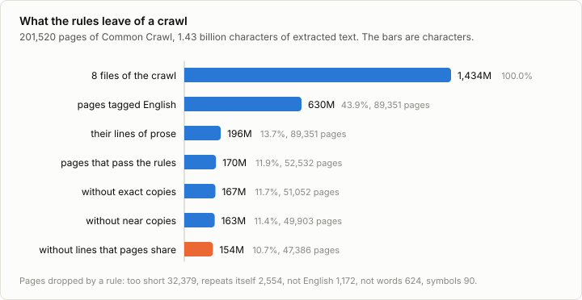
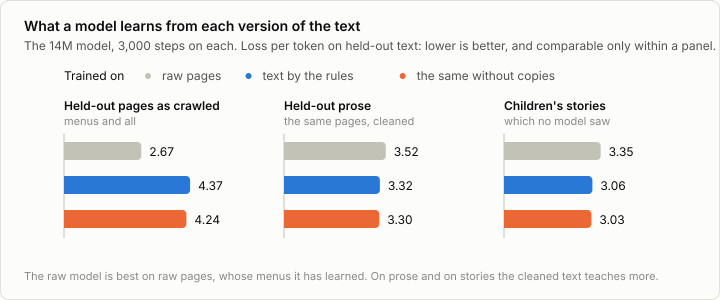

# 3b. Data preparation

Code: [`minllm/prepare.py`](../minllm/prepare.py) ·
Scripts: [`scripts/prepare_data.py`](../scripts/prepare_data.py),
[`scripts/cross_loss.py`](../scripts/cross_loss.py) ·
Tests: [`tests/test_prepare.py`](../tests/test_prepare.py) ·
Logs: [`runs/data/`](../runs/data/)

This is a side topic of [stage 3](03-pretraining.md), not a step of the
pipeline. Stage 3 trained on TinyStories, a corpus that was written to be
clean: every file is English, every line is a sentence, and no story is
there twice. Nobody who trains a model on text from the web starts there.
Most of the work of pretraining, by the account of those who do it, is
getting from what a crawler collects to text worth training on.

This note does that on a small piece of the real thing: eight files of
Common Crawl, a public crawl of the web, 200,000 pages. It uses the
tokenizer of stage 1 and the training loop of stage 3 unchanged, on other
text.

## What a crawl looks like

Common Crawl publishes a crawl as files of about 25,000 pages each. One of
its forms, WET, has the HTML already taken out: per page a few headers and
the text that a browser would show, line by line. This is a page of the
first file, the registration page of a ski, bike and paddle race, from its
start:

```
3P Salida Pole Pedal Paddle - Get Multi-Disciplinated - Registration/Schedule
Home
2024 Salida Pole Pedal Paddle Sponsors
Maps
Registration/Schedule
Rules/Regulations
Results
2024 Salida 3P Results
2023 Salida 3P Results
...
```

It goes on like that for another fourteen lines before its first sentence,
"Participation is capped at 200 registrants." The text of a page is mostly
what surrounds its content: menus, buttons, links to other pages, the
footer. Other pages of the same file are a shop's list of products, a
library catalog in Spanish that the crawl took for English, and a dance
school's site that was taken over to advertise gambling.

`prepare.pages` reads such a file. The steps after it are rules, and each is
one that the published pipelines describe: C4, the corpus of the T5 paper
(Raffel et al., 2019), MassiveText, the corpus of Gopher (Rae et al.,
2021), and FineWeb (Penedo et al., 2024).

## The rules

**1. Language.** The crawl names the languages it detected on each page.
Only pages whose first language is English go on: 44% of the pages and of
the text.

**2. Lines of prose.** `prepare.prose` keeps a line if it has at least five
words and ends in a period, a question mark, an exclamation mark or a
closing quote. This is C4's rule, and it is what removes menus: a menu
entry is short and ends in nothing. It is crude. Of the race's page it
keeps the eight sentences and drops the 23 lines of menu, and with them
the two lines that say what taking part costs, because a price list ends
in no period. It keeps a cookie notice, which is a fine sentence. Of the
English text, 31% is left.

**3. Rules for a page.** `prepare.verdict` drops a page whose prose fails
one of these, which are MassiveText's, in this order:

| A page is dropped as | if | Pages |
|---|---|---|
| too short | it has fewer than 50 words of prose | 32,379 |
| not English | under 2 of the words *the, be, to, of, and, that, have, with* occur, or over a tenth of its letters are not Latin | 1,172 |
| not words | under 80% of its words contain a letter, or its mean word length is outside 3 to 10 | 624 |
| symbols | it has more than one `#` or `...` per ten words | 90 |
| repeats itself | over 30% of its lines occur more than once in it | 2,554 |

Most pages that go are too short: after the line rule a page of products
or links has no prose left. The second rule catches what the crawl's
language tag did not.

**4. Addresses.** `prepare.scrub` replaces e-mail and IP addresses by
placeholders, as FineWeb does, so that a model cannot learn to recite
them: 3,575 in this sample.

**5. Copies.** Three kinds, each needing its own method.

- *The same page twice.* `prepare.digest` hashes a page's text without its
  case and spacing. 1,480 pages are exact copies of an earlier one.
- *Nearly the same page.* Two pages that differ in a date or a name have
  different hashes. `prepare.MinHash` gives every page a signature of 128
  numbers such that the share of numbers on which two signatures agree
  estimates the share of five-word runs that the pages have in common.
  Comparing all pairs of 51,052 signatures would be 1.3 billion
  comparisons. `prepare.near_duplicates` cuts each signature into 16 bands
  and compares only pages that agree on a whole band, which pages 80%
  alike do 95% of the time. 1,149 pages are near copies.
- *The same line on many pages.* No page is a copy of another because both
  end in the same sentence about cookies. `prepare.repeated_lines` finds the
  lines that more than two pages share, 8,252 of them here, and they are
  removed from all pages. "Save my name, email, and website in this browser
  for the next time I comment." is on 1,965 of the 49,903 pages, and
  "Choosing a selection results in a full page refresh." on 1,503.



| Step | Pages | Characters | Of the crawl |
|---|---|---|---|
| 8 files of the crawl | 201,520 | 1,434M | 100% |
| tagged English | 89,351 | 630M | 43.9% |
| lines of prose | 89,351 | 196M | 13.7% |
| pages that pass the rules | 52,532 | 170M | 11.9% |
| without exact copies | 51,052 | 167M | 11.7% |
| without near copies | 49,903 | 163M | 11.4% |
| without lines that pages share | 47,386 | 154M | 10.7% |

A tenth of the crawl is left. Two steps do nearly all of it: the language,
and the line rule, which alone removes two thirds of the English text. The
copies are 10% of what the rules passed, in a sample of eight files out of
90,000. At the scale of a whole crawl that share is far larger, since the
chance that a page's copy is in the sample grows with the sample.

## Does it matter?

The rules above are plausible, and plausible is not measured. FineWeb kept
or dropped each of its filters by training a model on what the filter left
and looking at the model. The same can be done here in half an hour.

Three versions of the text, from the same eight files:

| Version | What it is | Tokens |
|---|---|---|
| raw | every page tagged English, as extracted | 249.0M |
| rules | lines of prose, pages that pass the rules, addresses replaced | 53.9M |
| clean | the same without copies of all three kinds | 49.3M |

One tokenizer of 4,096 tokens, trained by stage 1's code on the raw text,
serves all three. The 14M model of stage 3 is trained on each for 3,000
steps, which is 49 million tokens and takes 10 minutes: one pass over the
clean text, and a fifth of the raw text. Then every model is measured on
held-out text of three kinds: the pages of a ninth file as they were
crawled, the same pages cleaned, and the validation stories of TinyStories,
which are plain English that none of the three has seen.



| Trained on | Held-out raw pages | Held-out prose | Stories |
|---|---|---|---|
| raw | 2.67 | 3.52 | 3.35 |
| rules | 4.37 | 3.32 | 3.06 |
| clean | 4.24 | 3.30 | 3.03 |

**Each model is best at what it was trained on.** The raw model predicts
raw pages far better than the others, because most of a raw page is a menu
and it has learned menus. Asked to continue "Once upon a time", this is
what the three write after their 3,000 steps:

> **raw:** Once upon a time with this book, we'll get the help of the news,
> tips and feedback Skip to content Home About Us Our Team Contact Us
> Privacy Policy Terms and Conditions About Us Our Team Our Team Our Team
> Contact Us Privacy Policy Copyright © […]

> **clean:** Once upon a time, this is a chance to play the game. It’s an
> important aspect, that’s why it’s all, when you build a new sound, we have
> seen the ultimate goals. When you buy a pair, you’re using an online
> gaming platform that is the most effective way to play the game.

**On the text that is wanted, cleaning is worth 0.2 to 0.3.** On held-out
prose the raw model has a loss of 3.52 and the cleaned ones 3.32 and 3.30.
On the stories, which belong to no version, it is 3.35 against 3.06 and
3.03. The raw model saw as many tokens as the others, and spent most of
them on lines that are not sentences.

**Removing copies adds little here**: 0.02 on prose and about 0.03 on the
stories, from one run each, which is at the edge of what a single run can
show. The copies were a tenth of the text. The model trained by the rules
alone does better on held-out text that still has its shared lines, 3.21
against 3.27: it has learned the cookie notices.

**A loss compares only on the same text.** The lowest number in the table,
2.67, belongs to the model that writes menus. Each run watched the loss
on its own kind of held-out text while it trained, and by that number the
raw run was ahead from the first evaluation to the last. Read alone, it
would make raw text look like the best data. A menu is easy to predict.
That is the whole reason the table has three columns: the first measures
what the web is, and the other two what the model is for.

## Run it

```sh
uv run scripts/prepare_data.py                 # downloads 9 files of the crawl, 700 MB, and writes data/web/
uv run scripts/train_tokenizer.py --data data/web/raw --out out/web/tokenizer.json
for v in raw rules clean; do
  uv run scripts/encode_data.py --data data/web/$v --tokenizer out/web/tokenizer.json
  uv run scripts/train.py --data data/web/$v --tokenizer out/web/tokenizer.json --out out/web-$v --steps 3000
done
uv run scripts/cross_loss.py --models out/web-raw out/web-rules out/web-clean \
    --data data/web/raw data/web/rules data/web/clean data/web/stories \
    --tokenizer out/web/tokenizer.json --out runs/data/cross.json
```

`data/web/stories/valid.txt` is a copy of TinyStories' validation file,
encoded with the web tokenizer.

## Exercises

1. Loosen the line rule to three words, or drop the rule about the last
   character. How much text comes back, what kind is it, and what does a
   model trained on it lose on the held-out prose?
2. Print twenty pairs that `near_duplicates` joins at a threshold of 0.8, and
   twenty more that it joins at 0.6 and not at 0.8. Where would you set it?
3. Run the preparation on 16 files and on 4. How does the share of copies
   change with the size of the sample?
4. Score every clean page with the model trained on the clean text, and
   read the 50 pages it finds strangest and the 50 it finds most ordinary.
   CCNet filters by such a score. Which end would you cut?
5. Train on the clean text and TinyStories mixed half and half. What does
   each held-out loss do, against the model of this note and the model of
   stage 3?
6. Train the tokenizer on the clean text and not on the raw text. How many
   of its 3,837 merges change, and what does the model trained on clean
   text gain, measured in bits per byte with `cross_loss.py`?
7. The rules threw away the race's price list. Write a rule that keeps a
   line if the lines around it are kept. What else does it let in?

## In practice

- **Start from the HTML.** The WET files used here are a convenience. The
  pipelines that care extract the text themselves from the raw pages, with
  a tool that finds the main content from the structure of the page
  (FineWeb uses trafilatura), and so need a rule about line endings much
  less.
- **Language and quality are classifiers.** A language is identified by a
  small trained model (fastText) with a threshold on its confidence, where
  this note took the crawl's own tag. Rules for quality are giving way to
  classifiers trained on examples of good and bad text, and to scores from
  a language model.
- **Every filter is checked by training.** Whether a filter helps is an
  empirical question, and several that sound right have turned out to hurt.
  FineWeb and DataComp-LM fix the model and the training and change only
  the data, as the table above does at a small scale.
- **Copies are the expensive step.** Rules look at one page at a time and
  run in parallel over thousands of files. Finding copies needs every page
  compared with all others, which is why it is done with signatures and
  bands, per crawl or per cluster of sites. How much to remove is itself
  disputed: FineWeb found that removing copies across all crawls at once
  made its models worse.
- **A corpus is a mixture.** Web text is one source beside books, code,
  papers and conversations, and the weight of each is chosen, as in The
  Pile. A source also brings its license and the wishes of its authors, and
  a crawl honors a site's request not to be crawled.
- **The amounts.** This note kept 154 million characters of 1.4 billion. A
  crawl of Common Crawl is 90,000 such files, and the corpora made from it
  are counted in trillions of tokens. The rules are the same.

## References

- Raffel et al. (2019), [Exploring the Limits of Transfer Learning with a Unified Text-to-Text Transformer](https://arxiv.org/abs/1910.10683). T5, and with it C4: Common Crawl cleaned by rules for lines and pages.
- Rae et al. (2021), [Scaling Language Models: Methods, Analysis & Insights from Training Gopher](https://arxiv.org/abs/2112.11446). MassiveText: the page statistics used here, and the removal of exact and near copies.
- Penedo et al. (2024), [The FineWeb Datasets: Decanting the Web for the Finest Text Data at Scale](https://arxiv.org/abs/2406.17557). A pipeline from Common Crawl in which every filter was kept or dropped by training models on its output.
- Broder (1997), [On the resemblance and containment of documents](https://doi.org/10.1109/SEQUEN.1997.666900). MinHash: the resemblance of two documents estimated from small signatures.
- Wenzek et al. (2019), [CCNet: Extracting High Quality Monolingual Datasets from Web Crawl Data](https://arxiv.org/abs/1911.00359). Deduplication, language identification and filtering by a language model's perplexity, on Common Crawl.
- Lee et al. (2021), [Deduplicating Training Data Makes Language Models Better](https://arxiv.org/abs/2107.06499). How much of standard corpora is near copies, and what removing them changes.
- Gao et al. (2020), [The Pile: An 800GB Dataset of Diverse Text for Language Modeling](https://arxiv.org/abs/2101.00027). A corpus mixed from 22 sources, with the weight of each chosen.
- Soldaini et al. (2024), [Dolma: an Open Corpus of Three Trillion Tokens for Language Model Pretraining Research](https://arxiv.org/abs/2402.00159). A documented pipeline and its tools, with what each step removed.
- Li et al. (2024), [DataComp-LM: In search of the next generation of training sets for language models](https://arxiv.org/abs/2406.11794). A benchmark of data curation: the model and the training are fixed, and only the data changes.
- [Common Crawl](https://commoncrawl.org/). The public crawl of the web that these corpora, and the sample of this note, start from.
