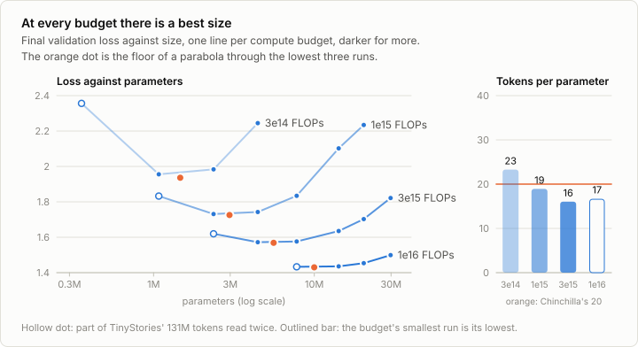
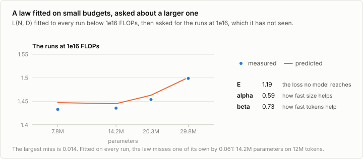

# 3c. Scaling laws

Code: [`minllm/scaling.py`](../minllm/scaling.py) ·
Scripts: [`scripts/scaling.py`](../scripts/scaling.py),
[`scripts/analyze_scaling.py`](../scripts/analyze_scaling.py) ·
Tests: [`tests/test_scaling.py`](../tests/test_scaling.py) ·
Logs: [`runs/scaling/`](../runs/scaling/)

This is a side topic of [stage 3](03-pretraining.md), not a step of the
pipeline. Stage 3 trained one model of 14M parameters for 6,000 steps. Why
that size, and why that long? Given a fixed amount of computation, a
larger model sees fewer tokens, and a smaller one sees more. Somewhere
between is the split that ends with the lowest loss. A large training run
happens once and cannot be repeated with another split, so the split is
chosen in advance, from small runs, by a law that says how the loss falls
with size and data. This note finds that law for the model of stage 3.

## Compute

A training step does about 6 floating-point operations per parameter per
token: 2 for the forward pass, a multiply and an add, and 4 for the
backward pass, which computes a gradient for the inputs and one for the
weights. Training a model of N parameters on D tokens costs about

    C = 6 N D

Attention over the window adds a few percent here, which the rule leaves
out. Stage 3's run, 14.2M parameters on 98M tokens, cost 8.4e15 operations.

## Eight sizes

`scaling.family` builds the model of stage 3 narrower and wider: widths
from 64 to 512, with depth growing with width so that the shape stays about
the same, heads of 64 dimensions, and an MLP 8/3 as wide as the stream.
Width 384 with 8 blocks is stage 3's model. The heads are given as query
heads and key/value heads.

| Width | Blocks | Heads | MLP | Parameters | Best learning rate |
|---|---|---|---|---|---|
| 64 | 2 | 1, 1 | 160 | 0.36M | 4e-3 |
| 128 | 3 | 2, 1 | 352 | 1.08M | 4e-3 |
| 192 | 4 | 3, 1 | 512 | 2.36M | 4e-3 |
| 256 | 5 | 4, 1 | 672 | 4.45M | 2e-3 |
| 320 | 6 | 5, 1 | 864 | 7.77M | 2e-3 |
| 384 | 8 | 6, 2 | 1,024 | 14.16M | 2e-3 |
| 448 | 9 | 7, 1 | 1,184 | 20.29M | 1e-3 |
| 512 | 10 | 8, 2 | 1,376 | 29.80M | 1e-3 |

Every size has its own best learning rate: a small model takes larger
steps. `scaling.py --phase lr` trains each size for 16M tokens at rates
that double from 5e-4 until the loss rises again, and keeps the best. Each
best lies between two rates that do worse. Stage 3 trained width 384 at
1e-3, half of its best here.

## Four budgets

Then every size is trained at every budget of 3e14, 1e15, 3e15 and 1e16
operations, as many tokens as the budget buys it, each run with its own
schedule: the learning rate warms up for a thirtieth of the run and decays
to a tenth at its end, as in stage 3. A run that is cut short of its
schedule ends with a higher loss than one planned for that length, which
is the mistake Hoffmann et al. (2022) found in the first scaling laws.

Stage 3's training text, the first 512 MB of TinyStories, is 131M tokens.
A small model at a large budget would read it many times, and repeated
text is worth less than new text, so every size reads it at most 1.7
times, and only the smallest size of each budget reads any of it twice.
That run is there so that the valley has a run on its small side.
Muennighoff et al. (2023) found text read up to four times worth almost as
much as new text. Every run also has at least 8M tokens, about 500 steps.
That leaves 20 runs, 4 to 6 per budget.

## The valleys



| Budget | Best size | Tokens | Tokens per parameter | Loss there |
|---|---|---|---|---|
| 3e14 | 1.47M | 34M | 23 | 1.936 |
| 1e15 | 2.97M | 56M | 19 | 1.725 |
| 3e15 | 5.58M | 90M | 16 | 1.568 |
| 1e16 | 9.98M | 167M | 17 | 1.430 |

The best size is the floor of a parabola through the lowest run and its
neighbours, against log N. At the three smaller budgets there are runs on
both sides of it. At 1e16 the smallest run, 7.8M parameters, is also the
lowest, by 0.003 over 14.2M, and the next smaller size would have to read
the text 2.9 times. So that floor is less sure, and the next fit leaves it
out.

Through the three other floors, the best size grows as C^0.58 and the
best number of tokens as C^0.42. Hoffmann et al. found both about 0.5, and
Kaplan et al. 0.73 for the size. Three budgets that span one decade give
the exponent only roughly: what holds across them is that the best split
stays near Chinchilla's 20 tokens per parameter, from 23 down to 16.

## One law for every run

Fitted to all 20 runs, as Hoffmann et al. fitted theirs:

    L(N, D) = 1.16 + 1625 / N^0.573 + 77435 / D^0.709

E, 1.16, is the loss that neither more size nor more text would get below.
The exponents are larger than Chinchilla's 0.34 and 0.28: here the loss
falls faster with both than in Chinchilla's runs, which differ in the text,
the tokenizer and the size of the models. The law misses 15 of its 20 runs
by less than 0.01. The larger misses, up to 0.061, are at the smallest
budget, whose runs are the shortest, at 14.2M parameters on 12M tokens,
under one token per parameter, and 0.013 at 1.08M parameters on 155M
tokens. Minimized along C = 6 N D, the law's own best size grows as
C^0.55, close to the floors' 0.58.

A law is worth having if it predicts a run before it is made. Fitted
without the four runs at 1e16, the law has E 1.19, alpha 0.59 and beta
0.73, and asked for those runs it is off by at most 0.014, every time a
little high:



## Stage 3's choice

Stage 3 trained 14.2M parameters on 98M tokens: 8.4e15 operations, 6.9
tokens per parameter. At that compute the law prefers 9.8M parameters on
142M tokens, 14 per parameter, and predicts 1.448 for it against
1.456 for stage 3's split. Near its floor the valley is flat, and a model
of 1.4 times the best size costs 0.008. Stage 3 measured 1.465, at half
the learning rate the sweep found best for its size.

## Run it

```sh
uv run scripts/scaling.py --phase lr                                          # widths 128 to 512 at four learning rates
uv run scripts/scaling.py --phase lr --dims 64,128,192 --lrs 1e-3,2e-3,4e-3,8e-3   # the smallest ones go higher
uv run scripts/scaling.py --phase grid --dims 64,128,192,256,320,384,448,512 --lrs 5e-4,1e-3,2e-3,4e-3,8e-3 --max-passes 1.7
uv run scripts/analyze_scaling.py                                             # the fits: runs/scaling/summary.json
```

On an M5 Pro, shared with other runs, the sweep took 1.2 hours and the grid
5.3.

## Exercises

1. Count the parameters without the embedding, as Kaplan et al. did, and
   fit again. How do the exponents and the best sizes change? Pearce and
   Song (2024) trace much of the difference between the first two laws to
   this choice.
2. Train each size once for a long schedule and read its loss at several
   points along the way, instead of training a run per budget. Which law do
   you get, and why does it favour larger models?
3. Use the fitted law to choose the size for a budget of 3e16, train it, and
   compare the loss with the law's. It reads TinyStories several times:
   how much does that cost against Muennighoff et al.'s estimate?
4. Answer stage 3's exercise 4 from the law: for five minutes and for an
   hour of this laptop, which size? Then train both and check.
5. Fit L(N, D) by least squares in place of the Huber loss, and with the
   runs of one budget left out at a time. How much do E, alpha and beta
   move? Besiroglu et al. (2024) found Chinchilla's own fit sensitive in
   the same way.
6. Repeat the grid on the web text of [3b](03b-data.md). Does the best
   number of tokens per parameter depend on the text?

## In practice

- **Every large run is planned from small ones.** Laboratories fit laws
  like this one on many runs of increasing size before committing to a
  final run, and check the final run against the law as it trains.
- **Most models are trained far past the best split.** The law minimizes
  the cost of training, but a model that is served to many users costs more
  to run than to train, and the running cost depends on its size alone. So
  small models are trained on far more tokens than the law prefers: Llama
  3's 8B model on about 15 trillion, some 1,900 per parameter (Grattafiori
  et al., 2024). The loss keeps falling, slowly.
- **The constants belong to the data and the recipe.** E, A and B change
  with the text, the tokenizer and the architecture; a law is fitted again
  for every new mix. The shape, two power laws and a floor, has held across
  all of them.
- **Hyperparameters have to transfer.** A law fitted on small models
  predicts large ones only if the large ones are trained as well. The best
  learning rate moves with width, as it did here, and parametrizations such
  as µP (Yang et al., 2022) are designed so that it does not.

## References

- Hestness et al. (2017), [Deep Learning Scaling is Predictable, Empirically](https://arxiv.org/abs/1712.00409). Power laws in the loss of models across tasks, as data and size grow.
- Kaplan et al. (2020), [Scaling Laws for Neural Language Models](https://arxiv.org/abs/2001.08361). The loss of language models as power laws in parameters, data and compute.
- Hoffmann et al. (2022), [Training Compute-Optimal Large Language Models](https://arxiv.org/abs/2203.15556). Chinchilla: the valleys at fixed compute, L(N, D) fitted to every run, and about 20 tokens per parameter.
- Besiroglu et al. (2024), [Chinchilla Scaling: A replication attempt](https://arxiv.org/abs/2404.10102). Fitting L(N, D) again to Chinchilla's data, and how much its parameters depend on the fit.
- Pearce and Song (2024), [Reconciling Kaplan and Chinchilla Scaling Laws](https://arxiv.org/abs/2406.12907). Why the two disagreed: whether the embedding counts as parameters, and the size of the models fitted.
- Muennighoff et al. (2023), [Scaling Data-Constrained Language Models](https://arxiv.org/abs/2305.16264). What text read a second, third and fourth time is worth.
- Grattafiori et al. (2024), [The Llama 3 Herd of Models](https://arxiv.org/abs/2407.21783). Models trained far past the compute-optimal split, because they are run far more often than trained.
- Yang et al. (2022), [Tensor Programs V: Tuning Large Neural Networks via Zero-Shot Hyperparameter Transfer](https://arxiv.org/abs/2203.03466). µP: a parametrization in which the best learning rate does not move with width.
