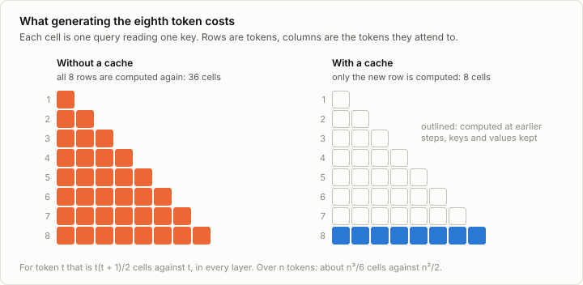
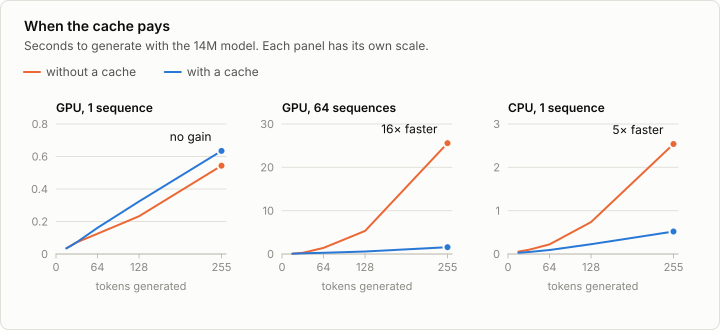
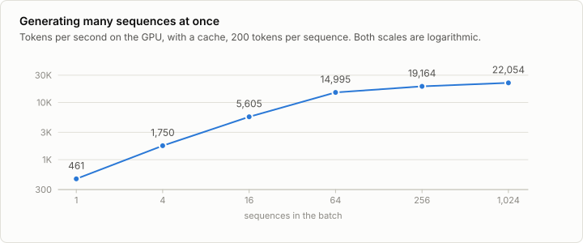

# 4. Inference

Code: [`minllm/inference.py`](../minllm/inference.py),
[`minllm/model.py`](../minllm/model.py) ·
Scripts: [`scripts/sample.py`](../scripts/sample.py),
[`scripts/bench_inference.py`](../scripts/bench_inference.py) ·
Tests: [`tests/test_inference.py`](../tests/test_inference.py)

A trained model is a function from a text to a distribution over the next
token. Turning that into text is a loop: ask for the distribution, pick a
token, append it, ask again. This stage is about the two decisions in that
loop, how to pick and how to avoid redoing work, and about doing it for many
texts at once. All three come back later: reinforcement learning spends much
of its time generating.

## Picking a token

The model's last layer gives one score per token, the logits. A softmax turns
them into probabilities, and `sample` draws from those. Three knobs reshape
the distribution first.

**Temperature** divides the logits before the softmax. Below 1, the likely
tokens gain and the unlikely ones lose. Above 1, the distribution flattens.
At 0 the likeliest token is always taken. The same prompt and seed at three
temperatures, without top-k, from the model of stage 3:

| Temperature | Continuation of "Once upon a time" |
|---|---|
| 0 | , there was a little girl named Lily. She loved to play with her toys and eat yummy food. One day, she found a big, red apple in her kitchen. |
| 0.8 | , there was a cheerful dog named Max. Max loved to play outside and run. One day, Max found a big, soft thing. It was a carrot! |
| 1.5 | , there was a cheerful crane. He lived in a big twig tree. One day, he found a piece of steel. He picked it up and wanted to rock back to his tree. |

At 0 the model writes the single most typical story it knows, and writes it
every time. At 1.5 it reaches for tokens it should not.

**Top-k** keeps the `k` likeliest tokens and discards the rest before
sampling. **Top-p** keeps the smallest set of likeliest tokens whose
probabilities add up to `p`. Both cut off the long tail of unlikely tokens,
where one bad draw can derail a text. Top-p adapts: when the model is sure,
the set is one or two tokens, and when many continuations are plausible, it
is large.

## The cache

The sampler from stage 2 runs the model on the whole text for every new
token. The result is correct and most of the work is repeated: because
attention is causal, nothing computed for a token changes when tokens are
appended after it.

What does a new token need from the earlier ones? In each attention layer,
its query is compared with their keys, and their values are averaged.
Nothing else crosses between positions. So if every layer keeps the keys and
values of the tokens it has seen, a new token can be processed alone.



Generation then has two phases:

- **Prefill.** The prompt goes through the model in one pass, as in training,
  and every layer stores the keys and values of all prompt tokens.
- **Decode.** Each new token goes through alone. Every layer appends its key
  and value to the cache and attends over the whole cache.

The change to the model is small: `Attention.forward` takes an optional
`cache`, and with one it stores the new keys and values and reads back all
of them. Three details are easy to get wrong.

- **Positions.** A token decoded alone is not at position 0. Its rotary
  angles must be those of its true position, so `Transformer.forward` slices
  the rotation table from the cache length on.
- **The mask.** During decode, the single new query may attend to every
  cached key. Asking the library for a causal mask at that point would be a
  bug, since for one query and many keys it leaves only the first key
  visible. Exercise 1 triggers it.
- **Allocation.** The cache is allocated once at its final size and written
  in place. Growing it by concatenation would copy the whole cache at every
  step.

`test_cache_gives_the_same_logits` holds the two paths together: prompt plus
one token at a time through the cache yields the logits of a single pass over
the full text.

### Memory

The cache trades memory for time. Per sequence it holds

```
layers × 2 (keys and values) × kv heads × head_dim × tokens
```

numbers. For the model here at its full context of 256 tokens, that is 2 MB.
For Qwen2.5-0.5B at its full context of 32,768 tokens in 16-bit floats, it is
403 MB per sequence. This is where grouped-query attention earns its place.
The cache stores the key/value heads before they are shared out, so Qwen's 2
key/value heads for 14 query heads make the cache 7 times smaller than the
2.8 GB it would otherwise be. On a server it is often the cache, not the
weights, that decides how many requests fit in memory.

## When the cache pays



| 255 tokens, 14M model | Without a cache | With a cache | |
|---|---|---|---|
| GPU, 1 sequence | 0.54 s | 0.64 s | no gain |
| GPU, 64 sequences | 25.6 s | 1.56 s | 16× faster |
| CPU, 1 sequence | 2.54 s | 0.52 s | 5× faster |
| CPU, 64 sequences | 73.5 s | 3.19 s | 23× faster |

The first row is the surprise. For a single sequence on the GPU the cache
changes nothing, and the reason is worth knowing. A forward pass of this model
is a few hundred small operations, and each costs a fixed amount to dispatch
to the GPU, 2 to 2.5 ms for the whole pass, whether it carries one token or
255. The GPU is nearly idle either way. The cache removes arithmetic, and
arithmetic was not what the time went to. The side topic
[4b](04b-speculative.md) puts that idle time to use: a cheap draft guesses
several tokens, and one pass of the model checks them all.

Once the arithmetic matters, the cache wins by a factor that grows with
length: with 64 sequences on the GPU, and already for one sequence on the CPU.
Note also that for a single sequence the CPU, with a cache, is faster than the
GPU. Small models and small batches do not need a GPU.

The same holds for larger models, with the thresholds moved: stage 5 repeats
the measurement on a 0.5B model, where the cache starts to pay for a single
sequence once the context reaches a few hundred tokens.

## Many sequences at once



For the same reason, a second sequence in the batch is almost free. From 1 to
64 sequences, throughput grows 32 times: each one slows down a little, and
there are 64 of them. Beyond that the GPU is actually busy and the curve
flattens, at about 22,000 tokens per second.

This is the single most important fact about serving language models, and it
is why later stages generate hundreds of samples per step without waiting
long.

A batch needs rows of equal length, and prompts differ. `stream` pads the
shorter ones on the left:

```
<pad> <pad> <pad> The   cat          ->  sat
Once  upon  a     time  ,            ->  there
```

Left, because then every row ends in its last real token, and the last
position predicts the next token for all rows at once. A mask keeps real
tokens from attending to padding. The padding shifts a prompt to later
positions, and this is harmless for the reason given in stage 2: rotary
embeddings see only distances. `test_prompts_of_different_lengths` checks that
a prompt gives the same output alone and in a padded batch, in 32-bit floats
on the CPU. In 16-bit floats on this laptop's GPU, another batch, or a pass
over several tokens, can add a row's sums in another order, and at a near
tie between two tokens that changes a greedy reply: [9c](09c-reasoning.md)
and [4b](04b-speculative.md) measure it.

Rows also finish at different times. Each row stops at its own stop token,
here `<|endoftext|>`, and the loop ends when all rows have stopped.

## Run it

```sh
uv run scripts/sample.py --n 1                        # printed token by token
uv run scripts/sample.py --temperature 0              # the most typical story
uv run scripts/sample.py --temperature 1 --top-p 0.9
uv run scripts/bench_inference.py                     # the numbers above
MINLLM_DEVICE=cpu uv run scripts/bench_inference.py
```

## Exercises

1. In `Attention.forward`, pass `is_causal=True` whenever `mask` is `None`,
   also for a single token. Which test fails? Print the attention weights of
   a decode step to see what the new token can still see.
2. Replace the preallocated buffers in `LayerCache` with `torch.cat`. Measure
   64 sequences of 255 tokens before and after.
3. Pad on the right instead of the left. What has to change for the outputs
   to stay correct?
4. Generate 50 stories at each of the temperatures 0.5, 1.0 and 1.5 and count
   how many distinct first sentences you get. Then fix the temperature at 1
   and vary `--top-p`.
5. How much memory does the cache of Qwen2.5-0.5B take for 64 users with
   4,096 tokens of context each? Compare it to the size of the weights.
6. The decode loop spends its time on overhead. Find out how much by timing a
   forward pass of one token with 2 layers and with 8.

## In practice

Every inference engine has this cache. What they add is scheduling and memory
management around it:

- **vLLM** keeps one batch running continuously. A new request joins the batch
  between two decode steps and a finished one leaves, so nobody waits for
  anybody else's text to end. Its cache is allocated in fixed-size blocks, like
  virtual memory pages, instead of one buffer per sequence at full length.
- **llama.cpp** runs models with weights compressed to a few bits each, often
  about 4, on CPUs and GPUs, Apple's among them. **MLX** is Apple's array
  library, with its own engine.
- All of them cut the cost of launching each operation, with compiled
  code, captured GPU graphs, or a whole step handed to the GPU at once,
  which is how they escape the per-operation overhead that dominates the
  measurements above. A server such as vLLM also keeps its batches large.

The last stage of this repository exports the model and runs it in MLX.

## References

- Fan, Lewis and Dauphin (2018), [Hierarchical Neural Story Generation](https://arxiv.org/abs/1805.04833). Sampling from the k likeliest tokens only.
- Holtzman et al. (2019), [The Curious Case of Neural Text Degeneration](https://arxiv.org/abs/1904.09751). Nucleus sampling, and why the likeliest text is repetitive and dull.
- Yu et al. (2022), [Orca: A Distributed Serving System for Transformer-Based Generative Models](https://www.usenix.org/conference/osdi22/presentation/yu), OSDI. Continuous batching: requests join and leave a running batch between decode steps.
- Kwon et al. (2023), [Efficient Memory Management for Large Language Model Serving with PagedAttention](https://arxiv.org/abs/2309.06180). vLLM: the key-value cache allocated in pages, so that many requests of unknown length share one GPU.
- Gerganov et al., [llama.cpp](https://github.com/ggml-org/llama.cpp). Inference in plain C++ on ordinary hardware, which made running models locally common.
- Apple, [MLX](https://github.com/ml-explore/mlx). An array framework for Apple silicon, used in stage 10 to run this repository's models.
