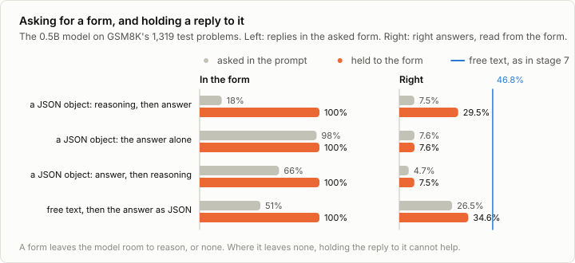

# 4a. Structured output

Code: [`minllm/constrain.py`](../minllm/constrain.py),
[`minllm/automaton.py`](../minllm/automaton.py),
[`minllm/schema.py`](../minllm/schema.py),
[`minllm/inference.py`](../minllm/inference.py) ·
Scripts: [`scripts/evaluate_structured.py`](../scripts/evaluate_structured.py),
[`scripts/bench_constrain.py`](../scripts/bench_constrain.py) ·
Tests: [`tests/test_constrain.py`](../tests/test_constrain.py),
[`tests/test_automaton.py`](../tests/test_automaton.py),
[`tests/test_schema.py`](../tests/test_schema.py) ·
Results: [`runs/structured/`](../runs/structured/)

This is a side topic of [stage 4](04-inference.md), not a step of the
pipeline. Stage 4 picked every token from the model's whole prediction. A
program that reads the reply often needs more than a likely text: it needs
a text of a fixed form, a JSON object with these keys, every time. Asking
for it in the prompt is a request. This note makes it a guarantee, with
one change to stage 4's loop: before a token is picked, every token that
would take the text out of the form is ruled out.

It is what the tool calls of [6a](06a-tool-calling.md) are written with,
and what every API that offers "structured output" does underneath.

## Asking is not enough

The 0.5B model of stage 5, asked for the answer to GSM8K's test problems as
a JSON object:

```
Answer with a JSON object and nothing else, in this form:
{"reasoning": "<your work>", "answer": <number>}
```

Of its 1,319 replies, 23.7% are JSON, and 18.4% have the two keys with a
string and a number. Most of the rest do not try: they begin "To determine
how much Janet makes..." and solve the problem in prose, the way the model
was trained to answer a math problem, and some of them are right. A
program that reads the reply as JSON gets nothing from them. Read from the
replies that do have the form, 7.5% of the problems are solved, where the
same model solves 46.8% when it may write as it likes and end with
`#### <number>` (stage 7).

## The idea

At every step the model gives every token a score, and stage 4 picks one.
To keep a reply in a form, it is enough to know, at every step, which
tokens may come next, and to set the scores of all others to minus
infinity before the pick. The model still chooses among what is left, by
its own scores.

`inference.stream` takes one more argument for this, `allow`. Before every
step it is called with the tokens picked in the step before, and returns,
for every row of the batch, which tokens are allowed. What it does not
allow gets a probability of zero. Everything else about generation stays
as it was.

What is left is to answer that question fast, for a form such as "a JSON
object with a string `reasoning` and a number `answer`", and for a
vocabulary of 151,665 tokens of which many are several characters long.

## A form as an automaton

The texts of such a form are a regular language: one regular expression
describes them all. `schema.regex` writes it for a JSON schema. For the
form above, with the layout the chat template uses for JSON, one space
after every colon and comma:

```
\{"reasoning": "(CHARACTER)*", "answer": -?(0|[1-9][0-9]*)(\.[0-9]+)?\}
```

where a CHARACTER is any printable character but a quote or a backslash, a
character of several bytes in valid UTF-8, or an escape such as `\n`.

A regular expression can be compiled into a deterministic automaton
(Rabin and Scott, 1959): a table with a row for every state and a column
for every byte, which says which state a byte leads to, or that it leads
nowhere. `automaton.Automaton` builds it the textbook way. It first makes
an automaton that may be in several states at once, one small piece per
part of the expression (Thompson, 1968), and then one whose states are sets
of those states. For the form above the table has 68 rows.

The table answers two questions in constant time. Can the text so far
still become a text of the form? It can if reading its bytes never leads
nowhere. Is it complete? It is if it ends in an accepting state.

## From bytes to tokens

A model does not write bytes. Its tokens are pieces of text, and in Qwen's
vocabulary a piece can be 128 bytes long: `{"` is one token, and so is
` reasoning`. From a state of the automaton, a token is allowed if all of
its bytes can be read one after another, and it leads to the state after
the last of them.

`constrain.Index` works that out once per state, for the whole vocabulary
at the same time: all 151,936 tokens walk through the table together, one
byte at a time. The result is, for every state, the state each token leads
to. During generation the mask of allowed tokens for a state is then a
lookup, made once and kept on the GPU. This is the method of Outlines
(Willard and Louf, 2023).

Two details decide whether the guarantee holds.

**Control tokens are never text.** `<|im_end|>` ends a turn. It is allowed
only where the text is complete, so a reply cannot stop in the middle of
the form and must stop at its end.

**A reply can run out of tokens.** A reply that fits so far and is cut off
by the limit on its length does not fit. So the index also counts, for
every state, the fewest tokens that reach the end of the form, and
`constrain.Constraint` allows a token only if the tokens that remain after
it still suffice. Near the limit a reply is led to its nearest end. In
bytes this would be wrong: the shortest text of the form above is 30 bytes
and 11 tokens.

`tests/test_constrain.py` lets a model that was never trained, which picks
tokens almost at random, answer under the constraint, and checks that every
reply is JSON of the schema, at any temperature and with as few tokens as
the form needs at least.

## What it does to the answers

With the constraint every reply has the form: 100% of them, against
18.4% asked. What is right is another question, and the answer depends on the
form more than on the constraint. Four forms, each asked in the prompt and
held to:



| The reply is | Asked: in the form | Asked: right | Held to it: right |
|---|---|---|---|
| a JSON object, reasoning then answer | 18.4% | 7.5% | 29.5% |
| a JSON object with the answer alone | 97.6% | 7.6% | 7.6% |
| a JSON object, answer then reasoning | 66.3% | 4.7% | 7.5% |
| free text, then the answer as JSON on the last line | 50.6% | 26.5% | 34.6% |
| free text, then `#### <number>` (stage 7) | | 46.8% | |

Every interval is about 2.5 points to either side.

**The answer alone is a guess.** `{"answer": 18}` leaves no room to work
the problem out, and the model, asked or held to it, solves 7.6%. That is
what it gets right without working anything out.

**So is the answer first.** With the answer before the reasoning, the
reasoning comes after the answer is written and cannot change it. Held to
that order the model solves 7.5%, as with no reasoning at all. The order
of the keys in a schema is the order in which the model writes, and a
schema that asks for the answer first asks for a guess.

**Reasoning inside a string is cramped.** Held to the first form, the model
reasons in the JSON string and solves 29.5%, four times what it got asked,
since now every reply counts. But a string allows no line break, only the
escape `\n`, and the model writes its reasoning short: 108 tokens in the middle of the range,
against about twice that when it may write freely.

**Free text, then the form, comes closest**: 34.6%, still 12 points
short of stage 7. Here the constraint has a cost of its own. A reply may
only stop right after its JSON line, and the model often wants to stop
elsewhere. Asked for this form, half of its replies end otherwise: with
the answer in `\boxed{}`, as it was trained to give it, with a closing
remark after the JSON, or with the JSON behind "The answer is:" on the
same line.
Not allowed to stop, it goes on, repeats itself, and runs into the limit
of 512 tokens, where the constraint makes it write a JSON line in a hurry.
That happens to 489 of the 1,319 replies, against 88 when the form was only
asked for. Of those 489, 4.9% are right; of the others, 52.0%.

The constraint guarantees the form, and nothing about the content. It can
only choose among what the model would write anyway, and a form that the
model would not have chosen pushes it into texts it writes badly. The forms
that work leave room to reason, put the reasoning before the answer, and
end where the model ends.

## What it costs

Two costs: building the index, once per form, and deciding every step.

Building the index walks 151,936 tokens through the table once per state.
For the form with reasoning and answer, 68 states, that takes 1.1 seconds; for
the answer alone, 20 states, 0.1 seconds. A server keeps the index of a schema
it has seen.

Deciding a step is a lookup per row and a stack of masks that were made
once. `scripts/bench_constrain.py` measures it: 64 prompts, 256 steps each, with
and without a constraint that allows nearly every token, so that the model
does the same work either way, each the fastest of 3 runs in a fresh
process:

```
free:         8.3s for 256 steps of 64, 1,967 tokens per second
constrained:  8.5s for 256 steps of 64, 1,917 tokens per second
```

The constraint costs 3%, most of it the Python loop over the rows. A mask
is made once per state and kept on the GPU, so a step only picks out the
masks of the states its rows are in.

## Run it

```sh
uv run scripts/evaluate_structured.py --form thinking                   # asked in the prompt
uv run scripts/evaluate_structured.py --form thinking --constrain       # held to the form
uv run scripts/evaluate_structured.py --form answer --constrain         # {"answer": <number>} and nothing else
uv run scripts/evaluate_structured.py --form answer-first --constrain   # the answer before the reasoning
uv run scripts/evaluate_structured.py --form reason-then-answer --constrain   # free text, then the answer as JSON
```

Each takes the 1,319 test problems of GSM8K and writes
`runs/structured/<form>-<asked|constrained>.json`.

## Exercises

1. Let the last form stop after any line that is the JSON object, and not
   only at the very end, by changing the expression. How many replies still
   run into the limit, and what is the score?
2. Put the form's description into the system prompt as well as the user's.
   Does asking harder raise the share of replies in the form?
3. Allow line breaks inside the reasoning string, written as `\n`. Do the
   replies get longer, and the score higher?
4. Add a key `"steps": [...]`, an array of strings, before the answer. Does
   reasoning in steps do better than reasoning in one string?
5. Sample with temperature 1 instead of greedily, held to the first form.
   How often is the answer right now, and how often do five samples agree?
6. Time `constrain.Index` for a schema with an `enum` of a hundred names.
   How many states does its automaton have, and how long does it take?

## In practice

- **Every API has it.** "JSON mode" and "structured outputs" in the
  hosted APIs, and `response_format` and guided decoding in vLLM, SGLang
  and llama.cpp, are this: a schema or a grammar, compiled to an automaton,
  turned into a mask per step. Libraries for it are Outlines, XGrammar and
  llama.cpp's GBNF grammars.
- **Grammars reach further.** JSON with nested objects of any depth is not a
  regular language, and needs a grammar with recursion, a pushdown
  automaton. XGrammar's work is making that as fast as the regular case:
  most tokens are decided without looking at the stack.
- **The mask is computed while the model runs.** A serving system builds
  the mask for the next step on the CPU while the GPU computes the logits,
  so that the constraint costs nothing measurable.
- **Token boundaries are subtle.** A constraint can only rule tokens out,
  and the remaining ones may split the text where the model would not have:
  a word it would write as one token has to be written in pieces. The model
  then sees text it rarely saw in training, and does worse. Beurer-Kellner
  et al. measure this and correct for it.
- **The form is part of the prompt.** Which keys come first, whether there
  is room to reason, and whether the model may end where it wants all
  matter more than the guarantee. The common recipe is the last form here:
  reason freely, then fill the form, or call the model twice.

## References

- Thompson (1968), [Programming Techniques: Regular expression search algorithm](https://doi.org/10.1145/363347.363387). A regular expression compiled into an automaton that may be in several states at once.
- Rabin and Scott (1959), [Finite Automata and Their Decision Problems](https://doi.org/10.1147/rd.32.0114). Such an automaton turned into a deterministic one whose states are sets of its states.
- Willard and Louf (2023), [Efficient Guided Generation for Large Language Models](https://arxiv.org/abs/2307.09702). Outlines: a regular expression's automaton, indexed by the tokens of the vocabulary, as the mask of every step.
- Geng et al. (2023), [Grammar-Constrained Decoding for Structured NLP Tasks without Finetuning](https://arxiv.org/abs/2305.13971). Constraints by a grammar, which reaches beyond regular languages, for tasks with structured outputs.
- Beurer-Kellner, Fischer and Vechev (2024), [Guiding LLMs The Right Way: Fast, Non-Invasive Constrained Generation](https://arxiv.org/abs/2403.06988). What a constraint does to the model's distribution where token boundaries and the form disagree.
- Dong et al. (2024), [XGrammar: Flexible and Efficient Structured Generation Engine for Large Language Models](https://arxiv.org/abs/2411.15100). Grammar-constrained decoding fast enough for serving, as used in vLLM and SGLang.
- Tam et al. (2024), [Let Me Speak Freely? A Study on the Impact of Format Restrictions on Performance of Large Language Models](https://arxiv.org/abs/2408.02442). Reasoning held to a format gets worse, and less so when the format leaves room for it.
- Gerganov et al., [GBNF grammars in llama.cpp](https://github.com/ggml-org/llama.cpp/blob/master/grammars/README.md). Constrained decoding by a grammar in a widely used local runtime.
- Bray (2017), [RFC 8259: The JavaScript Object Notation (JSON) Data Interchange Format](https://www.rfc-editor.org/rfc/rfc8259). What a JSON text is, which `schema.py` writes as an expression.
- Yergeau (2003), [RFC 3629: UTF-8, a transformation format of ISO 10646](https://www.rfc-editor.org/rfc/rfc3629). The well-formed byte sequences of UTF-8, which the expression for a string allows and no others.
