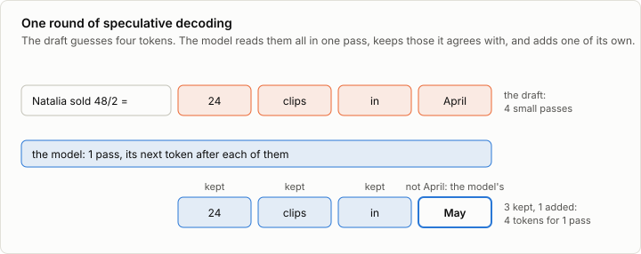
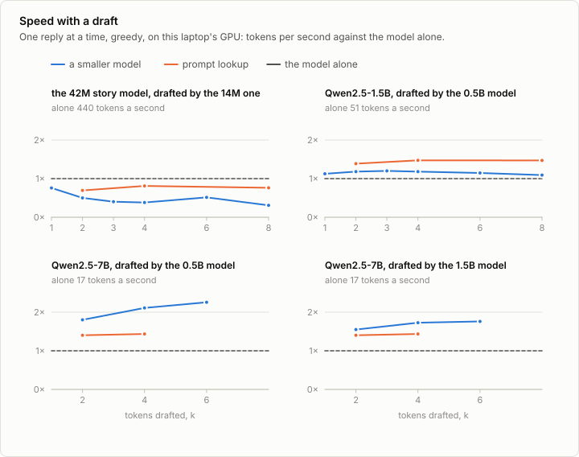
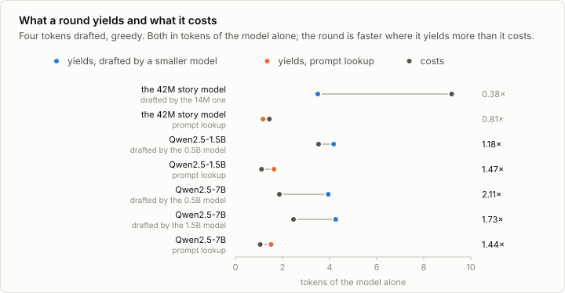

# 4b. Speculative decoding

Code: [`minllm/speculative.py`](../minllm/speculative.py) ·
Script: [`scripts/bench_speculative.py`](../scripts/bench_speculative.py) ·
Tests: [`tests/test_speculative.py`](../tests/test_speculative.py) ·
Results: [`runs/bench/`](../runs/bench/)

This is a side topic of [stage 4](04-inference.md), not a step of the
pipeline. Stage 4 made generation cheap per token with a KV cache, and fast
for many texts at once by batching them. One text at a time stayed slow:
stage 4 measured that on the GPU the cache gains nothing for a single
sequence, because a pass over one new token is spent on launching the
model's many small operations and on reading its weights, not on
arithmetic. A pass over five new tokens costs about the same.

Speculative decoding uses that. A cheap draft guesses the next few tokens.
The model checks all of them in one pass, keeps the ones it agrees with, and
adds one of its own. When the draft is often right, a pass yields several
tokens. And what comes out is exactly what the model alone would have
written: the draft decides only how fast.

## Draft, check, keep



One round, with a draft length of k:

1. The draft proposes k tokens, d1 to dk, one after another.
2. The model reads the text and all k draft tokens in one pass. Its causal
   attention gives it, at every position, the distribution it would have had
   there anyway: after the text, after d1, after d1 d2, and so on, k + 1
   distributions in all.
3. It goes through the draft in order. Where it would have picked the same
   token, the token is kept. At the first one it would not have picked, the
   draft stops counting, and the model's own token goes there instead. If
   every draft token is kept, the last distribution gives one more token for
   free.

So a round costs one pass of the model and k steps of the draft, and yields
between 1 and k + 1 tokens. Both models keep a KV cache of everything kept;
the rejected tokens are dropped from it (`KVCache.crop`) and overwritten by
the next round.

When decoding greedily, "would have picked" means: is it the likeliest token.
The output is then the model's greedy output, token for token, whatever the
draft is. `test_greedy_speculation_writes_what_the_model_writes` checks this
for both drafts and several k, in 32-bit floats on the CPU; on a GPU in
16-bit floats the arithmetic itself gets in the way, as the measurements
below show.

## Sampling without changing the distribution

Sampling is harder. The model would not have picked a fixed token; it would
have drawn one. Leviathan et al. (2022) and Chen et al. (2023) found the rule
that keeps the result distributed exactly as the model's own samples. Draft
token d, drawn by the draft with probability q(d), is kept with probability

    min(1, p(d) / q(d))

where p is the model's distribution at that position. A token the model
likes at least as much as the draft does is always kept. One it likes less
is kept as often as the model would have picked it. And when one is
rejected, the replacement is drawn from

    max(0, p - q), normalized

the probability that the draft took away from tokens the model wanted.
Summed over both ways a token can come out, kept from the draft or drawn as
the replacement, every token has exactly its probability under p. `accept`
is these lines; `test_sampling_keeps_the_models_distribution` samples
40,000 rounds and checks the first token against p.

## Two drafts

**A smaller model** with the same tokenizer. Qwen2.5 comes in sizes that
share one vocabulary, so the 0.5B model of stage 5 can draft for the 1.5B
model of [7b](07b-judge.md) and for Qwen2.5-7B-Instruct, which loads into
the same model code. The draft has to be much cheaper than the model to
pay: k of its passes go into every round.

**No model at all.** A reply often repeats its prompt: a solution copies the
numbers and names of its problem, an edit copies most of a file. Prompt
lookup (Saxena, 2023) finds the last earlier place where the text's final
few tokens occur and proposes what followed them there. It costs nothing
but the search, and proposes nothing when the text does not repeat. Its
proposal is certain, a q that puts all its probability on one token, and
the same rule applies.

## When it pays on a laptop

Each pair was measured one reply at a time on this laptop's GPU, in 16-bit
floats: the 1.5B model on ten of GSM8K's test problems with up to 256 new
tokens, the 7B model on five, and the story models of
[3a](03a-distillation.md), the 42M model drafted by the 14M one, on ten
story openings with up to 200 tokens. Every case ran three times, each in a
fresh process, and the fastest is kept.



**It pays where the model's pass is slow.** Qwen2.5-7B alone writes 16.9
tokens a second, a pass every 59 milliseconds. Drafted by the 0.5B model, it
writes 38.2 at k = 6, 2.26 times as fast: 69% of the drafted tokens are
kept, and a pass of the model yields 5.07 tokens. The 1.5B model as the
draft is kept more often, 76%, and pays less, 1.76 times, because its own
passes cost more. The 1.5B model alone writes 51.4 tokens a second, and the
0.5B draft, kept 80% of the time at k = 4, makes it only 1.18 times as fast.
The story models are slower with a draft at every k: 0.76 of the model's
speed at k = 1, and 0.38 at k = 4.



**A round has to cost less than it yields.** Counted in tokens of the model
alone, a round of four drafted tokens costs 1.87 for the 7B model drafted by
the 0.5B one, a fifteenth of its size, and 2.47 drafted by the 1.5B model.
It costs 3.53 for the 1.5B model drafted by the 0.5B one, a third of its
size. And it costs 9.19 for the story models, where a pass takes about 2
milliseconds, and every token the draft proposes or the model checks is a
step in Python that waits for the GPU's answer. At that size the steps
around the passes cost more than the passes save. A smaller draft
pays only where it is much cheaper than the model.

**Prompt lookup costs almost nothing.** With no model to run, a round of
four costs 1.05 tokens of the 7B model and 1.11 of the 1.5B model. It is
kept less often, 20% and 23% of its tokens, and yields 1.5 and 1.6 tokens
a pass on GSM8K, where a solution copies the numbers of its problem. That is
enough for 1.44 and 1.47 times the speed, the most for the 1.5B model. The
stories do not repeat their opening: lookup keeps 9% there, yields 1.17
tokens a pass, and runs at 0.81 of the model's speed.

**Sampling keeps fewer, for the 1.5B model clearly.** At temperature 1 and
k = 4 the 0.5B draft is kept 70% of the time for the 1.5B model, against 80%
greedy, and 73% for the 7B model, against 74%. The 7B model still samples
2.08 times as fast.

## The model's own tokens, and the GPU's

Greedy, the replies with a draft should be the model's own, token for
token. In 16-bit floats on the GPU they are not all: 0 to 2 of the 7B
model's 5 replies are, depending on the case, 1 to 6 of the 1.5B model's 10,
and 5 to 9 of the story model's 10. Where they part, they part at nearly the
same token whatever the draft: at k = 4 the 7B model's five replies part at
tokens 19, 145, 146, 83 and 34 with the 0.5B draft and with the 1.5B draft,
and at 24, 145, 146, 83 and 34 with prompt lookup. So it is not the draft
that is to blame but the check. A pass over several tokens need not add up
its 16-bit numbers in the order a pass over one token does, the results
differ in their last bits, and at a near tie between two tokens that can
tip the choice; from there the replies go their own ways.

In 32-bit floats on the same GPU, every reply is the model's own: all 10 of
the 1.5B model's with either draft at k = 4, and all 10 of the story
model's in each of the five cases rerun, at k = 1, 4 and 8. So are the
story model's in 16-bit floats on the CPU. It is what
[9c](09c-reasoning.md) found for batches: a greedy reply is reproducible
only in the same arithmetic, and on a GPU the shape of the work is part of
the arithmetic. The draft decides only the speed.

## Run it

The story models are those of [3a](03a-distillation.md): `out/wide` is its
teacher, which [2a](02a-moe.md) trains as well, and `out/base` is stage 3's
model. The 0.5B model is stage 5's, and the 1.5B model is
[7b](07b-judge.md)'s, downloaded by the first command.

```sh
uv run python -c "from minllm import pretrained; pretrained.download('data/qwen2.5-1.5b-instruct', 'Qwen/Qwen2.5-1.5B-Instruct')"   # 3 GB
uv run scripts/bench_speculative.py --target out/wide --draft out/base --max-new-tokens 200   # the story models of 3a
uv run scripts/bench_speculative.py --target data/qwen2.5-1.5b-instruct --draft qwen          # the 1.5B model, drafted by the 0.5B one
uv run scripts/bench_speculative.py --target data/qwen2.5-7b-instruct --draft qwen --n 5 --ks 2,4,6
uv run scripts/bench_speculative.py --target data/qwen2.5-7b-instruct --draft data/qwen2.5-1.5b-instruct --n 5 --ks 2,4,6 \
    --out runs/bench/speculative-qwen2.5-7b-instruct-draft-1.5b-mps.json
uv run scripts/bench_speculative.py --target out/wide --draft out/base --max-new-tokens 200 --ks 1,4,8 --dtype float32 --repeats 1 \
    --out runs/bench/speculative-wide-mps-float32.json                                     # the same replies in 32-bit floats
MINLLM_DEVICE=cpu uv run scripts/bench_speculative.py --target out/wide --draft out/base --max-new-tokens 200 --ks 1,4,8 --dtype bfloat16 --repeats 1 \
    --out runs/bench/speculative-wide-cpu-bfloat16.json                                    # and on the CPU
uv run scripts/bench_speculative.py --target data/qwen2.5-1.5b-instruct --draft qwen --ks 4 --dtype float32 --repeats 1 \
    --out runs/bench/speculative-qwen2.5-1.5b-instruct-mps-float32.json
uv run scripts/analyze_speculative.py                                                     # speeds, costs of a round, and the replies compared
```

The runs of the 7B model here raised the cap on the GPU's share of memory
with `MINLLM_MEMORY_FRACTION=0.7` before the commands that load it.

Qwen2.5-7B-Instruct is downloaded with `uv run python -c "from minllm
import pretrained; pretrained.download('data/qwen2.5-7b-instruct',
'Qwen/Qwen2.5-7B-Instruct', shards=True)"`, 15 GB in four files. The
loader builds the model without memory first and gives it the published
tensors directly, so that it is never held in 32-bit floats, which would
take 30 GB.

## Exercises

1. Measure how many draft tokens are kept at temperature 0, 0.7 and 1.
   Why does sampling keep fewer?
2. Make the draft length adaptive: lengthen it after a round in which every
   token was kept, shorten it after one in which the first was rejected.
3. Prompt lookup proposes nothing when the text does not repeat. Use it
   where it finds a match and the 0.5B draft elsewhere.
4. Batch speculative decoding: several sequences, each with its own number
   of kept tokens. What does it do to the padding, and to the speed?
5. Distill the draft from the model (as in [3a](03a-distillation.md)) on the
   model's own replies to GSM8K. Does the share of kept tokens rise?

## In practice

- **Serving stacks have it built in.** vLLM, SGLang, TensorRT-LLM and
  llama.cpp run speculative decoding with a draft model, prompt lookup, or
  heads trained for it.
- **Drafts built into the model.** Medusa (Cai et al., 2024) adds a few
  output heads that each predict a token further ahead, and EAGLE (Li et al.,
  2024) a small layer that drafts from the model's own last hidden state. No
  second model needs to be loaded, and the draft knows what the model knows.
- **Batches change the trade.** A server that batches many requests is no
  longer limited by the cost of one pass for one sequence, and the draft's
  passes are no longer nearly free. Speculation helps most where batches
  are small: on a laptop, and for the first requests of a quiet server.
- **The output is the model's.** Because the rule keeps the model's
  distribution, speculation needs no new evaluation: only the speed changes.
  On a GPU in 16-bit floats, a reply with a draft differs from the model's
  own as a reply batched differently does: in the last bits, and at near
  ties.

## References

- Leviathan, Kalman and Matias (2022), [Fast Inference from Transformers via Speculative Decoding](https://arxiv.org/abs/2211.17192). The rule that keeps a draft token with probability min(1, p/q), and resamples from what is left, so that the output is distributed as the model's own.
- Chen et al. (2023), [Accelerating Large Language Model Decoding with Speculative Sampling](https://arxiv.org/abs/2302.01318). The same rule, found at the same time, measured on a 70B model with a 4B draft.
- Stern, Shazeer and Uszkoreit (2018), [Blockwise Parallel Decoding for Deep Autoregressive Models](https://arxiv.org/abs/1811.03115). Guessing several tokens and checking them in one pass, for greedy decoding.
- Saxena (2023), [Prompt Lookup Decoding](https://github.com/apoorvumang/prompt-lookup-decoding). The draft taken from the text itself.
- Cai et al. (2024), [Medusa: Simple LLM Inference Acceleration Framework with Multiple Decoding Heads](https://arxiv.org/abs/2401.10774). Extra output heads as the draft.
- Li et al. (2024), [EAGLE: Speculative Sampling Requires Rethinking Feature Uncertainty](https://arxiv.org/abs/2401.15077). A draft that reads the model's last hidden state.
