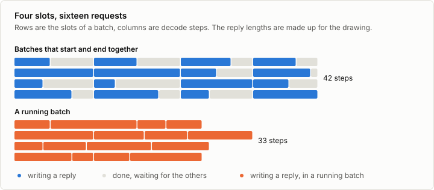
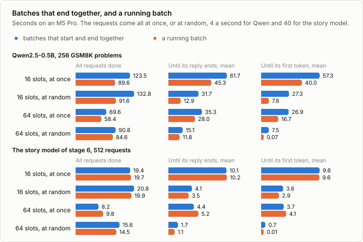

# 4c. Continuous batching

Code: [`minllm/batching.py`](../minllm/batching.py),
[`minllm/model.py`](../minllm/model.py) ·
Scripts: [`scripts/bench_batching.py`](../scripts/bench_batching.py),
[`scripts/serve.py`](../scripts/serve.py) ·
Tests: [`tests/test_batching.py`](../tests/test_batching.py) ·
Results: [`runs/bench/`](../runs/bench/)

This is a side topic of [stage 4](04-inference.md), not a step of the
pipeline. Stage 4 found that a second sequence in a batch is almost free on
a GPU, and generated many texts at once with `stream`. Those texts start
together, and the batch ends when the longest of them ends. A row that
finished early takes part in every step until then, and nothing new can
join. For a list of prompts known in advance that is fine. A server gets
requests at any time, of any length, and a short question should not wait
for someone else's long answer.

Continuous batching, which Orca called iteration-level scheduling, lets
requests join and leave a running batch between any two steps. Every
inference server works this way.



## A batch of slots

`Batcher` in `minllm/batching.py` keeps a batch of a fixed number of rows,
the slots, and a queue of waiting requests. Every call to `step` does two
things:

1. **Admit.** For every free slot, the next waiting request is prefilled
   alone, as stage 4 prefills a prompt. Its keys and values are copied into
   the slot, and its first token comes out of the prefill.
2. **Decode.** One token for every slot at once, in one forward pass. A
   request that samples a stop token, or reaches its limit, leaves, and its
   slot is free at the next step.

A free slot is computed along with the others and its output ignored, so the
batch keeps its shape. The state of the slots, which request is in each and
how long it is, stays on the CPU and goes to the GPU once per step.

## Every row at its own position

In `stream` every row is at the same position: prompts are padded on the
left to one length, and all rows advance together. In a running batch, a row
that joined a moment ago is at position 40 while its neighbor is at 300. Two
things that stage 4 shared across the batch become one per row.

- **Rotary angles.** `Transformer.hidden` takes a position per row from the
  cache of the slots and gathers every row's angles from the table, where
  stage 4 took one slice for all.
- **The mask.** Every row attends to the keys of its own slot up to its own
  length. The keys are stored up to the longest slot, and the mask hides the
  rest:

```python
mask = torch.arange(self.cache.width, device=self.device) <= self.cache.pos[:, None]
```

The cache of a slot is written where its row is: one indexed write per
layer, for all rows at once.

```python
self.k[rows, :, self.cache.pos] = k[:, :, 0]
```

`test_a_running_batch_gives_what_each_request_gives_alone` holds this
together: five requests through two slots, three of them joining a batch
already under way, give exactly what each gives alone, in 32-bit floats on
the CPU.

## What it costs

- **A prefill per request.** Stage 4 prefills a whole batch in one pass.
  Here a request is prefilled alone when it is admitted, which costs about
  one forward pass each.
- **Memory reserved in full.** A slot is allocated for the longest sequence
  it may hold, prompt and reply, because nobody knows in advance how long a
  reply will be. Most replies are shorter, and the rest of their slot is
  reserved and unused.

## What it gains

`scripts/bench_batching.py` answers the same requests in both ways, with
greedy replies. Batches that start and end together are stage 4's `stream`:
when the GPU is free, the requests that have arrived, up to the number of
slots, start as one batch, and the batch runs until its longest reply has
ended. The running batch is `Batcher`. The requests come all at once, or at
random, as a server gets them: independently of each other, at a given rate
on average.

```sh
uv run scripts/bench_batching.py        # Qwen2.5-0.5B, 256 GSM8K problems, 4 a second when at random
uv run scripts/bench_batching.py --model out/sft-words --task words --n 512 --rate 40
```

The first needs the weights of [stage 5](05-pretrained.md), the second the
fine-tuned story model of [stage 6](06-finetuning.md). The first took 12
minutes here, the second 2.



| Qwen2.5-0.5B, seconds | All done | Until a reply ends, mean | Until its first token, mean |
|---|---|---|---|
| 16 slots, at once, ending together | 123.5 | 61.7 | 57.3 |
| 16 slots, at once, running | 89.6 | 45.3 | 40.0 |
| 16 slots, at random, ending together | 132.8 | 31.7 | 27.3 |
| 16 slots, at random, running | 91.6 | 12.9 | 7.6 |
| 64 slots, at once, ending together | 69.6 | 35.3 | 26.9 |
| 64 slots, at once, running | 58.4 | 28.0 | 16.7 |
| 64 slots, at random, ending together | 90.8 | 15.1 | 7.5 |
| 64 slots, at random, running | 84.6 | 11.8 | 0.07 |

**With replies of different lengths, the running batch is ahead in every
case.** Qwen's replies are 294 tokens long on average and up to the limit of
512, which 13 of them reach. A batch that ends together runs as long as its
longest reply. With 16 slots and every request there at the start, that
makes 7,711 steps, where the running batch takes 4,874, close to the 4,671
of 16 rows that are always full. It ends all 256 requests in 89.6 seconds
instead of 123.5.

**When the requests arrive over time, each waits far less.** A request that
arrives just after a batch has started waits for the whole batch to end. In
the running batch it waits for the first free slot. At 4 requests a second
and 16 slots, a request gets its first token after 7.6 seconds instead of
27.3, and its whole reply after 12.9 instead of 31.7. Neither way keeps up
there: the requests ask for about 1,180 tokens a second, more than either
writes with 16 slots, and a queue forms. With 64 slots a slot is almost
always free, and the first token comes after 0.07 seconds instead of 7.5.

| The story model, seconds | All done | Until a reply ends, mean | Until its first token, mean |
|---|---|---|---|
| 16 slots, at once, ending together | 19.4 | 10.1 | 9.6 |
| 16 slots, at once, running | 19.7 | 10.2 | 9.6 |
| 16 slots, at random, ending together | 20.8 | 4.1 | 3.6 |
| 16 slots, at random, running | 19.9 | 3.5 | 2.9 |
| 64 slots, at once, ending together | 8.2 | 4.4 | 3.7 |
| 64 slots, at once, running | 9.8 | 5.2 | 4.1 |
| 64 slots, at random, ending together | 15.6 | 1.7 | 0.69 |
| 64 slots, at random, running | 14.5 | 1.1 | 0.01 |

**With replies of similar length, on the small model, it gains little.** The
story model's replies are 159 tokens on average and 217 at most, so a batch
that ends together wastes less. And for the 14M model a forward pass costs
about as much for one row as for 64, which stage 4 measured, so the prefill
of every request on its own costs about a step each. With 64 slots and every
request at once, the running batch takes 1,384 steps and 512 prefills, where
the batches that end together take 1,648 steps, and it ends later, after 9.8
seconds instead of 8.2. When the requests arrive over time it still answers
sooner: the first token after 0.01 seconds instead of 0.69, the whole reply
after 1.1 instead of 1.7.

**In 16-bit floats, a greedy reply depends on its batch.** A greedy reply
should be the same whichever way it is batched, and for all 512 requests to
the story model it is. Of Qwen's 256, 158 replies from the running batch
with 16 slots differ somewhere from those of batches of 16 that end
together, and even those batches, filled at once and at random, differ in
32. Qwen runs in bfloat16, where a sum depends on the order in which its
terms are added, and that order depends on the shape of the batch. Where two
tokens are almost tied, the other one comes out, and the rest of the reply
follows it. In 32-bit floats on the CPU, the test above gets exactly the
reply of each request alone.

## The server

`scripts/serve.py`, the OpenAI-compatible server of stage 10, now answers
requests that arrive together together. One thread owns the GPU and the
`Batcher`: whenever there is work it takes a step, and hands every new
token to the request it belongs to. Each request runs in a thread of the
HTTP server, adds itself to the batcher's queue and turns its tokens into
text as they come, streamed or not.

```sh
uv run scripts/serve.py --model out/sft-words --slots 16
```

A request brings its own temperature and `top_p`, so a running batch samples
every row its own way: `sample_rows` divides each row's logits by its own
temperature and cuts each at its own `top_p`, and takes the likeliest token
where the temperature is 0. `--context` bounds what a slot holds, prompt and
reply, since every slot is allocated for that many tokens.

## Exercises

1. Admit several waiting requests in one padded prefill, instead of one at a
   time. Does the running batch then beat batches that end together on the
   story model, with 64 slots and every request at once?
2. Measure the waste of reserving full slots: for the replies of the
   benchmark, the share of reserved cache entries that were ever written.
   Then give the cache out in blocks of 16 tokens as a request grows, as
   vLLM does, and compare.
3. Run the benchmark at arrival rates of 1, 2, 4 and 8 requests a second.
   Where does each kind of batching stop keeping up?
4. Give `Batcher` a limit on the tokens in flight rather than on the number
   of requests, and admit a request only while the cache has room for it.
5. Two requests that share a long prompt prefill it twice. Keep the keys and
   values of a prompt, and copy them into a new slot when the same prompt
   comes again.

## In practice

- **Every inference server** schedules this way, between decode steps: vLLM,
  SGLang, TensorRT-LLM and Hugging Face's TGI among them.
- **The cache is given out in pages.** vLLM's PagedAttention stores a
  sequence's keys and values in blocks of a few tokens, taken from a common
  pool as the sequence grows, where earlier systems reserved room for the
  longest possible reply. In the systems its authors measured before it,
  only 20.4% to 38.2% of the cache memory held keys and values of actual
  tokens.
- **Long prompts are prefilled in chunks.** A prompt of thousands of tokens
  prefilled in one pass stalls every request that is decoding meanwhile.
  Sarathi-Serve splits the prefill into chunks and runs each chunk in the
  same step as the decoding of the others.
- **Prefill and decode can go to different GPUs**, since one is limited by
  arithmetic and the other by memory, as DistServe does.
- **Shared prompts are prefilled once.** SGLang keeps the cache of prompt
  prefixes in a tree, and a request that starts like an earlier one reuses
  it: a long system prompt is computed once for all.

## References

- Yu et al. (2022), [Orca: A Distributed Serving System for Transformer-Based Generative Models](https://www.usenix.org/conference/osdi22/presentation/yu), OSDI. Iteration-level scheduling: a finished request leaves the batch, and a new one joins, between two iterations.
- Kwon et al. (2023), [Efficient Memory Management for Large Language Model Serving with PagedAttention](https://arxiv.org/abs/2309.06180). vLLM: the cache in fixed-size blocks, and how much memory reserving it in full wastes.
- Agrawal et al. (2024), [Taming Throughput-Latency Tradeoff in LLM Inference with Sarathi-Serve](https://arxiv.org/abs/2403.02310). Chunked prefills, run in the same steps as the decoding of other requests.
- Zhong et al. (2024), [DistServe: Disaggregating Prefill and Decoding for Goodput-optimized Large Language Model Serving](https://arxiv.org/abs/2401.09670). Prefill and decoding on different GPUs.
- Zheng et al. (2023), [SGLang: Efficient Execution of Structured Language Model Programs](https://arxiv.org/abs/2312.07104). RadixAttention: the cache of shared prefixes reused across requests.
