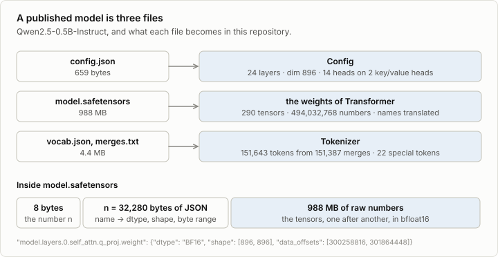
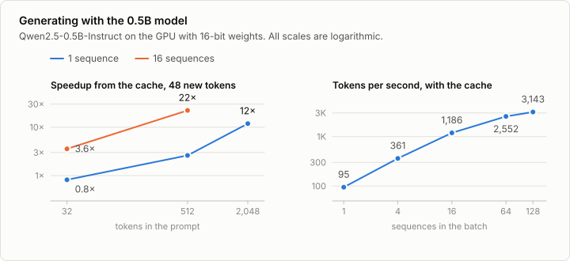
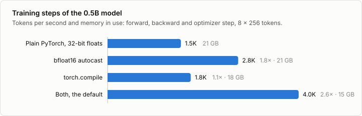

# 5. Pretrained weights

Code: [`minllm/pretrained.py`](../minllm/pretrained.py),
[`minllm/chat.py`](../minllm/chat.py) ·
Scripts: [`scripts/download_qwen.py`](../scripts/download_qwen.py),
[`scripts/chat.py`](../scripts/chat.py),
[`scripts/make_reference.py`](../scripts/make_reference.py) ·
Tests: [`tests/test_pretrained.py`](../tests/test_pretrained.py)

The model of stage 3 writes children's stories and knows nothing else. The
stages that follow improve a model on tasks, and for that they need a model
that already knows something. Training one is far out of a laptop's reach.
Downloading one takes a minute.

This stage loads Qwen2.5-0.5B-Instruct, an open model with 494 million
parameters, into the model code of stage 2, and proves that the result
computes what the reference implementation computes. Nothing about the model
stays hidden behind a library.

## A published model is three files



**The configuration** gives the numbers that stage 2 called `Config`. Qwen's
are in the table of that note: 24 layers, width 896, 14 query heads on 2
key/value heads, a vocabulary of 151,936.

**The weights** are in the safetensors format, which is as simple as a format
can be: 8 bytes that give the length of a header, the header as JSON, then
the raw numbers. The header says for every tensor its type, its shape and
which bytes are its own. `read_safetensors` is a dozen lines. The format exists
because its predecessor, Python's pickle, can run arbitrary code when a file
is loaded. This one cannot: it is data and nothing else.

**The tokenizer** is a byte-level BPE, the algorithm of stage 1, stored as a
vocabulary and a list of merges.

## Fitting the weights

`load_model` builds a `Transformer` from the configuration and fills it with
the file's tensors. Two things have to be reconciled.

The names differ. The file calls a tensor
`model.layers.0.self_attn.q_proj.weight` and this repository calls it
`layers.0.attn.q_proj.weight`. `to_minllm` translates by dropping a prefix
and making four substitutions.

The architecture differs in one detail: Qwen2.5 has a bias on the query, key
and value projections. That is one new `Config` field, `qkv_bias`, and three
changed lines in `Attention`. Everything else, RMSNorm, the rotary embedding
convention, SwiGLU, grouped-query attention, the tied output layer, matched
already, because stage 2 was written in this family's style.

`load_state_dict` is strict: a tensor that is missing, left over or of the
wrong shape raises an error. That is the first check, and a strong one. All
290 tensors find their place.

By parameter count, the model is 64% MLP, 9% attention and 28% embedding
table. The vocabulary of 151,936 tokens costs 136M parameters, which matters
again below.

## Fitting the tokenizer

The algorithm is the one from stage 1. The differences are bookkeeping:

- **Token ids.** A tokenizer trained here numbers the bytes 0 to 255 and the
  merges from 256 up. Qwen's vocabulary has its own numbering: the byte `!` is
  token 0 and the space is token 220. `Tokenizer` now takes the ids of the 256
  bytes as an argument, and orders merges by their rank instead of their id.
- **The file format.** The vocabulary file must write every token as text,
  including tokens that are not valid text, such as half of a Chinese
  character. It follows GPT-2's convention of spelling each of the 256 bytes
  as one printable character: the space becomes `Ġ`, the newline `Ċ`.
  `gpt2_alphabet` rebuilds that mapping.
- **Splitting.** Qwen's pattern splits numbers into single digits, where the
  one in stage 1 keeps up to three together. So `1234` is four tokens.
- **Normalization.** Text is put into Unicode's NFC form first, so that an `é`
  typed as one character and one typed as `e` plus an accent get the same
  tokens.
- **Special tokens.** 22 of them, among them the `<|endoftext|>`,
  `<|im_start|>` and `<|im_end|>` that stage 1 reserved under the same names.

## The chat format

Qwen is the same kind of next-token predictor as the story model. It is a chat
model because it was trained on conversations written in one fixed format,
ChatML:

```
<|im_start|>system
You are Qwen, created by Alibaba Cloud. You are a helpful assistant.<|im_end|>
<|im_start|>user
What is the capital of France?<|im_end|>
<|im_start|>assistant
```

After this prefix, the likeliest continuation is an answer, and the model ends
it with `<|im_end|>`, where generation stops. `render` in `minllm/chat.py`
writes a list of messages in this format. There is no chat API inside the
model, only text.

`chat.encode` turns a conversation into token ids, and only the markers it
writes itself become control tokens. The content of a message goes through
`encode_ordinary`, the function stage 1 built for text that is not trusted.
Otherwise a user could type `<|im_end|>` and continue in the system's voice.
`test_chat_encoding` tries exactly that.

## Is it the same model?

Loading without an error does not prove that the model computes the right
thing. A rotary embedding with the wrong convention or an epsilon in the
wrong place still gives fluent text, only worse. So the tests compare
against the reference implementation, Hugging Face transformers:

| Test | What must agree |
|---|---|
| `test_chat_format_matches_reference` | The rendered conversation, character for character |
| `test_chat_encoding` | Its token ids |
| `test_tokenizer_matches_reference` | The token ids of 14 texts: English, code, Chinese, Japanese, Korean, emoji, accents, special tokens |
| `test_logits_match_reference` | The ten likeliest next tokens and their logits to within 0.001, and one logit at every position |
| `test_generation_matches_reference` | 32 tokens of greedy generation, token for token |

The reference outputs are recorded once by `scripts/make_reference.py` and
kept in `tests/fixtures/qwen.json`. transformers is not a dependency of this
repository: `uv run --with transformers` installs it for that one command.
The tests that need the 1 GB of weights are skipped when the download is
absent.

## Run it

```sh
uv run scripts/download_qwen.py     # 1 GB
uv run pytest tests/test_pretrained.py
uv run scripts/chat.py
```

```
> My name is Ada. Remember it.
Hello Ada! How can I assist you today?

> What is my name?
Your name is Ada.
```

The model has no memory. The script sends the whole conversation again at
every turn.

What a model of this size can do is uneven. With `--temperature 0`:

| Prompt | Answer | |
|---|---|---|
| What is the capital of France? Answer in one sentence. | The capital of France is Paris. | right |
| What is 17 * 23? Give only the number. | 391 | right |
| What is 48 + 76 - 19? Give only the number. | 95 | wrong, it is 105 |

A task the model gets right some of the time is exactly what the remaining
stages need. Stage 7 measures how often, and stages 8 and 9 raise it.

## Speed and memory on a laptop



Stage 4 found that the cache did nothing for a single sequence of the small
model. With 35 times the parameters, the picture is the same in kind and
shifted: for one sequence after a short prompt there is still no gain, because
a pass of 24 layers costs about 10 ms of overhead before any arithmetic. At 512
tokens of prompt the cache is 2.6 times faster, at 2,048 tokens 12 times, and
for 16 sequences of 512 tokens 22 times. A single sequence generates at about 95 tokens per
second and a batch of 128 at 3,100.



A training step runs at 4,000 tokens per second with both switches of stage 3,
against 100,000 for the small model. That is the budget of the later stages:
a step over a hundred short answers takes a few seconds.

Memory is the tighter limit, and it comes from an unexpected place. A step
over 2,048 tokens takes 15 to 21 GB, and without compilation one over 4,096
does not fit in 26 GB.
The weights with their gradients and optimizer state are 8 GB of that. The
rest is the output layer: 151,936 logits for each position, and several copies
of them on the way through the loss. The later stages compute the loss only
at the positions that need it.

An Apple GPU shares its memory with the rest of the machine, so a step that
is too large does not fail. It pushes every other program into swap.
`pick_device` therefore caps the process at half of the memory the system
recommends, 26 GB on a machine with 64 GB, and a batch that is too large
raises an out-of-memory error. `MINLLM_MEMORY_FRACTION` changes the cap.

## Exercises

1. Break the model on purpose: change `norm_eps` to `1e-5`, or the
   `rope_theta` to 10,000. Chat with it. Then run the tests. Which of the two
   would you have noticed without them?
2. Load the weights in bfloat16 instead of 32-bit floats and compare the
   logits. How large is the difference, and does greedy generation still
   match for 32 tokens?
3. Qwen3-0.6B differs from Qwen2.5 in two ways: its head width is set
   independently of `dim / n_heads`, and it normalizes queries and keys before
   the dot product. Add both as `Config` fields and load it.
4. The embedding table is 28% of the parameters. For the model of stage 3 it
   was 11%. What would it be if this model used a vocabulary of 4,096 tokens?
5. Replace `chat.encode` in `scripts/chat.py` by `tok.encode(chat.render(...))`
   and write a user message that speaks in the system's voice. Does the model
   obey it?

## In practice

`AutoModelForCausalLM.from_pretrained` and `AutoTokenizer.from_pretrained` in
transformers do what `load_model` and `load_tokenizer` do here, for every
published architecture, with the Hugging Face Hub as the place the files come
from. safetensors has replaced pickle as the standard for weights. For
inference on small machines, weights are converted to GGUF, llama.cpp's
format, usually with the numbers quantized to a few bits each.

Loading a model yourself is rarely needed. Being able to is what tells you
that a model is a list of matrices and a rule for multiplying them.
