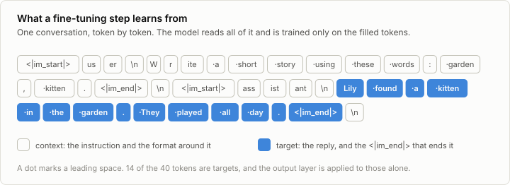
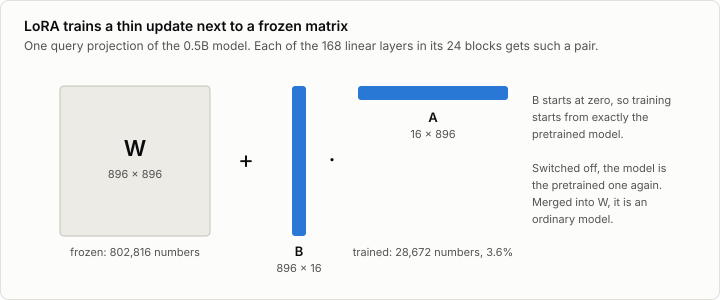
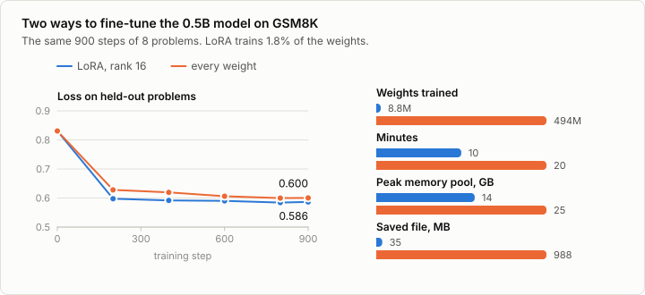

# 6. Fine-tuning

Code: [`minllm/chat.py`](../minllm/chat.py),
[`minllm/lora.py`](../minllm/lora.py),
[`minllm/tasks.py`](../minllm/tasks.py),
[`minllm/checkpoint.py`](../minllm/checkpoint.py) ·
Script: [`scripts/finetune.py`](../scripts/finetune.py) ·
Tests: [`tests/test_lora.py`](../tests/test_lora.py),
[`tests/test_tasks.py`](../tests/test_tasks.py),
[`tests/test_checkpoint.py`](../tests/test_checkpoint.py),
[`tests/test_pretrained.py`](../tests/test_pretrained.py)

Pretraining taught the model what text looks like. Fine-tuning teaches it what
to do: it continues training on examples of the behavior that is wanted. In
the literature this step is called supervised fine-tuning (SFT), or
instruction tuning when the examples are instructions with their answers.

The training step is the one from stage 3. Three things around it change:
the data are conversations, the loss counts only the replies, and the
learning rate is much smaller, because the model is being adjusted and not
built. A fourth change is optional: training a small set of new weights
instead of all the old ones.

## Two tasks

The remaining stages each need a task to work on, one per model.

**Words, for the 14M model.** "Write a short story using these words:
garden, kitten." The examples are cut from TinyStories itself. Take a story,
pick one to three of its less common words, and ask for a story with those
words: the story is then a correct answer. `tasks.words_examples` makes
436,157 such examples from the training text. The task is easy to check by
program, which the later stages depend on.

**GSM8K, for the 0.5B model.** 7,473 grade-school math problems, each with a
worked solution that ends in a line `#### 18`. It is a standard benchmark for
small models, and it has a test split of 1,319 problems that training never
sees.

## Learning only the replies

A conversation in the chat format of stage 5 is mostly not something the
model should learn to write. The instruction is given, and so is the format
around it. Only the reply is the behavior being taught.



`chat.training_example` returns the token ids of a conversation together with
labels: the token itself where the model should learn to produce it, and
`-100`, the value the loss ignores, everywhere else. The closing `<|im_end|>`
of a reply is a target. Leaving it out is the classic bug of fine-tuning: the
model learns to answer and never learns to stop.
`test_training_example_learns_only_the_replies` decodes the labels and checks
that they spell the replies and their ends, and nothing more.

Examples in a batch differ in length and are padded on the right, with `-100`
as the label of the padding. Training needs no extra mask for that. Padding
on the right comes after the real tokens, and the causal mask already keeps
every token from seeing what comes after it.

Masking also saves most of the cost of the output layer. Stage 5 found that
layer to be what limits training memory on the 0.5B model, with 151,936 logits
per position. `Transformer.hidden` returns the vectors that go into the output
layer, and the training step applies that layer only where there is a target:

```python
h = model.hidden(x)                     # (batch, seq, dim), every position
learn = y != -100
logits = model.lm_head(h[learn])        # (targets, vocab), only where something is learned
loss = F.cross_entropy(logits, y[learn])
```

## LoRA

Training all 494 million weights of the larger model works, and costs what it
costs: a gradient and two running averages for each weight, 8 GB before a
single activation is stored, and a 1 GB file for every variant of the model
that is kept.

LoRA trains something much smaller. Fine-tuning changes a weight matrix `W`
into `W + ΔW`. The bet is that `ΔW` does not need the freedom of a full
matrix, because adapting to a task moves the model in few directions. So
`ΔW` is written as a product of two thin matrices, `B A`, of rank `r`:



```python
y = base(x) + (x @ A.T) @ B.T * (alpha / r)
```

`W` is frozen. `A` starts as small random numbers and `B` as zeros, so the
product starts at zero and training begins from exactly the pretrained model.
The factor `alpha / r` sets the size of the update, and is conventionally kept
at 2. With `r = 16` on all seven linear layers of every block, the model
trains 8.8 million numbers, 1.8% of its weights.

`minllm/lora.py` is about 80 lines, and two of its functions matter beyond
this stage:

- `enable(model, False)` switches the adapters off, and the model computes
  what the pretrained model computes. Reinforcement learning needs the
  starting model as a reference to stay close to, and this provides it
  without a second copy in memory.
- `merge(model)` adds `B A` into `W` and removes the adapters, leaving an
  ordinary model for export.

The adapters are also all that needs saving: 35 MB next to the 1 GB of the
model they belong to.

## Run it

```sh
uv run scripts/finetune.py --task words               # 14M model, every weight, 11 minutes
uv run scripts/finetune.py --task gsm8k --lora 16     # 0.5B model through LoRA
uv run scripts/finetune.py --task gsm8k               # 0.5B model, every weight
uv run scripts/finetune.py --task gsm8k --lora 16 --keep-pool --steps 60 --out out/pool-check   # the memory pool left to grow
uv run scripts/chat.py --model out/sft-words --prompt "Write a short story using these words: garden, kitten."
```

### The story model learns an instruction

2,000 steps of 64 conversations at a learning rate of 3e-4, 11 minutes.
Before and after, for the instruction to use *mole* and *protect*, decoded
greedily (`chat.py --temperature 0`, saved in `runs/samples/`):

> **Before.** The mole was so happy that he had found a way to make the
> story. He thanked the wise old owl for the words and flew away.

> **After.** Once upon a time, there was a little mole. The mole lived in a
> hole in the ground. He had many friends, but his best friend was a big,
> strong lion. One day, the mole and the lion were playing near the hole. The
> mole said, "I want to protect my friends. […]"

The base model has never seen the chat format and treats the instruction as
the middle of some story. The fine-tuned one answers it. How well, counted
over 1,000 held-out instructions with the harness of the next stage:

| | Requested words used | All of them used |
|---|---|---|
| Base model | 6.5% | 2.5% |
| Fine-tuned | 39.6% | 20.5% |

Fine-tuning taught the format and part of the task. In four cases out of five
the story still misses a word. More fine-tuning would help, and stage 9 takes
the other route: it rewards the model for the words directly.

### The 0.5B model learns GSM8K, two ways

900 steps of 8 problems each, about one pass over the training set, once
through LoRA and once with every weight trained.



| | LoRA, rank 16 | Every weight |
|---|---|---|
| Weights trained | 8.8M | 494M |
| Learning rate | 2e-4 | 1e-5 |
| Held-out loss, from 0.831 | 0.586 | 0.600 |
| Time | 9.9 minutes | 19.8 minutes |
| Tokens per second | 2,600 | 1,250 |
| Peak memory pool | 14 GB | 25 GB |
| Saved file | 35 MB | 988 MB |

LoRA takes half the time and half the memory and ends at a slightly lower
loss. The comparison is between two sets of defaults, not two tuned methods:
a larger learning rate would likely move the full fine-tune further in the
same steps (exercise 5 looks at the other extreme).

What both runs learned is visible in a single reply. The same held-out
problem, before and after, as the run printed it
(`runs/sft-gsm8k-lora/console.log`):

> **Before.** To determine the number of Kia vehicles on the lot, we can
> follow these steps: 1. **Total number of vehicles on the lot**: 400
> vehicles. 2. **Number of Dodge v**[…]

> **After, LoRA.** There are 400/2=200 Dodge vehicles on the lot. There are
> 200/2=100 Hyundai vehicles on the lot. Thus, there are 100/2=50 Kia vehicles
> on the lot. #### 50

The published model explains at length in its own style. The fine-tuned one
writes like GSM8K's reference solutions, short lines of arithmetic and a
`####` at the end, and that is exactly what the loss asked for: the loss
measures how well the model predicts the reference solutions.

Whether it got better at mathematics is another question. The next stage
asks it, and the answer is not the one the falling loss suggests.

### A memory pool that fills up

The first attempts at these two runs died with an out-of-memory error at the
26 GB cap of stage 5. The cause was the allocator. PyTorch keeps freed GPU
memory in a pool and reuses a block only for a tensor of the same size.
Fine-tuning on examples of varying length gives every step tensors of a new
size, so the pool fills with blocks that are never used again. With
`--keep-pool`, which leaves the pool alone, the LoRA run holds 2.0 GB of
tensors and a pool of 17.6 GB after 10 steps and 22.3 GB after 50
(`runs/pool-check/`). `common.free_memory` empties the pool, and
`finetune.py` calls it every four steps, which kept it under 15 GB for LoRA.
Pretraining never met the problem, because all its batches have one shape.

## Exercises

1. Remove `<|im_end|>` from the targets in `chat.training_example`, fine-tune
   the story model for 300 steps, and chat with it. What does it do at the end
   of a story?
2. Train on every token instead of only the replies (`labels = ids`). Compare
   the held-out loss on the replies, and the memory of a step on the 0.5B
   model.
3. Fine-tune the story model through LoRA with `--lora 16`. How close does it
   come to full fine-tuning? Try rank 2 and rank 64.
4. In `LoRALinear`, initialize `B` randomly instead of with zeros. What is the
   held-out loss at step 0, and why is that a bad start?
5. Fine-tune with the pretraining learning rate, `--lr 1e-3`, on the 0.5B
   model with every weight trained. Watch the held-out loss.

## In practice

Hugging Face `peft` provides LoRA and its relatives for any model, and `trl`'s
`SFTTrainer` wraps the loop of this stage. QLoRA keeps the frozen weights in 4
bits, which lets a laptop adapt models an order of magnitude larger:
the side topic on [quantization](10a-quantization.md) makes such weights,
and one of its exercises puts these adapters on them. The
adapters of different tasks can be stored, swapped and even served side by
side on one copy of the base model, which is how most hosted fine-tuning
works. The side topic [6a](06a-tool-calling.md) uses this stage's recipe
to teach the 0.5B model to call a calculator.

The bugs of this stage are in the data, not the optimizer: a chat format that
differs by one newline from the one the model was trained with, a missing end
token, targets that include the prompt. All three produce a model that
trains without complaint and behaves oddly, and all three are caught by
decoding what the model is actually being trained on.

## References

- Howard and Ruder (2018), [Universal Language Model Fine-tuning for Text Classification](https://arxiv.org/abs/1801.06146). Fine-tuning a pretrained language model as the general recipe for a new task.
- Wei et al. (2021), [Finetuned Language Models Are Zero-Shot Learners](https://arxiv.org/abs/2109.01652). Instruction tuning: fine-tuning on many tasks phrased as instructions makes a model follow new ones.
- Ouyang et al. (2022), [Training language models to follow instructions with human feedback](https://arxiv.org/abs/2203.02155). InstructGPT: supervised fine-tuning on demonstrations as the first step of post-training.
- Wang et al. (2022), [Self-Instruct: Aligning Language Models with Self-Generated Instructions](https://arxiv.org/abs/2212.10560). Instruction data written by a language model.
- Hu et al. (2021), [LoRA: Low-Rank Adaptation of Large Language Models](https://arxiv.org/abs/2106.09685). LoRA: a frozen weight matrix plus a trained update of low rank.
- Dettmers et al. (2023), [QLoRA: Efficient Finetuning of Quantized LLMs](https://arxiv.org/abs/2305.14314). QLoRA: the same adapters on a model whose frozen weights are stored in 4 bits.
- Cobbe et al. (2021), [Training Verifiers to Solve Math Word Problems](https://arxiv.org/abs/2110.14168). GSM8K, the grade-school math problems that the 0.5B model is fine-tuned and tested on.
- Hugging Face, [peft](https://github.com/huggingface/peft). The library that practitioners use for LoRA and its relatives.
