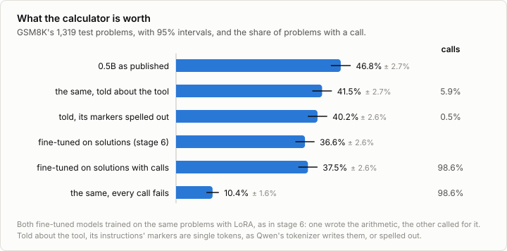

# 6a. Tool calling

Code: [`minllm/tools.py`](../minllm/tools.py) ·
Scripts: [`scripts/finetune.py`](../scripts/finetune.py),
[`scripts/evaluate_tools.py`](../scripts/evaluate_tools.py) ·
Tests: [`tests/test_tools.py`](../tests/test_tools.py) ·
Results: [`runs/eval/`](../runs/eval/), [`runs/sft-gsm8k-tools-lora/`](../runs/sft-gsm8k-tools-lora/)

This is a side topic of [stage 6](06-finetuning.md), not a step of the
pipeline. A model that calls a tool does nothing new: it writes text. The
call is text in a form it was trained on, a program that runs the model
reads it and runs the tool, and the result is written back into the
conversation for the model to go on from. What makes a model use tools
well is training data in which calls and results appear where they help.
So tool calling is fine-tuning, on conversations of a particular shape.

It uses stage 6's fine-tuning and LoRA, stage 7's evaluation, and the form
of [4a](04a-structured-output.md) for its calls.

## A call is text

Qwen2.5 was trained to call tools in one form, and its chat template
spells it out. The tools are listed in the system's turn, each as the JSON
schema of a function:

```
# Tools

You may call one or more functions to assist with the user query.

You are provided with function signatures within <tools></tools> XML tags:
<tools>
{"type": "function", "function": {"name": "calculate", "description": "Evaluate an arithmetic expression and return its value.", "parameters": {...}}}
</tools>

For each function call, return a json object with function name and arguments within <tool_call></tool_call> XML tags:
<tool_call>
{"name": <function-name>, "arguments": <args-json-object>}
</tool_call>
```

A call is a JSON object between `<tool_call>` and `</tool_call>`, which in
the published vocabulary are single control tokens, as `<|im_end|>` is.
The model writes a call and ends its turn. Whoever runs it reads the call,
runs the function, and writes the result into the next turn, in the user's
role, between `<tool_response>` and `</tool_response>`. Then the model
writes its next turn.

`tools.system_prompt` writes the tool list word for word as the template
does, and a test compares the two. `tools.encode` turns a conversation into
tokens with the two markers as control tokens, but only in the assistant's
turns: in anyone else's text they stay characters, for the reason stage 6
gave for `<|im_end|>`. The list of one tool takes 190 tokens of every
prompt, where the plain system prompt takes 16.

## GSM8K came with a calculator

Fine-tuning needs conversations with calls in them. GSM8K's solutions have
them already. Its authors (Cobbe et al., 2021) marked every calculation of
every solution for a calculator:

```
Natalia sold 48/2 = <<48/2=24>>24 clips in May.
Natalia sold 48+24 = <<48+24=72>>72 clips altogether in April and May.
#### 72
```

and ran a calculator while sampling: wherever the model wrote `<<48/2=`,
the calculator wrote `24>>`. Stage 6 stripped the marks and trained on the
rest. `tools.gsm8k_conversations` turns every mark into a call instead:
the text before it is the assistant's, the expression goes into a call to
`calculate`, the calculator's result comes back, and the solution goes on
in the next turn.

```
<|im_start|>assistant
Natalia sold 48/2 =
<tool_call>
{"name": "calculate", "arguments": {"expression": "48/2"}}
</tool_call><|im_end|>
<|im_start|>user
<tool_response>
24
</tool_response><|im_end|>
<|im_start|>assistant
24 clips in May.
Natalia sold 48+24 =
<tool_call>
{"name": "calculate", "arguments": {"expression": "48+24"}}
</tool_call><|im_end|>
...
```

The 7,473 training solutions become conversations with 23,716 calls, three
per problem on average. The calculator is `tools.calculate`, which reads
numbers, the operators and parentheses with Python's parser and evaluates
nothing else. Run on the 23,716 marked expressions, it gives the marked result
for every one, to the precision the solution wrote it in.

Training uses stage 6's LoRA recipe unchanged: rank 16, 900 steps of 8,
the same learning rate, on the same problems. `finetune.py --task
gsm8k-tools` keeps exactly the problems that `--task gsm8k` keeps, so that
the two models differ in one thing: whether the arithmetic was written by
the model or returned by the tool. As in stage 6 only the assistant's turns
are learned, its calls included. The tool's results are context: the model
is not trained to write what the calculator says, but to read it.

## The loop

`tools.run` answers a batch of problems by rounds. A round generates the
next turn of every conversation still open, with stage 4's batched
generation. A turn that contains calls gets their results in a user's
turn, and its conversation stays open. A turn without calls is the answer.
A malformed call, one that is not a JSON object with a name and arguments,
gets an error message as its result, and the model may try again.

The answer is scored as in stage 7: the number after `####`, or the last
number, of what the assistant wrote, its calls left out.

## What the tool is worth

Its answer to the first test problem, "Janet’s ducks lay 16 eggs per day. She eats three for breakfast every morning and bakes muffins for her friends every day with four. She sells the remainder at the farmers' market daily for $2 per fresh duck egg. How much in dollars does she make every day at the farmers' market?":

```
<|im_start|>assistant
First find the total number of eggs the ducks lay per day: 16 eggs/day * 3 eggs/day =
<tool_call>
{"name": "calculate", "arguments": {"expression": "16*3"}}
</tool_call><|im_end|>
<|im_start|>user
<tool_response>
48
</tool_response><|im_end|>
<|im_start|>assistant
48 eggs
Then find the total number of eggs she eats for breakfast: 3 eggs/day * 7 days =
<tool_call>
{"name": "calculate", "arguments": {"expression": "3*7"}}
</tool_call><|im_end|>
<|im_start|>user
<tool_response>
21
</tool_response><|im_end|>
<|im_start|>assistant
21 eggs
Then subtract the number of eggs she eats from the number of eggs she lays to find the number of eggs she sells: 48 eggs - 21 eggs =
<tool_call>
{"name": "calculate", "arguments": {"expression": "48-21"}}
</tool_call><|im_end|>
<|im_start|>user
<tool_response>
27
</tool_response><|im_end|>
<|im_start|>assistant
27 eggs
Then multiply the number of eggs she sells by the price per egg to find her earnings: 27 eggs * $2/egg = $
<tool_call>
{"name": "calculate", "arguments": {"expression": "27*2"}}
</tool_call><|im_end|>
<|im_start|>user
<tool_response>
54
</tool_response><|im_end|>
<|im_start|>assistant
54
#### 54<|im_end|>
```

Every step is a call, and every result is read and carried on. The answer
is wrong all the same, for a reason the calculator cannot see.



| Model | GSM8K solved | Problems with a call |
|---|---|---|
| 0.5B as published (stage 7) | 46.8% ± 2.7% | |
| the same, told about the tool | 40.2% ± 2.6% | 0.5% |
| fine-tuned on solutions, LoRA (stage 6) | 36.6% ± 2.6% | |
| fine-tuned on solutions with calls, LoRA | 37.5% ± 2.6% | 98.6% |
| the same, every call fails | 10.4% ± 1.6% | 98.6% |

**The published model does not use the tool.** Told about the calculator in
exactly the form it was trained on, it calls it in 0.5% of the problems,
and works the rest out in its head as before. Being able to call a tool is
not knowing when to. The 190 tokens of the tool's description cost it all
the same: it solves 6.6 points fewer than
without them (95% interval 3.9 to 9.4).

**The fine-tuned model calls it every time.** It calls the calculator in
98.6% of the problems, 3.4 times each, and none of its 4,464 calls is malformed: the
form is learned as fully as everything else in stage 6's data. After a
result comes back, the model's next turn begins with that result 4,429
times out of 4,464. It reads what the tool says.

**And solves as many problems as before.** Against stage 6's model, trained
on the same problems with the arithmetic written out, the difference is
+0.8 points, with a 95% interval of -1.4 to +3.3: within noise. The calculator
removes the arithmetic mistakes, and arithmetic was not where the model
failed. `scripts/count_calculations.py` checks every calculation that stage
6's model wrote out, such as "48-8+40 = 72", with the calculator: 159 of
its 3,169 are wrong, in 132 of its 1,319 replies. Its wrong answers come mostly
from setting up the wrong calculation, which a calculator carries out
faithfully. In the conversation above, it multiplied the eggs laid per day
by the eggs eaten for breakfast, and the calculator multiplied them right.

**When the calls fail, it fails.** With every call answered by an error,
the same model solves 10.4%. It still calls, 4.1 times a problem, gets the
error, and writes a number of its own, which is wrong in 1,063 of the
2,441 calculations it writes out: it was never trained to compute, only to ask.
Stage 6's model, which was, is wrong in 5.0%. A model trained with a tool
depends on it, and the training data decides what it falls back on when
the tool is gone.

## Run it

```sh
uv run scripts/finetune.py --task gsm8k-tools --lora 16 --accumulate 2   # 86 minutes
uv run scripts/evaluate_tools.py --model out/sft-gsm8k-tools-lora        # the calls run
uv run scripts/evaluate_tools.py --model out/sft-gsm8k-tools-lora --no-execute   # every call fails
uv run scripts/evaluate_tools.py --model qwen --max-new-tokens 512       # the published model, told about the tool
```

## Exercises

1. Train on a mix: half the solutions with calls and half with the
   arithmetic written out, as in stage 6. With the calls failing, does the
   model fall back on its own arithmetic?
2. Train with calls on only the calculations of more than two digits. Does
   the model learn when a call is worth it?
3. Constrain every call with [4a](04a-structured-output.md): the JSON
   between `<tool_call>` and `</tool_call>` held to the tool's schema.
   Here no call was malformed. Does the published model's rare call need it?
4. Give the model a second tool, `percent(part, whole)`, and rewrite the
   training data to use it where the marks compute a percentage. Does it
   choose between the two?
5. Run GRPO from stage 9 on the fine-tuned model, with the calls run during
   the rollouts. Does reinforcement learning fix what the calculator cannot?

## In practice

- **The format is the model's.** Each family of models is trained on its
  own way of listing tools and writing calls: Qwen's `<tool_call>` tags,
  Llama's JSON in a special header, OpenAI's function calls. Serving
  software translates between that and an API's `tools` and `tool_calls`,
  and a model used with another family's format calls badly.
- **Calls are trained, in large numbers.** Post-training data contains
  conversations with tools of many kinds, collected or generated, in which
  calls appear where they help and are absent where they do not. Toolformer
  (Schick et al., 2023) kept a call in its training text only where its
  result made the following text likelier.
- **Calls are often held to their schema** by constrained decoding, as in
  [4a](04a-structured-output.md), so that a call always parses. What the
  arguments mean is still up to the model.
- **The loop is the application.** Whoever runs the model executes the
  calls, decides which tools are allowed, limits how many may be made, and
  hands back errors. Agent frameworks are this loop with more tools and
  longer conversations. ReAct (Yao et al., 2022) interleaves reasoning,
  calls and results, as the conversations here do.
- **Reinforcement learning with tools** trains on whole conversations with
  calls run, rewarded by the final answer, which teaches when to call and
  what to do with a result. It is where tool use in current models is
  improved, and stage 9's GRPO is its core.
- **Costs.** The tool's description is in every prompt: here 190 tokens. And
  a conversation with calls is longer to train on: 86 minutes for the same
  900 steps that took stage 6 10, in two parts per batch to fit in memory.

## References

- Cobbe et al. (2021), [Training Verifiers to Solve Math Word Problems](https://arxiv.org/abs/2110.14168). GSM8K, whose solutions mark every calculation for a calculator, and the calculator that ran them during sampling.
- Schick et al. (2023), [Toolformer: Language Models Can Teach Themselves to Use Tools](https://arxiv.org/abs/2302.04761). A model that learns where to insert calls to a calculator and other tools, from text in which calls that helped were kept.
- Yao et al. (2022), [ReAct: Synergizing Reasoning and Acting in Language Models](https://arxiv.org/abs/2210.03629). Reasoning interleaved with actions and their observations, the shape of an agent's loop.
- Qin et al. (2023), [ToolLLM: Facilitating Large Language Models to Master 16000+ Real-world APIs](https://arxiv.org/abs/2307.16789). Training data for tool use generated at scale, over thousands of real APIs.
- Patil et al. (2023), [Gorilla: Large Language Model Connected with Massive APIs](https://arxiv.org/abs/2305.15334). A model fine-tuned to write correct calls to many APIs, and how often calls are wrong.
- Qwen Team (2024), [Qwen2.5-0.5B-Instruct chat template](https://huggingface.co/Qwen/Qwen2.5-0.5B-Instruct/blob/main/tokenizer_config.json). The format of tool lists, calls and results that the model was trained on.
