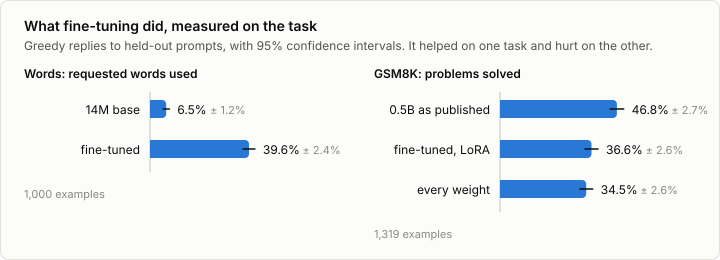

# 7. Evaluation

Code: [`minllm/evaluate.py`](../minllm/evaluate.py),
[`minllm/tasks.py`](../minllm/tasks.py) ·
Script: [`scripts/evaluate.py`](../scripts/evaluate.py) ·
Tests: [`tests/test_evaluate.py`](../tests/test_evaluate.py),
[`tests/test_tasks.py`](../tests/test_tasks.py) ·
Results: [`runs/eval/`](../runs/eval/)

Every stage so far was judged by a loss. A loss says how well the model
predicts text, and nobody wants a model for that. What is wanted is that the
story uses the words and that the answer to the math problem is right. This
stage measures those directly, and everything after it is judged by these
measurements. Reinforcement learning goes one step further and trains on
them.

## What an evaluation consists of

1. **Examples the model has not been trained on.** For GSM8K the test split
   of 1,319 problems, which fine-tuning never touched. For the words task,
   prompts built from held-out stories.
2. **A reply to each**, generated greedily by default. Greedy decoding has no
   randomness, so no seed changes the score. On a GPU the batches still can,
   a little, as the section on comparing two models shows.
3. **A scoring function.** A program that reads a reply and returns a number.
4. **An average, and how far to trust it.**

`evaluate.replies` does the second step with the batched generation of stage
4, sorted by prompt length so that little is wasted on padding.

## The scoring functions

They are short, and each contains decisions.

`tasks.words_score` returns the fraction of the requested words that appear
in the story. A word counts only whole: *gardener* does not satisfy
*garden*. This is strict, and a deliberate choice: the training stories
contain the requested words exactly, so the task as taught is exact.

`tasks.gsm8k_score` compares numbers. The model was asked to end with
`#### <number>`, and the number after the last `####` is its answer. A model
that was never fine-tuned often ignores that format, so if there is no
`####`, the last number in the reply counts. Commas, a dollar sign and a
trailing period are dropped before comparing.

The second rule matters more than it looks, and so does a setting that is not
even part of the scoring function: how long a reply may get. The results
below show both.

## How sure is a score?

The test examples are a sample of all the problems one could ask. A score on
them is an estimate, and it comes with an error:

```
standard error = standard deviation of the scores / sqrt(number of examples)
95% interval   = mean ± 1.96 standard errors
```

For a score near 50%, this is what the number of examples buys:

| Examples | 95% interval |
|---|---|
| 100 | ± 9.8 points |
| 500 | ± 4.4 points |
| 1,319 | ± 2.7 points |
| 5,000 | ± 1.4 points |

Halving the interval takes four times the examples. A gain of two points,
which is a good result for a new training method, is invisible on 500
examples. Gains of that size are reported often, and on small benchmarks they
are inside this interval.

## Comparing two models

There is a much sharper tool when two models are scored on the same examples.
Most of the uncertainty above comes from which examples were drawn: some are
easy, some are hard, and both models share that luck. Looking at the
difference per example removes it.

`evaluate.paired_difference` resamples the examples with replacement 2,000
times and records how the mean difference varies, which is the bootstrap. In
`test_paired_difference`, two models that differ on a single example out of
200 have separate intervals of ± 7 points each, which says nothing, and a
paired interval of about a point.

```sh
uv run scripts/evaluate.py --compare runs/eval/gsm8k-sft-gsm8k-lora.json runs/eval/gsm8k-sft-gsm8k.json
```

```
out/sft-gsm8k-lora             36.6% ± 2.6%
out/sft-gsm8k                  34.5% ± 2.6%
difference -2.1%, 95% interval -4.6% to +0.3%: within noise
```

The two ways of fine-tuning from stage 6 differ by two points, and the
interval of that difference includes zero. On 1,319 problems they cannot be
told apart.

**The interval does not cover the arithmetic.** It measures one thing:
which problems happened to be drawn. On this laptop's GPU, in 16-bit
floats, a greedy reply also depends on the batch it was generated in.
Batched otherwise, the same sums are added in another order, and at a near
tie between two tokens that can tip the choice. The published model, run
greedily twice on the first 500 test problems in different batches, solved
48.6% of them once and 46.6% the other time, and the two runs disagreed on
46 problems; a model with long replies disagreed with itself on 125 of the
500 ([9c](09c-reasoning.md)). In [4b](04b-speculative.md) the shape of a
pass does the same, and 32-bit floats or the CPU do not. So a difference of
a point or two is not settled by its interval alone.

## Results



| Task | Model | Score | 95% interval |
|---|---|---|---|
| Words | 14M base | 6.5% | ± 1.2 |
| | fine-tuned | 39.6% | ± 2.4 |
| GSM8K | 0.5B as published | 46.8% | ± 2.7 |
| | fine-tuned through LoRA | 36.6% | ± 2.6 |
| | fine-tuned, every weight | 34.5% | ± 2.6 |

**On the words task, fine-tuning did what it was meant to do.** The model
uses 39.6% of the requested words where the base model used 6.5%, a
difference of 33.1 points with an interval of 30.4 to 35.7.

**On GSM8K, fine-tuning made the model worse.** It solves 36.6% of the test
problems where the published model solves 46.8%: 10.2 points lost, with an
interval of 7.2 to 13.0. This is the same fine-tuning whose held-out loss
fell from 0.83 to 0.59 in stage 6.

Both facts are true, and the replies show how. This is the first test
problem: Janet's ducks lay 16 eggs a day, she eats three, bakes with four and
sells the rest at $2 each. The published model ends its answer like this,
with its LaTeX markup written out:

> 4. **Calculate the total revenue from selling the eggs:**
>    - Janet sells each egg for $2.
>    - The number of eggs sold is 9.
>    - Therefore, the total revenue is: 9 eggs × 2 dollars/egg = 18 dollars
>
> Thus, Janet makes 18 dollars every day at the farmers' market.

And this is the whole answer of the fine-tuned model:

> First find the total number of eggs the ducks lay per day: 16 eggs/day * 7 days/week = 112 eggs/week\
> Then subtract the number of eggs she eats to find the number of eggs she sells: 112 eggs/week - 3 eggs/meal - 4 eggs/meal = 95 eggs/week\
> Then multiply the number of eggs she sells by the price per egg to find her daily earnings: 95 eggs/week * $2/egg = $190/week\
> #### 190

The published model reasons at length, 920 characters for a typical reply.
The fine-tuned one has learned to write like GSM8K's reference solutions, 211
characters and a `####` at the end in 99% of replies. That is what the loss
rewarded, since the loss measures how well the model predicts those
references. The references are terse, and a small model taught to be terse
skips the steps it needed. The loss went down because the imitation got
better, and the imitation was of the wrong thing.

## One set of replies, three verdicts

The same replies support three different conclusions, depending on two
choices in the evaluation.

| | Published model | Fine-tuned (LoRA) | Verdict on fine-tuning |
|---|---|---|---|
| Strict: no `####`, no credit | 1.1% | 36.6% | a triumph |
| Lenient, replies up to 320 tokens | 41.5% | 36.5% | cost 5 points |
| Lenient, replies up to 512 tokens | 46.8% | 36.6% | cost 10 points |

The strict rule gives the published model 1%, because it writes `####` in 3%
of its replies. Under that rule fine-tuning appears to have taught a model
that could do no arithmetic to solve a third of the problems. What it taught
was a format.

The token limit was a mistake found along the way. The first version of this
evaluation allowed 320 new tokens, a number chosen by looking at fine-tuned
replies. That cut off 460 of the published model's 1,319 replies before they
reached their answer, and it went unnoticed until the script was made to
count them. With 512 tokens, 55 are cut off and the score is 5.3 points
higher. The authors of the model report 49.6, with a setup of their own.

None of the numbers in the table is wrong. Each answers a different
question, and only the last row answers the one that was meant. `evaluate.py`
now prints the number of cut-off replies with every score and saves all
replies to `out/eval/`, because the way to find such things is to read what
the model wrote.

## Run it

```sh
uv run scripts/evaluate.py --model out/base --task words
uv run scripts/evaluate.py --model out/sft-words --task words
uv run scripts/evaluate.py --model qwen --task gsm8k               # 1,319 problems, several minutes
uv run scripts/evaluate.py --model qwen --task gsm8k --max-new-tokens 320 --out runs/eval/gsm8k-qwen-320.json
uv run scripts/evaluate.py --model out/sft-gsm8k-lora --task gsm8k
uv run scripts/evaluate.py --model out/sft-gsm8k-lora --task gsm8k --max-new-tokens 320 --out runs/eval/gsm8k-sft-gsm8k-lora-320.json
uv run scripts/evaluate.py --model out/sft-gsm8k --task gsm8k
```

Each run writes its scores and ten of its replies to `runs/eval/`, and all of
its replies to `out/eval/`. Read them. A score says how often, and only the
replies say why.

## Exercises

1. Evaluate the fine-tuned story model with `--temperature 0.8` under five
   different `--seed` values. How much does the score move between seeds, and
   how does that compare with the interval the script prints?
2. Write a third scoring rule for GSM8K, between strict and lenient: accept a
   number in `\boxed{}` or after "the answer is", and nothing else. Re-score
   all three models from the replies in `out/eval/`. Which rule would you
   defend to someone who doubts your result?
3. Break the words score down by the number of requested words, using the
   `requested_words` field of the result file. Is asking for three words three
   times as hard as asking for one?
4. Evaluate on 200 examples instead of all of them (`--n 200`) and compare the
   LoRA model with the published one. Is the difference still clear? Would the
   difference between LoRA and full fine-tuning be?
5. Evaluate the published model with `--max-new-tokens 1024`. How many
   replies are still cut off, and what do those replies look like?

## In practice

`lm-evaluation-harness` implements several hundred benchmarks behind one
interface, and Inspect does the same for evaluations that involve tools and
several turns. The parts are the ones of this stage: a dataset, a prompt
format, a generation setting and a scorer.

The difficulties are the ones of this stage too. Scores depend on the prompt
wording and on the answer extraction, often by more than the difference
between two models, so numbers from different papers are rarely comparable.
Test sets leak into training data once they are public. And intervals are
seldom reported at all. The side topic [7a](07a-multiple-choice.md)
measures how much the way of asking moves a multiple-choice score, and
[7b](07b-judge.md) measures a language model as the judge of replies that
no program can score.

## References

- Cobbe et al. (2021), [Training Verifiers to Solve Math Word Problems](https://arxiv.org/abs/2110.14168). GSM8K: 1,319 test problems with one number as the answer.
- Efron (1979), [Bootstrap Methods: Another Look at the Jackknife](https://doi.org/10.1214/aos/1176344552), The Annals of Statistics 7(1). The bootstrap: how much an estimate varies, found by resampling the data it was computed from.
- Koehn (2004), [Statistical Significance Tests for Machine Translation Evaluation](https://aclanthology.org/W04-3250/), EMNLP. The paired bootstrap for comparing two systems on the same test set.
- Miller (2024), [Adding Error Bars to Evals: A Statistical Approach to Language Model Evaluations](https://arxiv.org/abs/2411.00640). Standard errors, paired differences and sample sizes for evaluations of language models.
- Biderman et al. (2024), [Lessons from the Trenches on Reproducible Evaluation of Language Models](https://arxiv.org/abs/2405.14782). What makes evaluations of language models hard to reproduce, by the authors of the evaluation harness that most papers use.
- EleutherAI, [lm-evaluation-harness](https://github.com/EleutherAI/lm-evaluation-harness). That harness.
