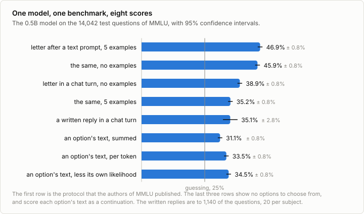
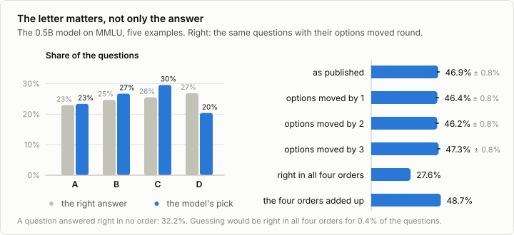
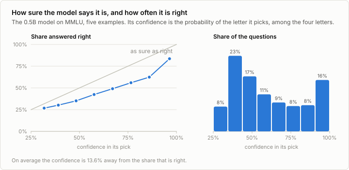
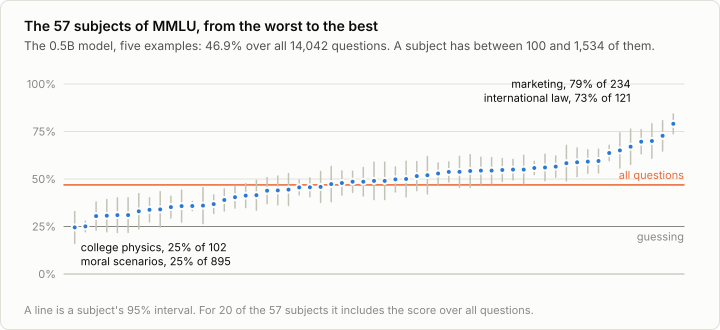
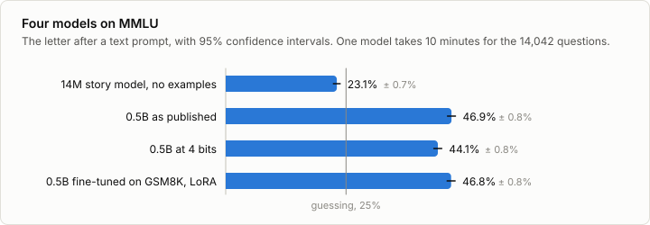

# 7a. Multiple choice

Code: [`minllm/choice.py`](../minllm/choice.py),
[`minllm/tasks.py`](../minllm/tasks.py) ·
Scripts: [`scripts/evaluate_choice.py`](../scripts/evaluate_choice.py),
[`scripts/analyze_choice.py`](../scripts/analyze_choice.py) ·
Tests: [`tests/test_choice.py`](../tests/test_choice.py) ·
Results: [`runs/eval/`](../runs/eval/)

This is a side topic of [stage 7](07-evaluation.md), not a step of the
pipeline. Stage 7 let a model write a reply and had a program read the
answer off it. Most of the benchmark numbers that are quoted for a model are
not made that way. On MMLU, ARC, HellaSwag and their like, the model writes
nothing: a question has a few possible answers, the model gives each a
probability, and the likeliest one is its answer.

It needs stage 7 for the intervals and the paired comparisons, and stage 8
for one function: the log-probability of a continuation, which
reinforcement learning computed to train on. Here it is only read.

## The idea

A question of MMLU, in the prompt that its authors published:

```
The following are multiple choice questions (with answers) about elementary mathematics.

What is the value of p in 24 = 2p?
A. p = 4
B. p = 8
C. p = 12
D. p = 24
Answer:
```

Whatever the model would write next, it has a probability for every token
that could come next, and four of those tokens are ` A`, ` B`, ` C` and
` D`. Comparing those four numbers is the whole evaluation:

```python
logits = model(prompt)[-1]                     # one forward pass, the last position
answer = logits[[id_A, id_B, id_C, id_D]].argmax()
```

`choice.next_token_logprobs` does this for a batch of prompts. For this
question, with five solved examples of the subject before it, the 0.5B
model gives A 43%, B 35%, C 17% and D 5%. Its answer is A, and C is right.

Three things that stage 7 had to deal with are gone:

- **Nothing is sampled or generated.** One forward pass per question, where a
  written reply costs one per token. The 14,042 test questions of MMLU take
  the 0.5B model 10 minutes with five solved examples in every prompt, and 2
  minutes without. The 1,319 replies of GSM8K in stage 7 took 9 minutes.
- **Nothing is parsed.** There is no reply whose answer a rule has to find.
- **No limit cuts the answer off.** Stage 7 lost 5 points to a limit of 320
  tokens.

What takes their place is the subject of this note: the answer now depends
on how the question is put to the model, and the model is asked which
letter is likeliest whether or not it meant to say a letter.

## The benchmark

MMLU (Hendrycks et al., 2021) is 14,042 questions with four options each,
from 57 subjects between high school and professional exams, plus 5 more
questions per subject that may be shown to the model as solved examples.
`tasks.mmlu_examples` reads them from the authors' archive.

Two numbers to hold a score against. Guessing gets 25%. And the right
answers are not spread evenly over the letters: D is right for 26.9% of the
questions and A for 22.9%, so a model that says D to everything gets 26.9%.

The 14M story model of stage 3 knows nothing of any of this, and makes the
first row of the table:

```
out/base on MMLU by letter-plain-0shot: 23.1% ± 0.7% over 14042 questions, 15s
qwen     on MMLU by letter-plain-5shot: 46.9% ± 0.8% over 14042 questions, 629s
```

The second row is the 0.5B model as published, asked the way the authors of
MMLU did: the prompt above as plain text to be continued, with the five
solved examples of the subject before the question. Qwen's own report gives
47.5% for the base model of this size, the one before chat training, so the
harness here measures about what theirs does. The rest of this note keeps
the model and the questions fixed and changes only how the question is
asked and how the answer is read.



## How the question is asked

| Prompt | Solved examples | Score | Probability on the four letters |
|---|---|---|---|
| text to continue | 5 | 46.9% ± 0.8% | 100% |
| text to continue | 0 | 45.9% ± 0.8% | 100% |
| a user's turn in the chat format | 0 | 38.9% ± 0.8% | 37% |
| a user's turn in the chat format | 5 | 35.2% ± 0.8% | 25% |

**The examples add one point.** They are there to show the form of an
answer more than to teach anything, and after `Answer:` the form is already
plain: without any example, all of the model's probability is on the four
letters.

**The chat format costs 7 to 12 points**, on a model that was trained for
chat. The last column says why. It is the probability that the model gives
to the four letters together, of everything it could say next. As plain
text after `Answer:` that is all of it. At the start of an assistant's turn
it is a third or a quarter: asked in a chat, this model does not open with
a letter. Its likeliest next token is `The` for 48% of the questions and
`To` for 19%, the start of an explanation, and one of the four letters
for 30%. The method still compares the four letters, and so reads its
answer from the little probability that is left on them. In that remainder
`A` wins 56% of the time, because `A` is also a word that starts a
sentence.

The examples make it worse here, not better. They sit inside the user's
turn, as text the user wrote, and five of them make the turn look even less
like something to be answered with one letter: `The` then leads for 67%
of the questions, and a letter for 7%.

So the same model has scores from 35.2% to 46.9% on the same questions. A
number from a multiple-choice benchmark is a number about a model and a
prompt, and two of them compare only if the prompt is the same.

## How the answer is read

The letter is one way to read an answer. Two others, on the same questions.

**A written reply.** This is stage 7's way. The question goes into a chat
turn without examples, the model writes up to 96 tokens, and
`choice.read_letter` looks for its answer in the reply: after "answer is"
or "Answer:", or at the start of a line. On 1,140 of the questions, 20 from
each subject:

| The answer is read from | Score |
|---|---|
| the letter after a text prompt, 5 examples | 49.6% |
| the letter at the start of the chat turn | 41.8% |
| the written reply | 35.1% ± 2.8% |

No answer can be read from 312 of the 1,140 replies. They start to
explain, "To determine the degree of the field extension", and are still
explaining when the 96 tokens are used up: stage 7's token limit again.
Of the replies that can be read, 48.3% are right. They are the easier
questions: on the same 828, the letter after a text prompt is right 54.2%
of the time, 5.9 points more (95% interval 2.5 to 9.2). So writing costs
twice. A reply that needs more room than it was given, and a rule to
parse, loses the questions it does not finish; and on those it does
finish, the model picks the right option less often than its letter
does.

**The option's text.** Here the model is shown no options. The prompt is
`Question: ... Answer:`, and each option's text is scored as a continuation
by `choice.continuation_logprobs`, the sum of the log-probabilities of its
tokens. Benchmarks without lettered options are scored this way, such as
the sentence endings of HellaSwag. Three rules for comparing the four sums:

| The answer is the option with | Score |
|---|---|
| the largest sum | 31.1% |
| the largest sum per token | 33.5% |
| the largest sum, less the sum for the same text after `Answer:` alone | 34.5% |

A plain sum favors short options, since every token makes it smaller.
Dividing by the number of tokens corrects for that, and subtracting what
the text scores without the question (Brown et al., 2020) corrects for
options that are likely whatever was asked. Each correction is worth a
point or two. All three stay far below the 46.9% of the letter, and that is
the benchmark's doing: 38% of MMLU's questions say "which of the
following" or the like, and cannot be answered by someone who is not shown
what follows. A way of scoring has to fit how the questions were written.

## The letter matters, not only the answer

After `Answer:` with five examples, the model's answers are spread over the
letters almost as the right answers are. It picks C for 30% of the
questions, where C is right for 26%, and D for 20%, where D is right for
27%. That looks harmless, and the score seems to confirm it. `--rotate 1`
moves every question's options round by one place, so that what stood
under A stands under B, and the score hardly changes:

| Options | Score |
|---|---|
| as published | 46.9% ± 0.8% |
| moved by one place | 46.4% ± 0.8% |
| moved by two | 46.2% ± 0.8% |
| moved by three | 47.3% ± 0.8% |

The four scores agree, and the answers behind them do not:

- Only for 44.5% of the questions does the model pick the same option in
  all four orders. For more than half, which option it chooses depends on
  the letter that the option stands under.
- 27.6% of the questions are answered right in all four orders, 32.2% in
  none, and 40.3% in some. Guessing would be right in all four for 0.4%.
- Whatever the order, the model is right more often when the answer is
  under B or C (51% and 50%) than under A or D (43% and 42%).

A score of 46.9% therefore does not say that the model knows the answer to
46.9% of the questions. It knows about 28% of them whatever the order, and
on a further 40% it is right in some orders and wrong in others. The
average comes out the same every time, because what one letter gains
another loses.

The four orders can also be put to use. Adding up, for each option, the
probability it got in the four places it stood in, and taking the largest
sum, gives 48.7%: the preference for a letter cancels out. It costs four
forward passes per question.



## How sure, and how often right

A written reply is right or wrong. A probability says more: how sure the
model was. Over the four letters, the 0.5B model gives its pick 60.5% on
average, and it is right 46.9% of the time.



If the two matched, the model would be right 60% of the time on questions
where it gives its pick 60%. It is right less often than it is sure, at
every level: 30% of the time where it says 39%, 49% where it says 67%, and
84% where it says 96%. On average its confidence is 13.6 points away from
its accuracy, which is the expected calibration error of Guo et al. (2017).

The order is right all the same. The surer the model, the more often it is
right, and the sixth of the questions on which it is surest it answers
right five times out of six. A system that may decline to answer can use
that: the confidence says where the model is worth listening to, once it
has been corrected by the amount it overstates. Exercise 5 does the
correction with one number.

## 57 subjects



The 57 subjects have between 100 and 1,534 questions each, and half of them
have fewer than 174. With 100 questions the interval of a score is 10
points to either side (stage 7), so a subject's score is a rough number:
for 20 of the 57 subjects the interval includes the score over all
questions, and seven subjects cannot be told from guessing, among them
college physics, college mathematics and abstract algebra. At the other
end are marketing with 79% and international law with 73%.

Moral scenarios, with 895 questions the second largest subject, is at
25.0%. Each of its questions describes two situations and asks whether
each is wrong, and its four options are the four combinations of "wrong"
and "not wrong". Nothing in the letters helps there, and the model does no
better than chance.

A table of 57 scores from one evaluation of a small model is mostly noise
at the level of the single subject, and tables of this kind are published
for every model. The interval belongs next to each number.

## Other models

A score that costs ten minutes can be had for every model that the earlier
stages made.



The 14M story model scores 23.1% ± 0.7%, without examples, since five of
them do not fit its context. The 0.5B model after two things that earlier
notes did to it, compared question by question with `evaluate.py
--compare`:

```
qwen                           46.9% ± 0.8%
out/qwen-q4                    44.1% ± 0.8%
difference -2.8%, 95% interval -3.6% to -2.1%: a real difference

qwen                           46.9% ± 0.8%
out/sft-gsm8k-lora             46.8% ± 0.8%
difference -0.1%, 95% interval -0.6% to +0.5%: within noise
```

**The story model** is below guessing. It says ` A` to 94.5% of the
questions, and A is the right answer for 22.9% of them. A model that has
no idea still produces a score, and where the score lands depends on which
letter it happens to prefer.

**At 4 bits** the 0.5B model loses 2.8 points. In docs/10a-quantization.md
the same rounding cost it a third of its score on GSM8K, from 46.8% to
31.9%. Choosing one of four letters survives the rounding far better than
working through a calculation, where one wrong digit spoils the answer, and
a benchmark of this kind would have called the 4-bit model nearly as good.

**Fine-tuned on GSM8K** through LoRA, the model is where it was. Stage 7
found that this fine-tuning cost 10 points on GSM8K itself, because it
taught a terse style of solution. On what the model knows of law and
history it left no trace.

## Run it

```sh
uv run scripts/evaluate_choice.py --model qwen                           # the authors' protocol, 10 minutes
uv run scripts/evaluate_choice.py --model qwen --shots 0 --format chat   # in a chat turn, 2 minutes
uv run scripts/evaluate_choice.py --model qwen --rotate 1                # the options moved round by one
uv run scripts/evaluate_choice.py --model qwen --method cloze            # each option's text as the continuation
uv run scripts/evaluate_choice.py --model qwen --method generate --shots 0 --per-subject 20
uv run scripts/evaluate.py --compare runs/eval/mmlu-qwen-letter-plain-5shot.json runs/eval/mmlu-qwen-q4-letter-plain-5shot.json
uv run scripts/analyze_choice.py                                         # the numbers of this note, from all of the above
```

The first run downloads the questions, 166 MB.

## Exercises

1. Add "Answer with the letter only." to the chat prompt. How much of the
   probability moves onto the four letters, and how much of the 7 points
   comes back?
2. In the chat format, score the letter with a leading space too, and take
   whichever of the two tokens is likelier for each letter. Does it change
   the score?
3. Put the five examples into the chat as five turns of user and assistant,
   and not into one user turn. This is what harnesses do for chat models.
4. Score the questions with the options in a random order per question, with
   three different seeds. How far apart are the three scores, and how does
   that compare with the interval of one?
5. Calibrate the model with one number: divide the four log-probabilities by
   a temperature before the softmax, and choose the temperature on the 5
   questions per subject that are set aside for examples. How far is the
   confidence from the accuracy afterwards?
6. Evaluate the models of stage 9 that were trained from the 0.5B model.
   Did reinforcement learning on GSM8K change what the model knows about
   history?

## In practice

- **Harnesses.** `lm-evaluation-harness` is what most published numbers come
  from. A task there is a prompt template, the list of continuations to
  score, and a metric; `loglikelihood` is the request that this note
  implements. Its results differ from run to run of the harness by the
  details above, which is why reports name its version and the task's.
- **Reported numbers are not comparable by default.** Whether examples were
  shown, in what format, whether the chat template was applied and how the
  answer was read are choices, and papers make them differently. A
  difference of a few points between two reports of the same model is
  usually one of these.
- **Closed models cannot be scored this way** when their API returns no
  probabilities. For them, and by now for many open models too, the answer
  is generated and read off the reply, as in stage 7, and the two ways of
  reading meet in the same table.
- **Multiple choice is losing ground** as an evaluation. A model can score
  on it without being able to produce the answer, the format invites the
  letter effects shown here, and the public questions leak into training
  data. What replaces it is what stage 7 does: tasks with an answer that a
  program can check, and replies judged by a model.

## References

- Hendrycks et al. (2021), [Measuring Massive Multitask Language Understanding](https://arxiv.org/abs/2009.03300). MMLU: the questions, the five examples per subject and the prompt that this note uses.
- Brown et al. (2020), [Language Models are Few-Shot Learners](https://arxiv.org/abs/2005.14165). GPT-3: solved examples in the prompt, completions scored by their likelihood, and dividing by the likelihood of the completion alone.
- Robinson, Rytting and Wingate (2022), [Leveraging Large Language Models for Multiple Choice Question Answering](https://arxiv.org/abs/2210.12353). Showing the options and scoring a letter against scoring each option's text.
- Zheng et al. (2023), [Large Language Models Are Not Robust Multiple Choice Selectors](https://arxiv.org/abs/2309.03882). Models prefer certain letters, and a way to estimate and remove that preference.
- Pezeshkpour and Hruschka (2023), [Large Language Models Sensitivity to The Order of Options in Multiple-Choice Questions](https://arxiv.org/abs/2308.11483). How much a score moves when the options are reordered.
- Alzahrani et al. (2024), [When Benchmarks are Targets: Revealing the Sensitivity of Large Language Model Leaderboards](https://arxiv.org/abs/2402.01781). Small changes to a multiple-choice format reorder a leaderboard.
- Guo et al. (2017), [On Calibration of Modern Neural Networks](https://arxiv.org/abs/1706.04599). Confidence against accuracy, the measure of the gap, and calibration by a temperature.
- Biderman et al. (2024), [Lessons from the Trenches on Reproducible Evaluation of Language Models](https://arxiv.org/abs/2405.14782). What makes evaluations differ between reports, from the authors of `lm-evaluation-harness`.
- EleutherAI, [lm-evaluation-harness](https://github.com/EleutherAI/lm-evaluation-harness). The harness behind most published benchmark numbers of open models.
- Qwen Team (2024), [Qwen2.5-LLM: Extending the boundary of LLMs](https://qwenlm.github.io/blog/qwen2.5-llm/). The published MMLU score of the 0.5B base model, 47.5%.
