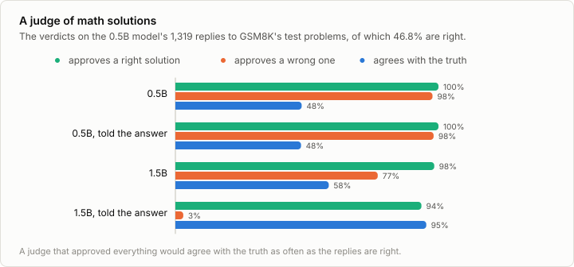
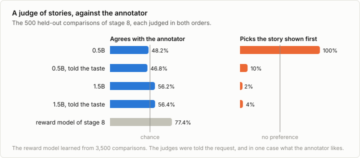

# 7b. Evaluation by a judge

Code: [`minllm/judge.py`](../minllm/judge.py) ·
Scripts: [`scripts/judge.py`](../scripts/judge.py),
[`scripts/analyze_judge.py`](../scripts/analyze_judge.py) ·
Tests: [`tests/test_judge.py`](../tests/test_judge.py) ·
Results: [`runs/judge/`](../runs/judge/)

This is a side topic of [stage 7](07-evaluation.md), not a step of the
pipeline. Stage 7 scored replies with programs: the number is right or it
is not. Most of what is asked of a chat model has no such program. Whether
a story is good, a summary faithful or an answer helpful is a judgment, and
people are slow and expensive judges. So a language model is asked instead.
It reads the task, the reply and what to look for, and gives a verdict.
This is how most chat benchmarks are scored now, and how the preference
data of stage 8 is increasingly made.

A judge is a model like any other, and its verdicts are measurements with
errors. This note measures them, in two places where the true verdict is
known: GSM8K's right answers, and the hidden taste of stage 8's annotator.

## A verdict as a probability

A judge is asked for its verdict as JSON, and the reply is started for it:

```
<|im_start|>assistant
{"correct":
```

Its next token is ` true` or ` false`. `judge.verdicts` reads the two
probabilities in one forward pass and renormalizes them, the way
[7a](07a-multiple-choice.md) reads the four letters. The verdict is then a
number between 0 and 1, and a reply is approved where it is above one half.
Nothing is generated, and nothing can come out in another form.

## Is this solution right?

The first task has a known answer. The replies are the 1,319 that the 0.5B model
wrote to GSM8K's test problems in stage 7, of which 46.8% are right. A judge
reads the problem and a reply and says whether its final answer is right.
Two judges: the 0.5B model itself, and Qwen2.5-1.5B-Instruct, three times
its size, loaded into the same model code. And two ways of asking: with the
problem and the reply only, or with the right answer given as well.



| Judge | Approves right ones | Approves wrong ones | Agrees with the truth |
|---|---|---|---|
| 0.5B | 100.0% | 97.7% | 48.0% |
| 0.5B, told the answer | 100.0% | 98.1% | 47.8% |
| 1.5B | 98.4% | 76.9% | 58.3% |
| 1.5B, told the answer | 93.5% | 3.0% | 95.4% |

**The 0.5B judge approves everything**, its own wrong solutions included,
and so agrees with the truth as often as the solutions are right. Told the
right answer, it approves 98.1% of the wrong ones still: whether two numbers
are the same does not decide its verdict.

**The 1.5B judge is lenient**: it approves 76.9% of the wrong solutions. A
solution that is written confidently, in the right steps, with one wrong
number, reads as right, and finding the wrong number means solving the
problem, which is what the model being judged failed at.

**Told the answer, it is nearly perfect**: 95.4%. The task has become
comparing a number in the solution with the number given. That is the
lesson for evaluation with a judge in general: a reference answer turns a
judgment the judge cannot make into one it can.

**The verdict is not all there is.** Each verdict is a probability, and the
0.5B judge's probabilities, told the answer, rank right solutions above
wrong ones well: a right one gets the higher probability 93% of the time
(the area under the ROC curve). Its fault is where it draws the line. The
line that `analyze_judge.py` chooses on half of the problems, at a
probability of 0.87, makes the judge agree with the truth on 83.9% of the
other half, where the line at one half gives 45.2%. This is 7a's finding
about confidence again: the order of the probabilities is worth more than
their size, and examples with known answers fix the size.

## Which story is better?

The second task has no right answer, only a preference: stage 8's
annotator, whose taste is a known function. Its 500 held-out comparisons
are pairs of stories for the same request with the annotator's choice. A
judge is shown both and asked which is better, with or without being told
what the annotator likes: a happy ending, someone speaking, about 40 to 110
words, nothing gloomy, no sentence broken off. Every pair is judged twice,
with the stories in both orders.



| Judge | Agrees with the annotator | Same verdict in both orders | Picks the story shown first |
|---|---|---|---|
| 0.5B | 48.2% | 0.2% | 99.9% |
| 0.5B, told the taste | 46.8% | 15.0% | 9.5% |
| 1.5B | 56.2% | 3.2% | 1.6% |
| 1.5B, told the taste | 56.4% | 7.2% | 3.6% |
| stage 8's reward model | 77.4% | | |

**The verdict is decided by the position.** The 0.5B judge says "A" for
99.9% of the pairs, whatever is in them. Told the taste, it turns to "B".
The 1.5B judge says "B" for nearly all. Swapping the stories leaves the
verdict where it was, on the slot and not the story, and a judge that
gives the same verdict in both orders is the exception: 16 pairs of 500 for
the 1.5B judge. Zheng et al. (2023) found the same bias in large judges,
much weaker; in a small one it is nearly all there is.

Averaging the two orders takes the position out, and leaves what the
judges do know: the 1.5B judge agrees with the annotator on 56.2% of the
pairs, a little better than a coin. Of the 16 pairs it judges the same in
both orders, it agrees on 12. Being told the taste does not help it.
Stage 8's reward model, the 14M story model trained on 3,500 of the
annotator's comparisons, agrees on 77.4%. A small model trained for one
judgment beats a larger one asked for it in words.

The judges also pick the longer story more often than the annotator does:
the 0.5B judge on 62% of the pairs of unequal length and the 1.5B judge on
53%, where the annotator, who dislikes long stories, picks the longer one
on 39%. Dubois et al. (2024) measure the same preference for length in
judges of chat replies, and correct for it.

## What to take from it

A judge is an instrument. Before its verdicts are believed, they are
measured against verdicts that are known, as here, and the numbers say
what kind of instrument it is: one that approves everything, one that
reads the slot, one whose order is right and whose cut is wrong. Each
calls for a remedy: a reference answer, both orders, a threshold set on
labeled examples. Large judges have the same faults to a smaller degree,
and the same remedies are standard practice with them.

## Run it

```sh
uv run python -c "from minllm import pretrained; pretrained.download('data/qwen2.5-1.5b-instruct', 'Qwen/Qwen2.5-1.5B-Instruct')"   # the 1.5B judge, 3 GB
uv run scripts/make_preferences.py                       # stage 8: the stories and their comparisons, if not made yet
uv run scripts/evaluate.py --model qwen --task gsm8k     # stage 7: the replies to judge, all 1,319, in out/eval/
uv run scripts/judge.py --task gsm8k
uv run scripts/judge.py --task gsm8k --reference
uv run scripts/judge.py --task gsm8k --judge data/qwen2.5-1.5b-instruct
uv run scripts/judge.py --task gsm8k --judge data/qwen2.5-1.5b-instruct --reference
uv run scripts/judge.py --task stories
uv run scripts/judge.py --task stories --rubric
uv run scripts/judge.py --task stories --judge data/qwen2.5-1.5b-instruct
uv run scripts/judge.py --task stories --judge data/qwen2.5-1.5b-instruct --rubric
uv run scripts/analyze_judge.py                          # the area under the ROC curve, the line at 0.87, the pairs judged alike
```

The 1.5B model loads into the same model code as the 0.5B one. The judge
reads every one of the 1,319 replies, so stage 7's evaluation has to be run
in full, without `--n`.

## Exercises

1. Ask the judges for the verdict on stories as a score from 1 to 10 for
   each story alone, and compare the two scores. Does judging one story at
   a time get rid of the position?
2. Give the 1.5B judge three solved examples of the comparison first. Does
   it still pick by position?
3. Take only the pairs in which the 1.5B judge gives the same verdict in
   both orders, and train stage 8's reward model on its verdicts instead of
   the annotator's. How does the reward model do?
4. Judge the replies of stage 9's GRPO model to the words task. Does the
   judge notice the repetition that the verifier rewarded?
5. Have each judge judge its own replies and the other's. Does a judge
   prefer its own?

## In practice

- **The judge is a large model.** Benchmarks such as MT-Bench, AlpacaEval
  and Arena-Hard use a frontier model as the judge, which agrees with people
  about as often as people agree with each other. The faults measured here
  remain in a smaller form: the position, the length, a judge's own style.
- **Both orders, always.** Pairwise judgments are made in both orders and
  combined, or counted as a tie where they disagree.
- **References where they exist.** A judge given a reference answer is
  doing a comparison, and is far more reliable than one judging from
  scratch. Where no reference exists, a rubric that names what to look for
  is the next best thing.
- **Judges make training data.** Constitutional AI (Bai et al., 2022) and
  RLAIF replace the people of stage 8 with a model's judgments by written
  principles. The reward model of stage 8 then learns from the judge, with
  all of the judge's faults.
- **Calibrate on labeled examples.** Some verdicts from people, collected for
  the same task, are kept to measure the judge against and to set its
  threshold, and are measured again when the judge changes.

## References

- Zheng et al. (2023), [Judging LLM-as-a-Judge with MT-Bench and Chatbot Arena](https://arxiv.org/abs/2306.05685). A strong model as the judge of chat replies, how often it agrees with people, and its biases: the position of a reply, its length, its own replies.
- Chiang et al. (2024), [Chatbot Arena: An Open Platform for Evaluating LLMs by Human Preference](https://arxiv.org/abs/2403.04132). The human judgments that model judges are held to.
- Dubois et al. (2024), [Length-Controlled AlpacaEval: A Simple Way to Debias Automatic Evaluators](https://arxiv.org/abs/2404.04475). A judge's preference for longer replies, measured and taken out of its scores.
- Bai et al. (2022), [Constitutional AI: Harmlessness from AI Feedback](https://arxiv.org/abs/2212.08073). A model's judgments by written principles in place of human comparisons, as the preference data of reinforcement learning.
