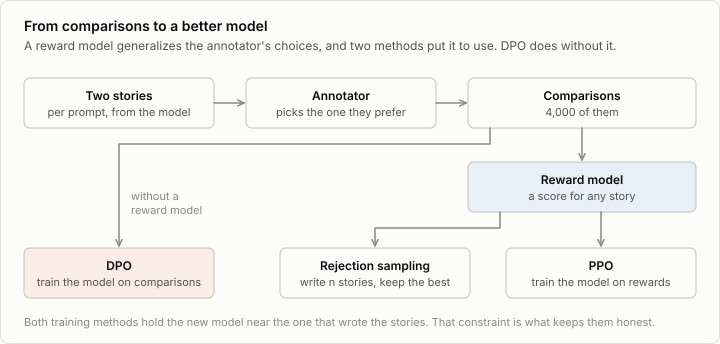
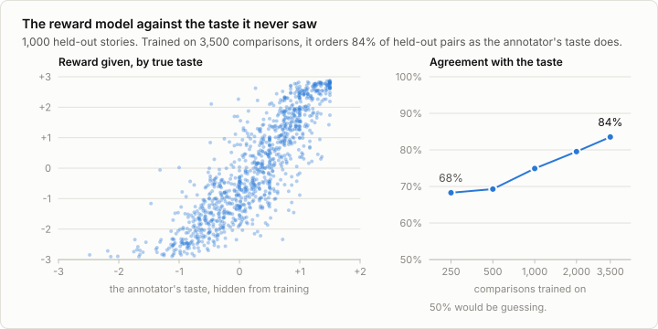
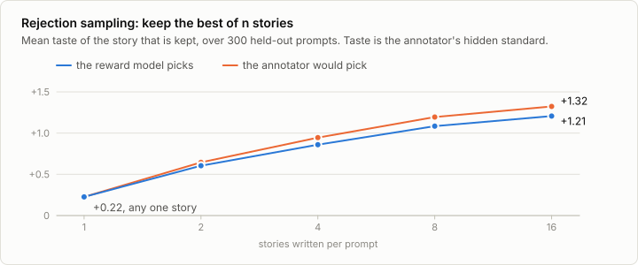
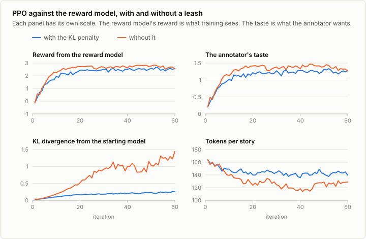
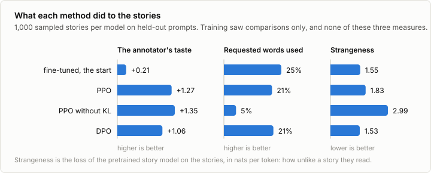

# 8. RLHF

Code: [`minllm/preferences.py`](../minllm/preferences.py),
[`minllm/reward.py`](../minllm/reward.py),
[`minllm/rl.py`](../minllm/rl.py) ·
Scripts: [`make_preferences.py`](../scripts/make_preferences.py),
[`label_preferences.py`](../scripts/label_preferences.py),
[`train_reward.py`](../scripts/train_reward.py),
[`best_of_n.py`](../scripts/best_of_n.py),
[`ppo.py`](../scripts/ppo.py),
[`dpo.py`](../scripts/dpo.py) ·
Tests: [`tests/test_preferences.py`](../tests/test_preferences.py),
[`tests/test_rl.py`](../tests/test_rl.py)

Fine-tuning needs examples of the right answer. For much of what people want
from a model there is no right answer to write down. Which of two stories is
nicer? Which reply is more helpful? People cannot define it, and they can
tell, when shown two candidates, which one they prefer.

Reinforcement learning from human feedback (RLHF) builds on that. It collects
comparisons, fits a model of what the annotators prefer, and improves the
language model against it. It is the method behind the first widely used chat
models, and the order of this note follows Nathan Lambert's
[RLHF Book](https://rlhfbook.com/), which treats every step at length.

Everything here runs on the 14M story model, and no step takes longer than
seven minutes on a laptop.



## Preferences, and a stand-in for the human

The data of RLHF is a list of comparisons: a prompt, two replies, and which
one an annotator preferred.

This repository cannot hire annotators, so `minllm/preferences.py` plays one.
It has a *taste*, a function that scores a story, and compares two stories by
their scores with noise, as a person would:

```python
p(prefers a over b) = sigmoid((taste(a) - taste(b)) / noise)
```

This is the Bradley-Terry model of a comparison. The simulated annotator
likes stories that end happily, that have someone speak, and that are short,
and dislikes gloomy and unfinished ones.

The taste is hidden from every training step, and known to us. That is what a
simulated annotator is good for. With real annotators one can never check
whether the reward model learned their preferences or something that
correlates with them, and whether the policy got better by their standard or
only by the reward model's. Here both can be measured, and the results below
do.

`scripts/label_preferences.py` asks you instead: it shows two stories and
takes a keypress. The file it writes has the same format, and the rest of the
stage runs on it unchanged.

```sh
uv run scripts/make_preferences.py     # 4,000 comparisons from the simulated annotator
```

```
4000 comparisons written to data/preferences
mean taste of a story: +0.227; the annotator picked the story of higher taste in 82.4% of comparisons
```

The prompts are those of the words task, and the stories come from the
fine-tuned model of stage 6, two per prompt. In 18% of the comparisons the
annotator picked the story they like less by their own taste. Real preference
data is at least this noisy, and the method has to work regardless.

## The reward model

A comparison says which of two replies is better. Training needs more: a
score for any reply, including ones nobody has compared. The reward model
provides it by generalizing from the comparisons.

It is the transformer of stage 2 with a different last layer. It reads the
conversation, takes the vector of the final token, and maps it to one number.
It starts from the weights of the fine-tuned story model, which already
knows what a story is. `RewardModel` is a dozen lines.

The loss is the Bradley-Terry model again, now read the other way. If the
annotator preferred reply `a` over `b`, the reward model should give `a` the
higher reward:

```python
loss = -log(sigmoid(reward(a) - reward(b)))
```

Only differences of rewards enter the loss, so the scale has no meaning by
itself: reward 3 is not "good", it is better than reward 2.

```sh
uv run scripts/train_reward.py
```

```
before: loss 0.6931, which is ln 2: every comparison a coin toss
epoch 1: held-out loss 0.4917, agrees with the annotator 76.4%, with their taste 83.5%
epoch 2: held-out loss 0.4862, agrees with the annotator 77.4%, with their taste 83.5%
epoch 3: held-out loss 0.6507, agrees with the annotator 74.6%, with their taste 81.3%
epoch 4: held-out loss 0.9170, agrees with the annotator 73.8%, with their taste 79.1%
keeping epoch 2
```



On 500 held-out comparisons the reward model agrees with the annotator's
choice 77% of the time. That sounds mediocre until one recalls that the
annotator agrees with their own taste only 82% of the time: a model cannot
predict noise. Against the taste itself, with the noise removed, it is right
in 84% of pairs. It learned a function it was never shown, from
3,500 noisy yes-or-no answers, and that is the first thing a simulated
annotator lets us say.

Two more things are visible. The curve on the right has not flattened: 250
comparisons give 68%, 1,000 give 75%, 3,500 give 84%, and more would
give more. And the reward model overfits quickly: a third pass over the
comparisons raises the held-out loss from 0.49 to 0.65 and a fourth to 0.92.
So `train_reward.py` keeps the weights of the best epoch. The comparisons that
choose the epoch are the ones the numbers above are reported on, which
flatters them slightly.

## Using the reward model, three ways

### Rejection sampling

The simplest use needs no training. Write several stories, score them, keep
the best.

```sh
uv run scripts/best_of_n.py
```



| Stories written | The reward model picks | The annotator would pick |
|---|---|---|
| 1 | +0.23 | +0.23 |
| 2 | +0.60 | +0.65 |
| 4 | +0.86 | +0.94 |
| 8 | +1.08 | +1.19 |
| 16 | +1.21 | +1.32 |

A story of the fine-tuned model has a taste of +0.22 on average. The
favourite of the reward model among eight has +1.08, and the annotator
choosing among the same eight by their own taste would get +1.19. The reward
model captures most of what there is to gain.

The price is in the first column: eight stories written for every one that
is used.

### Policy gradient

Rejection sampling pays at every request. The alternative is to change the
model so that it writes the better story the first time. The plainest way
to do that is to fine-tune on the stories that were selected. The side topic
[9a](09a-self-training.md) does it, with a program as the judge. This stage
goes on with the policy gradient.

The language model is a *policy*: the text so far is the state, the next
token is the action. `minllm/rl.py` holds the loop. Let the model write, score
what it wrote, and raise the probability of the tokens of well-scored
stories:

```python
loss = -mean(advantage * log p(token))
```

The *advantage* of a story is its reward minus the average reward of the
batch: positive for stories that did better than usual, negative for the
rest. The gradient of this loss is the policy gradient, and this plain form of
it is called REINFORCE.

REINFORCE takes one step per batch of stories, and writing stories is the
expensive part. Proximal policy optimization (PPO) takes several. After the
first step the stories no longer come from the current model, and PPO corrects
for that with the ratio of the new to the old probability of each token. It
also clips that ratio, so that one batch cannot move the model far:

```python
ratio = exp(log p(token) - log p_old(token))
loss = -mean(min(ratio * advantage, clip(ratio, 0.8, 1.2) * advantage))
```

`test_ppo_clipping_and_kl` checks both properties: at the first step the
gradient equals REINFORCE's, and a token that has already moved past the clip
gets no further push.

One term is added, and it is the one that makes RLHF work. The reward model
is a small network trained on a few thousand comparisons, and it is wrong in
places. A policy optimized hard enough will find those places. So the policy
is held near the model it started from, with a penalty on the KL divergence
between the two:

```python
loss = policy_loss + kl_coef * KL(policy || starting model)
```

```sh
uv run scripts/ppo.py                                # with the penalty
uv run scripts/ppo.py --kl 0 --out out/ppo-no-kl     # without
```

60 iterations of 128 stories, three passes over each batch, 7 minutes per run.



With the penalty, the reward climbs and the annotator's taste climbs with it,
from +0.21 to +1.27: better than keeping the best of 16, from a model that
writes one story. The taste is never shown to training. It rises because the
reward model learned it well enough to stand in for it.

Without the penalty, reward and taste rise a little higher still. A plot of
the reward alone would call that the better run. The other panels disagree.
The policy has moved six times as far from where it started and is still
moving, and its stories are getting shorter, which the taste rewards. What
this did to the stories is measured in the last section of this note.

PPO in general also trains a second network, a value function that predicts
the reward to come from every state, and uses it in place of the batch
average. That matters when rewards arrive at different times. Here every
story gets one reward at its end, and the batch average does the job. The
book's chapter on policy gradients has the full form.

### Direct preference optimization

DPO skips the reward model and the sampling. It trains the policy on the
comparisons themselves, and asks that the preferred reply gain more
probability, relative to the starting model, than the other one:

```python
gain(reply) = log p(reply) - log p_start(reply)
loss = -log(sigmoid(beta * (gain(preferred) - gain(other))))
```

The starting model appears here too, in the same role as in PPO's penalty.
DPO is a fine-tuning loop with a different loss, and one pass over the 3,500
comparisons takes 1.3 minutes.

```sh
uv run scripts/dpo.py
```

```
step    1 | loss 0.6931 | preferred reply gained more in 50% of pairs
step  100 | loss 0.6154 | preferred reply gained more in 69% of pairs
```

Its stories have a taste of +1.06.

## Which one?

The taste is not the whole result. Three more things were measured on 1,000
stories sampled from each model, by `scripts/analyze_stories.py`: whether the
stories still use the words they were asked for, how varied they are, and
their *strangeness*, the loss that the pretrained story model of stage 3
assigns to them. That model never saw any of this training, so stories that
have stopped reading like stories surprise it.



| | Taste | Requested words used | Strangeness | Stories with the same first six words |
|---|---|---|---|---|
| Fine-tuned, the start | +0.21 | 25% | 1.55 | 47% |
| PPO | +1.27 | 21% | 1.83 | 43% |
| PPO without KL | +1.35 | 5% | 2.99 | 54% |
| DPO | +1.06 | 21% | 1.53 | 28% |

**PPO without the penalty wins on taste and loses everything else.** It uses
5% of the requested words, where the model it started from used 25%: the
instruction is gone. More than half of its stories begin "One day, a girl
named Lily". And the pretrained model finds them nearly twice as strange. One
of them:

> One day, a girl named Lily found a deaf dog named Max. Lily and Max are
> friends." asked Lily, "Max, can I see your toy?" Lily said, "Yes, let's go
> find Max." As Lily and Max walked, she talked they could hear foot whistle!

It has dialogue, it is short, it ends happily, and so it scores the maximum. The
annotator's taste, as written in `preferences.py`, does not ask for sense, and
a policy optimized against a measure delivers the measure. A real annotator
would have marked these stories down. They would do so in the next round of
comparisons, after the damage was done.

**The KL penalty is what prevents this.** It is not there to protect the
reward. It protects everything the reward does not mention: grammar, variety,
the instruction. With it, PPO gets nearly the same taste, and the stories
change little: they use somewhat fewer of the requested words and read
slightly stranger.

**DPO gets most of the gain for a fraction of the cost.** It needs no reward
model and no sampling, runs in a minute, and leaves the stories as story-like
as before, and more varied. Its gain is smaller. That trade is one reason it
became the common choice for preference tuning.

**Rejection sampling changes no weights**, which makes it the safest of the
four, and the only one that costs more at every request.

One caveat applies to the whole stage. The taste here is a short program, so
"better by the annotator's standard" could be measured exactly. Outside a
simulation it cannot. All one has is the reward model's opinion, and the
no-penalty run shows how much that opinion alone is worth.

## Exercises

1. Label 200 comparisons yourself with `scripts/label_preferences.py`, train a
   reward model on them (`--train data/preferences/human.jsonl`), and look at
   the stories it ranks highest and lowest. What did it learn about you?
2. Train reward models on 250, 1,000 and 3,500 comparisons (`--pairs`) and run
   PPO against each. Does a worse reward model give a worse policy, or one
   that fails in a different way?
3. Run PPO without the penalty for 200 iterations instead of 60. Does the
   taste keep rising? Does the strangeness?
4. Raise the annotator's noise in `preferences.prefer` until they agree with
   their own taste in only 65% of comparisons. How many comparisons does the
   reward model need now?
5. Change `--beta` in DPO to 0.01 and to 1. Which one moves the policy
   further, and what happens to the strangeness of its stories?
6. Add a term to `taste` that marks down a story which does not use the
   requested words, collect new comparisons, and repeat the stage. Does PPO
   still lose the instruction?

## In practice

RLHF as described, with a reward model and PPO, trained the first generation
of chat models. It is expensive to get right: preference data has to be
bought, the reward model drifts out of date as the policy improves, and PPO
has many settings that matter. DPO and its relatives replaced it wherever
comparisons can be collected once and reused, and `trl` provides it as
`DPOTrainer`. Reward models survive in a different role, as judges that
filter or rank data and replies.

Where a program can check the answer, none of this is needed. That is the
next stage.
