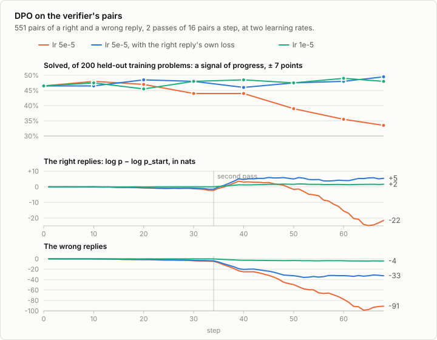
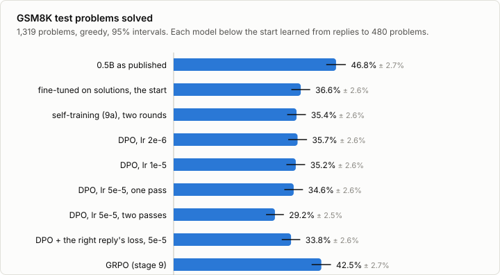

# 8b. DPO on math problems

Code: [`minllm/dpo.py`](../minllm/dpo.py) ·
Scripts: [`scripts/make_preferences.py`](../scripts/make_preferences.py) (`--task gsm8k`),
[`scripts/dpo.py`](../scripts/dpo.py),
[`scripts/analyze_dpo.py`](../scripts/analyze_dpo.py) ·
Tests: [`tests/test_dpo.py`](../tests/test_dpo.py) ·
Results: [`runs/dpo/`](../runs/dpo/)

This is a side topic of [stage 8](08-rlhf.md), not a step of the pipeline.
Stage 8 trained the story model with DPO on comparisons by a simulated
annotator, in 80 seconds. Here the same method meets the 0.5B model and
GSM8K, with the verifier of stage 9 as the annotator: of two replies the
model wrote to one problem, a right one is preferred to a wrong one.

That puts three ways to learn from checked replies side by side, from the
same start. Self-training ([9a](09a-self-training.md)) fine-tunes on the
right replies and throws the wrong ones away. DPO trains on the right
replies against the wrong ones. GRPO (stage 9) learns from every reply, and
samples new ones as it learns. All three start from the model of stage 6,
fine-tuned with LoRA on GSM8K's solutions, which solves 36.6% of the test
problems.

It needs that model, from stage 6, and the evaluations of stage 9 and 9a to
compare against.

## Pairs from a verifier

`make_preferences.py --task gsm8k` has the model answer 480 training
problems 8 times each, at temperature 1, with 256 tokens of room, as stage
9 did. The problems and the seed are those of 9a's first round, and so are
the shares of right replies and of problems with one, to the last reply: as
far as the logs can tell, these are the replies that self-training learned
from in its first round.

A reply is right if the model ended it and its final number is the answer.
`dpo.pairs` then takes, of every problem, up to two pairs of a right reply
and a wrong one, no text used twice:

| 3,840 replies to 480 problems | |
|---|---|
| right | 32.9% |
| problems with only right replies | 16 |
| problems with only wrong replies | 133 |
| problems with both, which give pairs | 331 |
| pairs | 551 |

A problem whose replies are all right, or all wrong, says nothing about
which is better, and gives no pair. A right reply in a pair is 85 tokens
long on average, a wrong one 91, and 99.3% of the wrong ones ended: they
are wrong in what they compute, not cut off.

## Training

`scripts/dpo.py` is stage 8's, with three changes so that it carries the
0.5B model. The reference is the model at the start, which is the policy
before its first step, so one pass over the pairs before training gives
every log-probability the reference will be asked for, and no second copy
of the model is kept. A step of 16 pairs runs two pairs at a time, the
gradients added up. And the model computes in 16-bit floats, as in stage 6.
Training continues the LoRA adapters of stage 6, as GRPO and self-training
did. The loss is stage 8's, now in `minllm/dpo.py`:

```python
gain = logp - reference[:, rows]             # how much likelier each reply has become than at the start
loss = dpo.loss(gain[0], gain[1], beta)      # -log sigmoid(beta * (gain of the right reply - gain of the wrong one))
```

Five runs, all with beta 0.1 and 16 pairs a step: at GRPO's learning rate of
5e-5 for one pass over the pairs and for two, at 1e-5 and at 2e-6 for two,
and at 5e-5 for two with the right reply's own loss added. The two smaller
rates were added after the first runs at 5e-5, and picked before any of
their own results: DPO's loss sums over a whole reply, and so takes larger
steps than fine-tuning at the same rate. A pass is 34 steps, and two passes
take about 11 minutes. Every 10 steps, 200 held-out training problems are
scored greedily, as GRPO did. Those are a signal of progress and no more:
200 problems give an interval of about 7 points either way.



## Both replies can fall

DPO sees only the difference between the two gains. At a learning rate of
1e-5 it does what was meant: over the last five steps of the second pass,
the right replies are 1.6 nats likelier than at the start and the wrong ones
4.2 nats less likely.

At 5e-5 both fall from the first pass on. At step 30 the right replies have
lost 2.7 nats and the wrong ones 5.4, and the loss has hardly moved, from
0.693 to 0.595. In the second pass the model meets every pair again and
separates all of them: the loss falls to 0.05, and over the last five steps
the wrong replies are 91 nats less likely than at the start, and the right
ones 21.5. The held-out score falls from 46.5% to 33.5%.

The right reply is the one DPO prefers, and still it lost probability. The
loss is just as satisfied when both replies fall, as long as the wrong one
falls faster. This is called likelihood displacement. Pal et al. found it
worst for pairs that differ in few tokens, and a right and a wrong reply to
a math problem look alike, as 9a found: same form, same steps, parting at a
number or two. Adding the right reply's own loss per token, as Pang et al.
did for math problems (`--nll 1`), holds it up: at the same rate the right
replies end 5.5 nats likelier and the wrong ones 32.5 nats less likely.

## On the test set



```sh
uv run scripts/analyze_dpo.py
```

| Against the start, 36.6% | Solved | Difference | 95% interval |
|---|---|---|---|
| DPO, lr 2e-6 | 35.7% | −0.9 | −2.4 to +0.4 |
| DPO, lr 1e-5 | 35.2% | −1.4 | −3.5 to +0.5 |
| DPO, lr 5e-5, one pass | 34.6% | −2.0 | −4.7 to +0.5 |
| DPO, lr 5e-5, two passes | 29.2% | −7.4 | −10.2 to −4.9 |
| DPO, lr 5e-5, with the right reply's loss | 33.8% | −2.8 | −5.3 to −0.3 |

**No setting gains.** The two smaller rates and the single pass end within
noise of the start, and the two runs that moved the model most end below
it. The run with the right reply's own loss looked best on the held-out
problems, at 49.5%, and lost 2.8 points on the test set: 200 problems could
not tell. Self-training, from these replies and a second round, ended at
35.4%. GRPO, which sampled as many replies as DPO, ended at 42.5%, 7.4
points above DPO at 1e-5, with an interval of 4.7 to 9.9.

Plain DPO at 5e-5, after two passes, writes replies of the same form as
the start, which end in an answer as often, and gets more problems wrong:
of the test problems it lost 221 that the start solved, and won 123 that
the start did not.

**Pairs that stay as they were.** All three methods saw the same kind of
data: replies of the starting model, checked by a program. DPO sampled its
replies once, before training, and self-training once a round. GRPO sampled
64 new replies at every one of its 60 steps, from the model as it was by
then, and its comparisons were always about what the model now wrote. The
literature gives that as the reason why online methods do better: Xu et al.
found PPO ahead of DPO in every test they ran, and DPO hurt by the gap
between the model and its preference data, and Tajwar et al. found that
sampling from the model as it trains, and pushing down its bad replies, both
matter. Here the gap grows with every step DPO takes: the more it learns its
pairs, the less they are its own. Exercise 1 measures what fresh pairs
change.

The scale is small, too. 551 pairs from a model that solves a third of the
problems is little. Qwen2.5's offline stage did the same with about 150,000
pairs, checked by answer matching and by running code, for one pass, and
then went on with online reinforcement learning.

## Run it

It needs `out/sft-gsm8k-lora` from stage 6, and the test evaluations of
that model, of stage 9's `out/grpo-gsm8k` and of 9a's `out/self-gsm8k`,
which `analyze_dpo.py` compares against.

```sh
uv run scripts/make_preferences.py --task gsm8k          # 3,840 replies and 551 pairs, 15 minutes
uv run scripts/dpo.py --model out/sft-gsm8k-lora --train data/preferences/gsm8k.jsonl --out out/dpo-gsm8k-lr1e-5 --lr 1e-5 --batch-size 16 --chunk 2 --epochs 2 --eval-every 10    # 11 minutes
uv run scripts/dpo.py --model out/sft-gsm8k-lora --train data/preferences/gsm8k.jsonl --out out/dpo-gsm8k-lr2e-6 --lr 2e-6 --batch-size 16 --chunk 2 --epochs 2 --eval-every 10
uv run scripts/dpo.py --model out/sft-gsm8k-lora --train data/preferences/gsm8k.jsonl --out out/dpo-gsm8k-1 --batch-size 16 --chunk 2 --epochs 1 --eval-every 10
uv run scripts/dpo.py --model out/sft-gsm8k-lora --train data/preferences/gsm8k.jsonl --out out/dpo-gsm8k --batch-size 16 --chunk 2 --epochs 2 --eval-every 10
uv run scripts/dpo.py --model out/sft-gsm8k-lora --train data/preferences/gsm8k.jsonl --out out/dpo-gsm8k-nll --nll 1 --batch-size 16 --chunk 2 --epochs 2 --eval-every 10
for m in dpo-gsm8k-lr1e-5 dpo-gsm8k-lr2e-6 dpo-gsm8k-1 dpo-gsm8k dpo-gsm8k-nll; do uv run scripts/evaluate.py --model out/$m --task gsm8k; done   # 3 minutes each
uv run scripts/analyze_dpo.py
```

The training logs go to `out/<run>/log.jsonl`, where `analyze_dpo.py` reads
them, and `runs/dpo/` keeps those of the runs above.

## Exercises

1. Sample new pairs from the model trained at 1e-5 and train it again for a
   round, as Pang et al. did for four rounds. Do pairs of the model's own
   current replies gain where the first round did not? Count the replies
   sampled against GRPO's.
2. Change `--beta` to 0.5 and to 0.02 at a learning rate of 5e-5. Which one
   holds the right replies up, and what happens on the held-out problems?
3. `dpo.pairs` pairs each right reply with one wrong one. Pair every right
   reply of a problem with every wrong one instead. Are more pairs from the
   same problems worth anything?
4. Start from the published model with fresh adapters, `--model qwen` for
   the pairs and for `dpo.py` after adding `--lora 16` support to it. Its
   replies are longer and right more often. Does DPO help a stronger model?
5. Read ten pairs of the second pass at 5e-5 next to what the trained model
   now writes for their problems. What did it learn about the wrong replies?

## In practice

- **Qwen2.5's chat models** were post-trained with this setup at the start
  of their reinforcement learning: replies of the fine-tuned model,
  resampled and checked by answer matching or by running the code, those
  that pass preferred to those that fail, about 150,000 pairs, DPO for one
  pass. Online reinforcement learning with GRPO came after it.
- **Iterative variants** sample new pairs from the trained model and train
  again. Pang et al. took Llama-2-70B-Chat from 55.6% to 81.6% on GSM8K in
  four rounds, DPO with the right reply's loss added, where DPO alone
  reached 61.8%.
- **Fixes for the falling right reply**: a loss on the right reply, as here
  and in Pang et al.; a penalty when it falls below the start (DPO-Positive);
  or leaving out the pairs that make it fall (Razin et al.). `trl`'s
  `DPOTrainer` has the first as an option, `rpo_alpha`.
- **Where a program can check the answer**, recent recipes, Qwen2.5's and
  DeepSeek-R1's among them, end with online reinforcement learning, as in
  stage 9.

## References

- Rafailov et al. (2023), [Direct Preference Optimization: Your Language Model is Secretly a Reward Model](https://arxiv.org/abs/2305.18290). DPO.
- Pang et al. (2024), [Iterative Reasoning Preference Optimization](https://arxiv.org/abs/2404.19733). Pairs of a right and a wrong chain of thought, judged by the final answer, DPO with the right reply's loss added, and new pairs every round.
- Pal et al. (2024), [Smaug: Fixing Failure Modes of Preference Optimisation with DPO-Positive](https://arxiv.org/abs/2402.13228). DPO lowering the probability of the preferred reply, most for pairs that differ in few tokens, and a penalty against it.
- Razin et al. (2024), [Unintentional Unalignment: Likelihood Displacement in Direct Preference Optimization](https://arxiv.org/abs/2410.08847). Why the preferred reply falls, and which pairs make it fall.
- Xu et al. (2024), [Is DPO Superior to PPO for LLM Alignment? A Comprehensive Study](https://arxiv.org/abs/2404.10719). PPO ahead of DPO in their tests, and DPO's sensitivity to the gap between the model and its preference data.
- Tajwar et al. (2024), [Preference Fine-Tuning of LLMs Should Leverage Suboptimal, On-Policy Data](https://arxiv.org/abs/2404.14367). Sampling from the model as it trains, and pushing down its bad replies.
- Qwen Team (2024), [Qwen2.5 Technical Report](https://arxiv.org/abs/2412.15115). Offline DPO on replies checked by answer matching and execution, then online GRPO.
