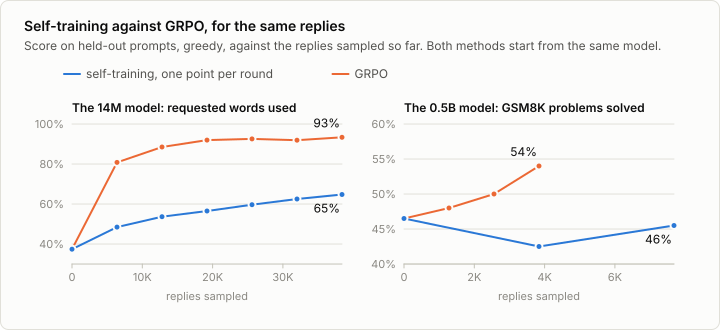
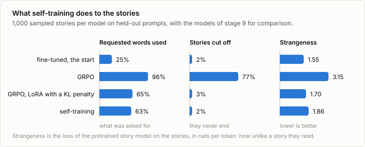
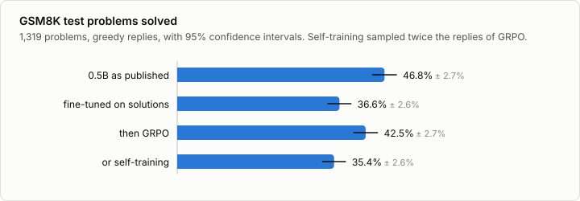

# 9a. Self-training

Code: [`minllm/selftrain.py`](../minllm/selftrain.py),
[`minllm/rl.py`](../minllm/rl.py) ·
Script: [`scripts/self_train.py`](../scripts/self_train.py) ·
Tests: [`tests/test_selftrain.py`](../tests/test_selftrain.py) ·
Logs: [`runs/self/`](../runs/self/)

This is a side topic of [stage 9](09-rlvr.md), not a step of the pipeline.
Stage 9 has a model answer a prompt several times, a program check the
answers, and a policy-gradient step make the better answers more likely.
Self-training keeps the first two and replaces the third with something
simpler: keep the answers that are right, and fine-tune on them as if they
were data. Then the better model answers again.

It is an old idea under several names. For reasoning with language models it
is STaR (Zelikman et al., 2022, arXiv:2203.14465). Llama 2 (Touvron et al.,
2023, arXiv:2307.09288) calls it rejection sampling fine-tuning, with a
reward model as the judge, and used nothing else for the first rounds of its
post-training. PPO was added on top only later. In game playing it is expert
iteration.

It needs stages 6 to 9: the fine-tuned models, the verifiers and the
rollouts.

## The loop

One round of `scripts/self_train.py`:

```python
prompts, replies, texts = rl.rollout(model, tok, conversations, samples, max_new_tokens)   # 1. answer
scores = [score(example, text) for example, text in ...]                                   # 2. verify
kept = selftrain.keep(texts, scores, finished, samples, per_prompt=2)                      # 3. keep what is right
x, y, _ = rl.batch(prompts[kept], replies[kept], device)                                   # 4. fine-tune on it
loss = F.cross_entropy(rl.target_logits(model, x, y), y[y != -100])
```

Nothing in it is new. Steps 1 and 2 are stage 9's. Step 3 is the best-of-N
selection of stage 8, judged by a program instead of a reward model. Step 4
is the loss of stage 6, on the model's own replies. That is the attraction of
the method: whoever can fine-tune and can check an answer can run it.

`selftrain.keep` is strict about what counts as right. A reply is kept only
if the model ended it itself and its score is 1: all requested words used, or
the right number. Of the replies to one prompt, the same text counts once and
at most two are kept, so that the prompts the model finds easy do not crowd
out the rest.

Against GRPO, three things differ:

- **Credit.** GRPO moves the model with every reply: up for those that did
  better than the others to the same prompt, down for those that did worse.
  Self-training uses the right replies only, all with the same weight, and
  throws the wrong ones away. Nothing is pushed down.
- **Distance.** The model is trained on text that it wrote itself a moment
  ago. That keeps it close to how it writes already, without a penalty to
  hold it there.
- **What it cannot learn from.** A prompt that gets no right reply in any of
  its tries teaches nothing. GRPO had the same limit, as groups in which
  every reply earned the same reward.

## The story model

```sh
uv run scripts/self_train.py --task words      # 6 rounds of 1,600 prompts x 4 stories, 13 minutes
```

The start is the fine-tuned story model of stage 6, which uses 40% of the
words it is asked for, and the run samples 38,400 stories in all. Both are
what GRPO had in stage 9, so the two can be compared reply for reply.



| Round | Stories right, of 6,400 | Prompts with a right story | Kept | Held-out score |
|---|---|---|---|---|
| 0 | | | | 37.4% |
| 1 | 12.7% | 32.0% | 729 | 48.5% |
| 2 | 20.5% | 44.1% | 1,072 | 53.7% |
| 3 | 26.0% | 51.9% | 1,305 | 56.5% |
| 4 | 31.3% | 59.2% | 1,537 | 59.7% |
| 5 | 34.8% | 62.9% | 1,665 | 62.5% |
| 6 | 39.0% | 67.5% | 1,826 | 64.7% |

A story is right if it uses every requested word and ends. The held-out score
is the share of requested words used, as in stage 9.

**It works, and more slowly than GRPO.** On the 1,000 test prompts the model
goes from 39.6% to 68.7%, a gain of 29.1 points with an interval of 26.5 to
31.7. GRPO reached 93.6% from the same number of stories. The loop does feed
itself: a better model writes more right stories, so every round has more to
learn from than the last. And still every round adds less: 11 points, then
5, then 3, 3, 3 and 2.

**It uses little of what it samples.** In the first round 729 of 6,400
stories are kept. A story that used two of its three words is thrown away
with the ones that used none. GRPO learns from that story as well: it did
better than its group, or worse, and moves the model either way.

**It does not cheat.** This is what the stories look like, measured as in
stages 8 and 9:



| 1,000 sampled stories | Requested words used | Stories cut off | Strangeness |
|---|---|---|---|
| Fine-tuned, the start | 25% | 2% | 1.55 |
| GRPO | 96% | 77% | 3.15 |
| GRPO through LoRA with a KL penalty | 65% | 3% | 1.70 |
| Self-training | 63% | 2% | 1.86 |

GRPO won its score by repeating words until the token limit, and needed a
penalty to keep writing stories. Self-training ends where the leashed GRPO
ended, at 68.7% against 70.2% on the test prompts, which is within noise, and
it had no penalty. Its stories end, and the pretrained model finds them a
little stranger than the leashed ones and far less strange than GRPO's.
Asked for *mole* and *protect*:

> Once upon a time, there was a little mole named Tim. Tim lived in a small
> hole in the ground. He had a friend named Sam. Sam was a strong mole. They
> liked to play together in the sun. One day, Tim was playing with his
> friend, Sam. […] Tim said, "Sam, I protect you. I protect you from being
> strong and brave." Sam was happy to hear this.

The reason is in what each method can reach. A policy gradient pushes
towards whatever scored higher, further with every step, and that is how it
arrived at text no story model would write. Fine-tuning on kept stories can
only make likelier what the model has already written whole, and a story has
to be sampled before it can be kept. The model stays among its own stories.
The strangeness does creep up, from 1.55 to 1.86 in six rounds, and exercise
4 follows it further.

## The 0.5B model on GSM8K

```sh
uv run scripts/self_train.py --task gsm8k     # 2 rounds of 480 problems x 8 replies, 40 minutes
uv run scripts/evaluate.py --model out/self-gsm8k --task gsm8k
```

The start is again GRPO's: the 0.5B model fine-tuned on reference solutions,
at 36.6% of the test problems. One round samples 3,840 replies, as many as
GRPO's whole run, and there are two rounds.

| Round | Replies right, of 3,840 | Problems with a right reply | Kept | Held-out score |
|---|---|---|---|---|
| 0 | | | | 46.5% |
| 1 | 32.9% | 72.3% | 611 | 42.5% |
| 2 | 34.2% | 72.7% | 627 | 45.5% |



```
out/sft-gsm8k-lora             36.6% ± 2.6%
out/self-gsm8k                 35.4% ± 2.6%
difference -1.2%, 95% interval -3.7% to +1.1%: within noise
```

**Here it does nothing.** After two rounds, twice the replies of GRPO and 40
minutes, the model solves as many test problems as before. GRPO gained 5.9
points from half of that, and ends 7.1 points ahead of self-training, with an
interval of 4.5 to 9.9. The share of sampled replies that are right hardly
moves, from 32.9% to 34.2%. Under GRPO it rose from 31% to 57%. The held-out
score is measured on 200 problems, and its dip and return are within what
200 problems can tell.

This is the result of one recipe, not of the method. Each round was 77
steps at a learning rate of 1e-4, half of what stage 6 used, and neither was
tuned. A larger step, more rounds, or STaR's way of retraining from the start
might find something that this run did not.

**Why the tasks differ.** A right story differs from a wrong one all over,
and in the same way for every prompt: it takes its words from the
instruction. Imitating right stories teaches that. A right solution and a
wrong one to a math problem look alike. They have the same form, the same
length and the same kind of steps, and they part at one or two numbers, for
reasons that are different in every problem. Fine-tuning on the right
solutions therefore teaches the model mostly what it does already: its loss
on the kept replies is 0.44 from the first step, well below the 0.59 it has
on the reference solutions.

GRPO's advantage is a subtraction, a reply's reward minus the mean of its
group. Whatever the right and the wrong replies to a problem have in common
gets no push from it, and the push lands where they part. Self-training
compares nothing. It makes all of a kept reply likelier, most of which was
never in question. This is the baseline of stage 8 again, seen from what
happens without one.

## Exercises

1. STaR starts every round from the starting model again and fine-tunes on
   everything that has been kept so far, where this script continues from
   the last round on the last round's replies alone. Change it. Which gets
   further in six rounds on the words task?
2. Run the words task with `--samples 2 --prompts 3200` and with
   `--samples 16 --prompts 400`. The replies are as many. What happens to the
   share of prompts with a right story, and to the score?
3. Run with `--per-prompt 1` and with `--per-prompt 4`. Do the prompts that
   the model finds easy crowd out the others?
4. Run 20 rounds on the words task, then sample stories from the result
   (`evaluate.py --task taste --temperature 1`) and measure them with
   `analyze_stories.py`. Does the score flatten, and where is the
   strangeness by then?
5. Keep the stories that use at least half of their words, not only the
   ones that use all. Is the model faster for it, or only less exact?
6. Start the 0.5B model as published, with fresh adapters:
   `--task gsm8k --model qwen --lora 16 --max-new-tokens 512`. Its right
   solutions are written in its own long style, not in the terse one of
   stage 6. Does it get above its 46.8%?
7. Run one round of self-training on GSM8K and then GRPO from the result
   (`grpo.py --task gsm8k --model out/self-gsm8k`), which is the order Llama
   2 used. Is the pair better than either alone, for the same replies?

## In practice

- **It is often the first thing to try.** It needs no reinforcement
  learning code and no access to probabilities, only samples, a filter and
  fine-tuning. The kept replies are a dataset: they can be read, cleaned,
  mixed with other data and reused. Llama 2 was post-trained this way for
  several rounds before PPO was added.
- **The judge varies.** Here it is a program. For code it is a test suite,
  for mathematics the known answer, which is what STaR uses, and in RLHF a
  reward model, as in stage 8.
- **What bounds it** is what the rounds above show. It learns only from
  prompts it gets right at least once in its tries, it uses a small part of
  what it samples, and each round adds less than the one before. It also
  narrows: 61% of the self-trained model's stories begin with the same six
  words, against 47% at the start. A model that learns from its own output
  gets more of what it already does well.
- **Where reinforcement learning earns its place** is in using every sample,
  the wrong ones included, in comparing replies with each other, and in
  reaching replies that the model would not have written at the start. On
  GSM8K the comparison was the whole signal. Stage 9 shows both the gain and
  the price.
