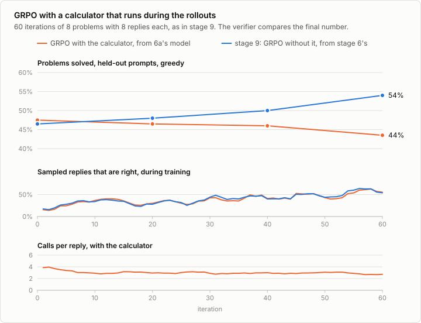
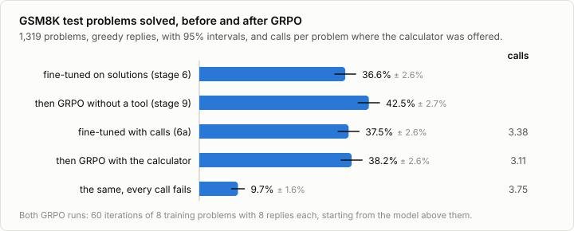

# 9b. Reinforcement learning with a tool

Code: [`minllm/tools.py`](../minllm/tools.py) (`rollout`),
[`minllm/rl.py`](../minllm/rl.py) ·
Script: [`scripts/grpo.py`](../scripts/grpo.py) (`--task gsm8k-tools`) ·
Tests: [`tests/test_tools.py`](../tests/test_tools.py),
[`tests/test_rl.py`](../tests/test_rl.py) ·
Results: [`runs/rlvr/`](../runs/rlvr/)

This is a side topic of [stage 9](09-rlvr.md), not a step of the pipeline.
[6a](06a-tool-calling.md) fine-tuned the 0.5B model on GSM8K's solutions
with every calculation turned into a call to a calculator. It learned the
form completely, calling 3.4 times a problem and never malformed, and solved
no more problems than before: its mistakes were in what it set out to
calculate, which the calculator carries out faithfully. Fine-tuning showed it
where calls go. It did not tell it whether a call helped.

Stage 9's GRPO does tell a model that, with a reward for the right final
answer. Here the calls run while the replies are sampled, so that the
reward judges the whole conversation: what the model wrote, what it asked
the tool, and what it made of the answer. This is how tool use in current
models is trained.

## A reply in several turns

A sampled reply is no longer one stretch of the model's text. It is the
model's turn up to a call, the tool's turn with the result, the model's
next turn, and so on until it answers without calling:

```
<|im_start|>assistant
Natalia sold 48/2 =
<tool_call>
{"name": "calculate", "arguments": {"expression": "48/2"}}
</tool_call><|im_end|>                       the model's tokens
<|im_start|>user
<tool_response>
24
</tool_response><|im_end|>                   the tool's, and the format's
<|im_start|>assistant
24 clips in May. ...                         the model's again
```

`tools.rollout` samples a batch of such conversations at once. Each round
generates the next turn of every conversation that is still open, runs the
calls of those that made any, writes the results back, and goes on with
those. Two things differ from 6a's `tools.run`, which evaluates:

- **The ids are kept as sampled.** `run` writes each turn into the
  conversation as text and encodes the whole conversation again for the next
  round. Text encoded again need not give back the ids that were sampled: a
  space and a word can come back as one token where the model wrote two. The
  policy gradient is the gradient of the log-probability of what the model
  did, so it has to be taken on those ids. `rollout` appends the sampled
  ids, and encodes only the tool's turn.
- **Every id is marked as the model's or not.** The tool's results and the
  chat format around them are read by the model, and never trained on: the
  model did not choose them, and a gradient on them would teach it to
  predict the calculator's output. `rl.batch` takes these marks and sets the
  other targets to -100, as stage 6 does for the prompt.

`test_rollout_keeps_the_sampled_ids` checks both against the conversation
as `tools.encode` writes it: the same ids, and the model's marks exactly the
tokens that fine-tuning would learn.

## GRPO from 6a's model

The run is stage 9's, from 6a's model instead of stage 6's: 60 iterations,
each of 8 training problems with 8 sampled replies, LoRA adapters, no KL
penalty, and a reward of 1 for the right final number. The calculator runs
in every rollout. An iteration took 3.6 minutes at the median, against stage
9's 22 seconds, but this run shared the GPU with two others, and how much of
the difference is the tool's rounds and how much the other runs it cannot
say.



**The training reward is stage 9's curve.** Both runs drew the same 8
problems at every iteration, from the same seed, and the share of sampled
replies that are right rose in both alike: from 32% in the first 20
iterations to 51% in the last 20 here, from 31% to 52% in stage 9. With 8
problems an iteration, that share says more about which problems came up
than about the model. The 200 held-out problems tell the runs apart: stage
9's rose from 46.5% to 54%, this one's went from 47.5% to 43.5%. On 200
problems, either change could be noise. The test set decides:



```
out/sft-gsm8k-tools-lora       37.5% ± 2.6%
out/grpo-gsm8k-tools           38.2% ± 2.6%
difference +0.8%, 95% interval -1.7% to +3.2%: within noise
```

**GRPO did not move the score.** From starts a point apart, 36.6% and
37.5%, the same recipe gained stage 9's model 5.9 points, with an interval
of 3.2 to 8.5, and this one 0.8. After it, the model without the tool is
ahead by 4.3 points, with an interval of 1.5 to 7.2. The run did change
which problems the model solves: 133 turned right and 123 wrong, against
stage 9's 200 and 122.

**It was not that the calculator had done stage 9's work already.** One
guess is that stage 9's GRPO taught the model to compute more carefully,
which a model with a calculator does not need. The replies say otherwise.
Of the 200 problems that stage 9's GRPO turned right, 28 had a calculation
written wrong before, and the other 172 none that `tools.written_calculations`
finds. What it gained was mostly in what to calculate, the mistakes 6a found
the calculator cannot fix. Why GRPO fixed fewer of them with the tool, one
run of each cannot say.

**What the model learned is to call less.** Calls per test problem fell
from 3.38 to 3.11, and problems with a call from 98.6% to 97.3%. In
training, its own share of a reply fell from 173 tokens in the first 20
iterations to 150 in the last 20, where stage 9's replies to the same
problems went from 103 to 99. The calculations it still writes out are as right as
before, 47 wrong of 2,250 against 49 of 2,517. And it depends on the tool
as much as before: with every call failing, it solves 9.7%, 28.5 points
less.

## Run it

```sh
uv run scripts/finetune.py --task gsm8k-tools --lora 16 --accumulate 2   # 6a: the model that calls
uv run scripts/grpo.py --task gsm8k-tools                                # 60 iterations, 5.8 hours beside two other runs
uv run scripts/evaluate_tools.py --model out/grpo-gsm8k-tools
uv run scripts/evaluate_tools.py --model out/grpo-gsm8k-tools --no-execute
uv run scripts/analyze_tools.py                                          # the comparisons, problem by problem
```

## Exercises

1. Charge a small cost for every call in the reward. Does the model call
   less, and which calls does it give up?
2. Start GRPO from the published model with the tool in its prompt, without
   6a's fine-tuning: it called in 0.5% of the problems. Can reinforcement
   learning alone teach it to call?
3. Train on the tool's tokens too, without the marks. What does the model
   learn to predict, and what does it do when a call fails?
4. Let the calculator fail on a tenth of its calls during training. Does the
   model learn to recover from an error?
5. Give the reward for the right final number only when every calculation
   written in the reply is also right, as `tools.written_calculations`
   checks them. Does it change what the model calls?

## In practice

- **Agents are trained this way.** Search engines, code interpreters,
  browsers and shells are run during the rollouts, a reward comes at the
  end, and their outputs are masked out of the loss, as here (Search-R1,
  ReTool). The tool loop is the environment.
- **Format first, then reinforcement learning.** A model learns the form of
  a call from fine-tuning, as in 6a, and when to call and what to make of
  the answer from reinforcement learning on top (ReTool).
- **Environments at scale.** A training step waits for every tool call of
  every rollout, so the tools run in many sandboxes in parallel, and the
  sampling and the training are often kept on separate machines.
- **One reward for many turns.** The reward judges the whole conversation,
  and every token of every turn shares it. Rewards for single steps, from a
  verifier or a model, are used where the final answer is far away.

## References

- Shao et al. (2024), [DeepSeekMath: Pushing the Limits of Mathematical Reasoning in Open Language Models](https://arxiv.org/abs/2402.03300). GRPO.
- Schick et al. (2023), [Toolformer: Language Models Can Teach Themselves to Use Tools](https://arxiv.org/abs/2302.04761). Calls kept in the training text where their results helped.
- Yao et al. (2022), [ReAct: Synergizing Reasoning and Acting in Language Models](https://arxiv.org/abs/2210.03629). Reasoning, calls and their results interleaved in one reply.
- Qian et al. (2025), [ToolRL: Reward is All Tool Learning Needs](https://arxiv.org/abs/2504.13958). Reinforcement learning for tool calls, and what to reward.
- Jin et al. (2025), [Search-R1: Training LLMs to Reason and Leverage Search Engines with Reinforcement Learning](https://arxiv.org/abs/2503.09516). A search engine called during the rollouts, its results masked out of the loss.
- Feng et al. (2025), [ReTool: Reinforcement Learning for Strategic Tool Use in LLMs](https://arxiv.org/abs/2504.11536). A code interpreter run during the rollouts, after fine-tuning on calls first, as here.
