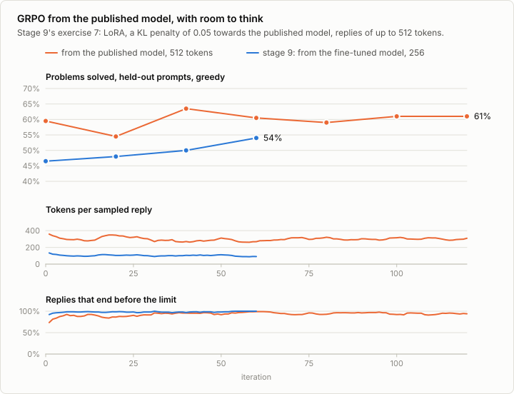
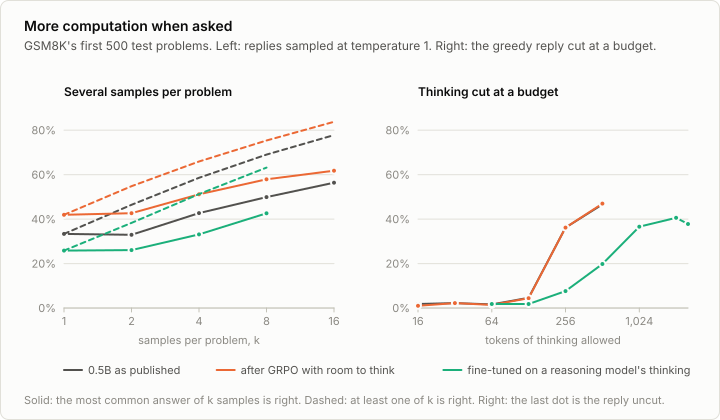
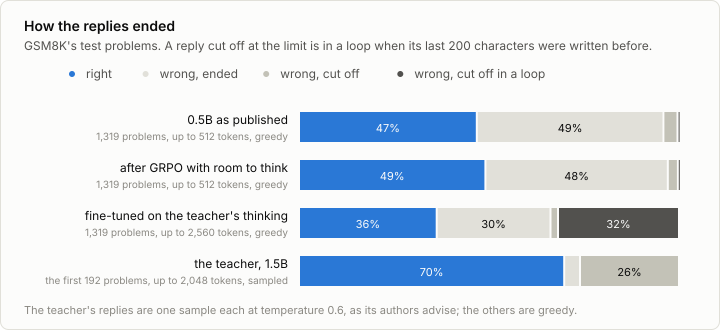

# 9c. Reasoning

Code: [`minllm/reasoning.py`](../minllm/reasoning.py) ·
Scripts: [`scripts/grpo.py`](../scripts/grpo.py),
[`scripts/test_time.py`](../scripts/test_time.py),
[`scripts/make_traces.py`](../scripts/make_traces.py),
[`scripts/finetune.py`](../scripts/finetune.py) (`--task gsm8k-traces`) ·
Tests: [`tests/test_reasoning.py`](../tests/test_reasoning.py) ·
Results: [`runs/reasoning/`](../runs/reasoning/)

This is a side topic of [stage 9](09-rlvr.md), not a step of the pipeline.
The models called reasoning models, which appeared from late 2024 on, write
a long chain of thought before they answer, and are right more often the
longer they are allowed to think. Stage 9's GRPO is the method behind
them, and stage 9 used it on GSM8K. But it did not train a reasoning model:
it started from a model fine-tuned to write terse solutions, gave it 256
tokens, and its replies stayed short.

This note asks what makes a reasoning model, in three ways that are all in
use:

- **Reinforcement learning with room to think.** GRPO from the published
  model, which already writes its steps, with replies of up to 512 tokens.
  This is stage 9's exercise 7, and the way DeepSeek-R1 was trained.
- **More computation at the time of asking, without training.** Several
  replies sampled and the most common answer taken, and the thinking cut at
  a budget and the answer asked for there.
- **The thinking of a reasoning model, imitated.** A small reasoning model
  thinks through GSM8K's training problems, and the 0.5B model is
  fine-tuned on the thinking that reached the right answer. This is how the
  small DeepSeek-R1 models were made.

## Reinforcement learning with room to think

GRPO starts from the published model with fresh LoRA adapters of rank 16,
replies of up to 512 tokens, and a KL penalty of 0.05 towards the published
model, which is the same model with its adapters switched off. 120
iterations of 8 problems with 8 replies took 9.4 hours, beside two other
runs on the same GPU.



**The replies did not grow longer.** DeepSeek-R1's replies grew longer over
thousands of steps of reinforcement learning. Here the sampled replies stayed
near 300 tokens, 312 in the first 20 iterations and 301 in the last 20, and
more of them ended within the limit, 88% and then 94%. The held-out score
moved between 54.5% and 63.5% and ended at 61%, from 59.5%. On the test set:

```
qwen                           46.8% ± 2.7%
out/grpo-qwen                  49.1% ± 2.7%
difference +2.3%, 95% interval +0.0% to +4.5%
```

**2.3 points, at the edge of noise.** 41 of its replies ran into the limit,
against 55 of the published model's. Stage 9's run from the fine-tuned
model, ten points lower, gained 5.9.

## More computation when asked

On the first 500 test problems, both models wrote 16 replies to every
problem at temperature 1, and one greedy reply, which was also cut after a
budget of tokens and the answer asked for there. The figure also shows the
student of the next section, with 8 samples.



**Votes help, and GRPO most where it samples.** One sampled reply is right
33.4% of the time from the published model and 41.9% after GRPO, while
their greedy replies are right 46.6% and 47.0% of the time: GRPO brought
the model's samples closer to its best reply. The most common answer of 16
samples is right 56.4% and 61.8% of the time, about 10 and 15 points above
greedy. At least one of the 16 is right in 77.8% and 83.8%: the right answer
is among the samples more often than a vote finds it.

**A budget cuts what these two do not separate.** Neither writes its
thinking apart from its answer. Their replies are about 290 tokens long, and
a cut falls in the middle of a worked solution: at 128 tokens the answer
asked for is right 4.6% and 4.4% of the time, at 256 tokens 36.2% for both.

## The thinking of a reasoning model, imitated

The teacher, DeepSeek-R1-Distill-Qwen-1.5B, thought through 960 of GSM8K's
training problems, one reply each at temperature 0.6 with up to 2,048 tokens,
in 258 minutes beside the other runs. It was right on 77.4%, and 76.5% of
its replies ended within the limit, 1,395 tokens long on average. The 701
that closed their thinking, ended and were right are the traces. The 0.5B
model was fine-tuned on 601 of them, every weight for two passes, in 56
minutes, and the loss on the other 100 fell from 0.997 to 0.524.



```
qwen                           46.8% ± 2.7%
out/sft-gsm8k-traces           36.2% ± 2.6%
difference -10.5%, 95% interval -13.4% to -7.8%
```

**The student thinks like the teacher, and does not stop.** Given 2,560
tokens, 474 of its 1,319 replies ran into the limit, and 448 of those were in
a loop, their last 200 characters written before. The first of them works out
how much feed Wendi's chickens need, writes "So, the answer should be 20
cups.", which is right, then "But hold on, the question says", reads the
question again, and works it out again, until the limit. The teacher ran
into its limit in 57 of the first 192 test problems, and never in a loop: it
was still thinking. On those 192 problems the teacher solves 69.8%, the
published 0.5B model 45.8%, and the student 35.4%. Of the student's replies
that ended, 53.3% are right, against 48.7% of the published model's, though
these are not the same problems. 601 traces taught the 0.5B model the form of
long thinking, and not when it is done. DeepSeek-R1's authors distilled
800,000 samples, into models of 1.5B parameters and more.

**Cutting the loops short helps a little, votes more.** On the first 500
test problems, the student's greedy reply is right 37.8% of the time, and
1,570 tokens long on average. Cut at 2,048 tokens and made to answer there,
after the end of its thinking, 25 of the 194 replies cut are right, where 11
were when they ran on to 2,560: 40.6% in all. Cut at 1,024 tokens, with 922
tokens of thinking on average, it is right 36.6% of the time, and at 512
tokens 19.8%. Eight sampled replies, 1,904 tokens long on average, are right
25.9% of the time one by one, and their most common answer 42.6% of the
time, the best the student does. Eight samples of the published model: 33.4%
and 49.9%. Neither the cut nor the vote brings the student up to the
published model's greedy reply, right 46.6% of the time on these problems in
a fifth of the tokens.

**A greedy reply depends on its batch.** Stage 7's evaluation wrote greedy
replies to the same 500 problems, among all 1,319 and so in other batches.
The two runs disagree on which problems are solved: on 46 for the published
model, 35 after GRPO, and 125 for the student, which solves 35.2% of them
there against 37.8% here. Batched otherwise, the same sums are added in
another order, and in 16-bit floats that can tip a near tie between two
tokens; a long reply has more of them to tip. The cut at 2,048 tokens is
compared on the same replies, within one run.

## Run it

```sh
uv run scripts/grpo.py --task gsm8k --model qwen --lora 16 --max-new-tokens 512 --kl 0.05 --iterations 120 --out out/grpo-qwen
uv run scripts/evaluate.py --model out/grpo-qwen --task gsm8k
uv run scripts/test_time.py --model qwen
uv run scripts/test_time.py --model out/grpo-qwen
uv run scripts/make_traces.py --n 960                               # the teacher's thinking on 960 training problems
uv run scripts/make_traces.py --split test --n 192                  # the teacher's own score on the first test problems
uv run scripts/finetune.py --task gsm8k-traces --accumulate 8
uv run scripts/evaluate.py --model out/sft-gsm8k-traces --task gsm8k --max-new-tokens 2560
uv run scripts/test_time.py --model out/sft-gsm8k-traces --max-new-tokens 2560 --budgets 64,128,256,512,1024,2048 --samples 8
uv run scripts/analyze_reasoning.py                                 # the comparisons, and the replies cut off in a loop
```

The teacher is DeepSeek-R1-Distill-Qwen-1.5B, 3.5 GB under the MIT license:
`uv run python -c "from minllm import pretrained;
pretrained.download('data/r1-distill-qwen-1.5b',
'deepseek-ai/DeepSeek-R1-Distill-Qwen-1.5B', files=['config.json',
'tokenizer.json', 'tokenizer_config.json', 'model.safetensors'])"`. It
reads Qwen's vocabulary with chat markers of its own, and loads into the
same model code.

## Exercises

1. Run the reinforcement learning without the KL penalty, and with a limit
   of 1,024 tokens. Do the replies grow longer, and does the score follow?
2. Sample the votes at temperature 0.6 instead of 1. Where is the vote at
   16 samples best?
3. Let the 1.5B judge of [7b](07b-judge.md), told nothing but the problem,
   pick one of the 16 samples. How close does it come to pass@16?
4. Fine-tune the student on the teacher's thinking for one pass and for
   four. Does more help, or does it start to copy?
5. Run GRPO from the distilled student. Does reinforcement learning add to
   distillation, as DeepSeek-R1's authors found for their larger models?
6. Cut the teacher's own thinking at budgets. How much of its long thinking
   does it need?

## In practice

- **Trained in stages.** DeepSeek-R1 was fine-tuned on a few thousand long
  chains of thought first, then trained with reinforcement learning on
  problems whose answers a program checks, then on general requests. The
  first stage gives the format and readable thinking, the second the
  accuracy.
- **Small models are distilled.** DeepSeek-R1's authors found that a small
  model fine-tuned on a large reasoning model's thinking reasons better
  than the same model trained with reinforcement learning alone. The
  teacher here is one of the models made that way.
- **The budget is a setting.** Reasoning models are served with a choice of
  how long to think, an effort level or a number of thinking tokens, and
  the thinking is cut or extended to meet it.
- **Every request pays.** Votes over samples, best-of-n with a verifier, and
  longer thinking all spend computation each time a question is asked,
  where training spends it once.

## References

- DeepSeek-AI (2025), [DeepSeek-R1: Incentivizing Reasoning Capability in LLMs via Reinforcement Learning](https://arxiv.org/abs/2501.12948). A reasoning model trained with GRPO on verified answers, its replies growing longer over training, and small models made by fine-tuning on its thinking.
- Wei et al. (2022), [Chain-of-Thought Prompting Elicits Reasoning in Large Language Models](https://arxiv.org/abs/2201.11903). Writing the steps before the answer.
- Wang et al. (2022), [Self-Consistency Improves Chain of Thought Reasoning in Language Models](https://arxiv.org/abs/2203.11171). Several sampled chains of thought, and the most common answer.
- Muennighoff et al. (2025), [s1: Simple test-time scaling](https://arxiv.org/abs/2501.19393). A budget for thinking, enforced by cutting the thinking and asking for the answer.
- Snell et al. (2024), [Scaling LLM Test-Time Compute Optimally can be More Effective than Scaling Model Parameters](https://arxiv.org/abs/2408.03314). When more computation at the time of asking is worth more than a larger model.
- Chen et al. (2021), [Evaluating Large Language Models Trained on Code](https://arxiv.org/abs/2107.03374). pass@k and its unbiased estimate from n samples.
- Zeng et al. (2025), [SimpleRL-Zoo: Investigating and Taming Zero Reinforcement Learning for Open Base Models in the Wild](https://arxiv.org/abs/2503.18892). Reinforcement learning of reasoning on small open models, Qwen2.5-0.5B among them.
