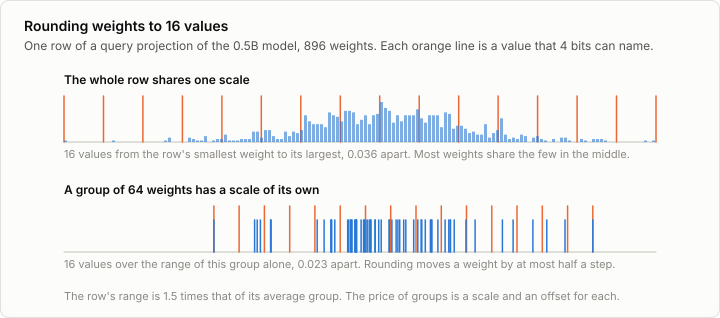
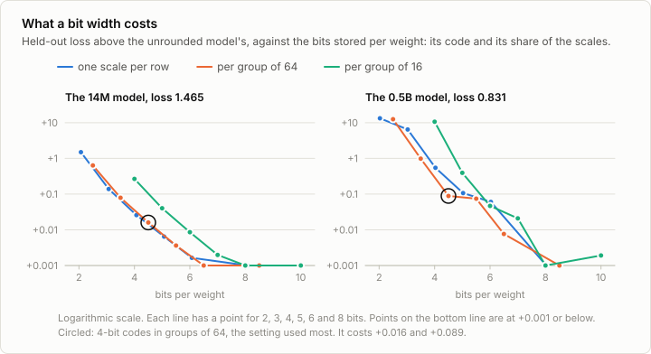
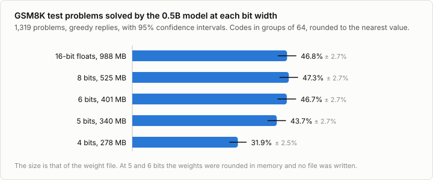
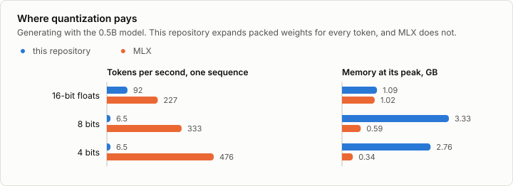

# 10a. Quantization

Code: [`minllm/quantize.py`](../minllm/quantize.py),
[`minllm/checkpoint.py`](../minllm/checkpoint.py),
[`minllm/export.py`](../minllm/export.py) ·
Scripts: [`scripts/quantize.py`](../scripts/quantize.py),
[`scripts/bench_quantize.py`](../scripts/bench_quantize.py),
[`scripts/check_quantize.py`](../scripts/check_quantize.py) ·
Tests: [`tests/test_quantize.py`](../tests/test_quantize.py) ·
Logs: [`runs/quant/`](../runs/quant/)

The 0.5B model of stage 5 is a file of 988 MB: 494 million weights at 16 bits
each. The models that people run on their own machines are stored at 4 or 5
bits per weight. Quantization is how they get there. It rounds every weight
to one of a few values and stores which one.

This is a side topic of [stage 10](10-stack.md), not a step of the pipeline.
Stage 10 writes a model in the format that other tools read, and this note
writes it smaller. It takes a model that is already trained and asks the
questions of the earlier stages again: what happens to the loss and to the task of stage 7, to
the speed of stage 4, and to the export of stage 10. Nothing is trained
here, which is why the method is called post-training quantization. It is
the simplest one in wide use.

## A code, a scale and an offset

A weight is stored as a small whole number, its *code*. Two more numbers turn
a code back into a weight:

```
weight = code * scale + offset
```

With 4 bits a code is one of 16 values, so a weight can only be one of 16
numbers, evenly spaced between `offset` and `offset + 15 * scale`. The scale
and the offset are chosen so that those numbers reach from the smallest
weight to the largest, and every weight is rounded to the nearest of them.
`quantize.quantize` is that, in a few lines:

```python
low, high = groups.amin(-1), groups.amax(-1)
scale = (high - low) / (2**bits - 1)
codes = ((groups - low) / scale).round()              # 0 to 2^bits - 1
...
weight = codes * scale + low                          # dequantize: what the codes stand for
```

Rounding moves a weight by at most half a step, half of `scale`.
`test_error_is_at_most_half_a_step` checks it. So everything depends on how
large the step is, and that depends on which weights share a scale.



If a whole row shares one scale, its 16 values have to span the row's two
most extreme weights, and most weights, which are near zero, crowd around a
few values in the middle. Cut the row into groups of 64 weights, give each
group a scale and an offset of its own, and the steps shrink, because a small
group rarely contains the row's extremes. In the row of the figure they
shrink by a third.

Groups are not free. A scale and an offset are stored for each, as 16-bit
floats, so a group of 64 weights at 4 bits costs `4 + 32 / 64 = 4.5` bits per
weight. That is the setting used most, and the default here.

Codes are packed for storage, eight 4-bit codes to a 32-bit word.
`Quantized` holds a matrix in that form, `QuantLinear` is a linear layer that
expands its weight whenever it is used, and `QuantEmbedding` expands only the
rows that are looked up. `quantize.apply` swaps them into a model.

## What a bit width costs

```sh
uv run scripts/quantize.py --model out/base --sweep
uv run scripts/quantize.py --model qwen --sweep
```

The sweep rounds a model's matrices at six bit widths and three ways of
sharing a scale, and measures the loss on held-out text each time: the
stories of stage 3 for the 14M model, and for the 0.5B model the reference
solutions of 160 GSM8K problems, the loss that stage 6 watched.



In groups of 64, the loss rises by:

| Bits per code | 14M model, from 1.465 | 0.5B model, from 0.831 |
|---|---|---|
| 8 | +0.000 | −0.001 |
| 6 | +0.001 | +0.008 |
| 5 | +0.004 | +0.075 |
| 4 | +0.016 | +0.089 |
| 3 | +0.079 | +0.984 |
| 2 | +0.636 | +12.6 |

**Eight bits are free.** Half of the published file's 16 bits carry nothing
that the loss can see. Differences below 0.003 are noise for the 0.5B model:
its loss goes down a little at 8 bits, which rounding cannot explain.

**Below 4 bits the model falls apart.** At 3 bits the 0.5B model's loss
doubles, and at 2 bits it is above the 11.9 of guessing among all 151,936
tokens. The steps of the table are not even. Each bit less doubles the size
of the rounding error, and the loss grows much faster than that at the low
end.

**Groups matter for the large model.** At 4 bits the 0.5B model loses 0.547
with one scale per row, 0.089 in groups of 64 and 0.047 in groups of 16. Its
rows are up to 4,864 weights long, and one outlier among them stretches the
steps of all the others. The 14M model, with rows of 384 and 1,024, hardly
cares: 0.026, 0.016 and 0.009.

**Smaller groups are not always better.** A group of 16 costs 2 bits per
weight in scales. Plotted against what is actually stored, as in the figure,
groups of 16 never win in either model: the bits are better spent on the
codes. For the 14M model one scale per row does as well as groups of 64. For
the 0.5B model groups of 64 are the best of the three from 3.5 to 6.5 bits
per weight.

**The embedding table rounds for nothing.** With only the 0.5B model's
embedding table at 4 bits, which is also its output layer, the loss changes
by −0.004. With only its blocks at 4 bits it rises by 0.088. The table is
28% of the model's weights and costs nothing to shrink.

**The curve is not smooth.** In groups of 64, going from 4 to 5 bits halves
the rounding error and lowers the cost only from 0.089 to 0.075. Going on to
6 bits lowers it to 0.008. Rounding to the nearest value keeps every single
weight as close as it can be, which is not the same as keeping the model's
output close, and which way a weight happens to fall matters. The methods
under "In practice" start from this observation.

## On the task

The loss on reference solutions is quick to measure, and it is not what
anyone wants from the model. Stage 7's question is how many test problems it
solves.

```sh
uv run scripts/quantize.py --model qwen --bits 4                 # writes out/qwen-q4
uv run scripts/evaluate.py --model out/qwen-q4 --task gsm8k
uv run scripts/evaluate.py --model qwen --task gsm8k --bits 6    # rounds in memory, writes no file
```



| Bits per code | File | Held-out loss | GSM8K test problems | Against 16-bit floats |
|---|---|---|---|---|
| 16-bit floats | 988 MB | 0.831 | 46.8% | |
| 8 | 525 MB | 0.829 | 47.3% | +0.5, within noise |
| 6 | 401 MB | 0.838 | 46.7% | −0.1, within noise |
| 5 | 340 MB | 0.905 | 43.7% | −3.1, interval −5.7 to −0.7 |
| 4 | 278 MB | 0.919 | 31.9% | −14.9, interval −17.6 to −12.0 |

The comparisons are paired, problem by problem, as in stage 7.

**Six bits keep the model whole,** at 41% of the size of the published file.

**Four bits cost it a third of what it could do.** This is the setting that
most quantized models are published in, and for a model this small, rounded
this simply, it is too few.

**The loss did not say so.** Between 5 bits and 4 the loss moves by 0.014,
and the share of problems solved by 12 points. The loss is measured with the
reference solution fed in: a wrong prediction costs a little, and the next
position starts from the right text again. Solving a problem takes a few
hundred of the model's own tokens in a row, and one slip in the arithmetic
spoils the answer. Small damage to every token compounds. Stage 7 met a loss
that improved while the task got worse. Here the loss barely moves while the
task collapses.

**Reading the replies does not say so either.** The 4-bit model writes the
same fluent, well-formatted solutions. Of the 617 problems that the
unrounded model solves it gets 288 wrong, and it solves 92 that the unrounded
one missed. In stages 8 and 9, reading the output caught what the number
hid. This time only counting does.

## Files, memory and speed

```sh
uv run scripts/quantize.py --model qwen --bits 4
```

```
qwen: 494.0M parameters, held-out loss 0.8306
out/qwen-q4: 278.1 MB, 4.50 bits per parameter, held-out loss 0.9193 (+0.0887)
```

The directory holds the whole model, and `checkpoint.load` reads it without
the model it was made from. The loss printed is that of the file read back.

```sh
uv run scripts/quantize.py --model qwen --bits 8
uv run scripts/export.py --model out/qwen-q4 && uv run scripts/export.py --model out/qwen-q8
uv run --with mlx-lm scripts/bench_quantize.py      # memory and speed at 16, 8 and 4 bits, here and in MLX
```



**In this repository's code, the saving is on disk only.** `QuantLinear`
expands its codes into an ordinary matrix whenever it is used, so every
generated token expands all 494 million weights again. The 4-bit model
writes 6.5 tokens per second where the unrounded one writes 92. Its weights
take 0.29 GB of GPU memory instead of 0.99, and the expanded copies that come
and go take more than that back: after one sequence the pool of GPU memory
has grown to 2.8 GB, where the unrounded model needs 1.1. This code computes
the right numbers, which is what the tests check, and it is the slowest way
to run a quantized model. What is missing is a kernel: a matrix
multiplication that reads the packed codes directly.

**MLX has that kernel, and reads the same file.** The packing of
`quantize.pack` is MLX's, and `export.py` writes a quantized model under the
names MLX expects:

```sh
uv run scripts/export.py --model out/qwen-q4
uv run --with mlx-lm scripts/check_quantize.py --model out/qwen-q4
```

```
logits: largest difference 0.273 where the largest logit is 30.2, over 4,710,016 values
generation: identical for 48 of 48 tokens: 'I had a garden in my backyard where I could grow flowers and vegetables. […]'
```

(The output is saved in `runs/export/check-qwen-q4.txt`.)

MLX computes in 16-bit floats, which accounts for the difference of 1% in the
logits. The greedy continuation is the same, token for token, as this
repository's code gives for the same rounded weights.

In MLX the 0.5B model writes 227 tokens per second from 16-bit floats, 333
from 8 bits and 476 from 4 bits, and its memory goes from 1.02 GB to 0.59
and 0.34. Fewer bits are faster there. The usual explanation is that
generating a token reads every weight once, and that at this size the time
goes into moving the weights through memory.

So quantization pays in memory and in speed where the runtime computes on the
packed weights, and it costs accuracy by the bit width. For this model 8
bits are a pure gain, 6 bits keep the accuracy, and 4 bits give the speed and
the size that the method is known for at a price that is too high.

An exported quantized model is in MLX's layout only. transformers does not
read it, and no GGUF file for llama.cpp is written.

## Exercises

1. MLX picks its scale so that zero is exactly one of a group's values.
   Change `quantize.quantize` to do that, and run the sweep again. What
   happens at 4 bits and at 5 bits, and what does that say about how much to
   read into a single number of the table?
2. `--embed-bits` sets the embedding table's width apart from the blocks'.
   The table rounds for nothing and the blocks do not. Which pair of widths
   gives the smallest file whose loss stays within 0.01 of the original?
3. Min-max scaling lets a group's one outlier set the step for the other 63
   weights. Choose each group's scale by trying a few narrower ranges and
   keeping the one with the smallest squared error. What does it do at 4
   bits, and at 3?
4. Drop the offset: let the 16 values lie symmetrically around zero, with a
   scale only. A group of 32 weights then costs 4.5 bits per weight too.
   Which of the two ways of spending half a bit is better?
5. `lora.add` works on a quantized model: the codes stay fixed and the
   adapters are trained in 32-bit floats. Fine-tune `out/qwen-q4` on GSM8K as
   in stage 6 and compare the memory with the 14 GB that LoRA took there.
   This is QLoRA.
6. Quantize the mixture of experts of [2a](02a-moe.md), routers included, and run
   `analyze_moe.py` on it. Do tokens still go to the same experts?
7. Round only one kind of matrix of the 0.5B model to 4 bits at a time: the
   query, key and value projections, the output projections, the MLPs. Which
   one carries the damage?

## In practice

- **Formats.** llama.cpp's GGUF files and MLX's conversions are what most
  people run locally. Both store codes in small blocks with a scale per
  block, as here. GGUF's common `Q4_K_M` keeps some matrices at 6 bits and
  the rest at 4, and quantizes the scales themselves, for about 4.8 bits per
  weight. bitsandbytes loads a model in 4 bits inside PyTorch, for QLoRA.
- **Smarter rounding.** GPTQ and AWQ run a few hundred examples through the
  model and choose codes or scales to keep each layer's *output* close,
  instead of each weight. That is what the uneven curve above asks for, and
  it is how 4 bits, and 3, are made usable.
- **Size matters.** Large models round well: the usual advice is that 4 bits
  cost little above a few billion parameters. Small models have less to
  spare, as this one shows, and are run at 6 or 8 bits.
- **Training with rounding.** Quantization-aware training rounds the weights
  in the forward pass while training, so that the model learns weights that
  survive it. It costs a training run and gives the best models at very few
  bits.
- **More than weights.** Here only weights are rounded and the arithmetic
  stays in floats. Chips without fast floating point also round the
  activations and compute in integers, which is the older meaning of the
  word.

## References

- Jacob et al. (2017), [Quantization and Training of Neural Networks for Efficient Integer-Arithmetic-Only Inference](https://arxiv.org/abs/1712.05877). Weights as integers with a scale and a zero point, and training that prepares a model for it.
- Nagel et al. (2021), [A White Paper on Neural Network Quantization](https://arxiv.org/abs/2106.08295). An overview of rounding after training and of training with rounding.
- Dettmers et al. (2022), [LLM.int8(): 8-bit Matrix Multiplication for Transformers at Scale](https://arxiv.org/abs/2208.07339). Language models at 8 bits without loss of quality.
- Frantar et al. (2022), [GPTQ: Accurate Post-Training Quantization for Generative Pre-trained Transformers](https://arxiv.org/abs/2210.17323). GPTQ: codes chosen layer by layer to keep the layer's output close, with a few hundred examples.
- Lin et al. (2023), [AWQ: Activation-aware Weight Quantization for LLM Compression and Acceleration](https://arxiv.org/abs/2306.00978). AWQ: scales chosen by how large the activations are that a weight meets.
- Dettmers et al. (2023), [QLoRA: Efficient Finetuning of Quantized LLMs](https://arxiv.org/abs/2305.14314). QLoRA: a 4-bit data type for weights, and adapters trained on top of it.
- Gerganov et al., [GGUF](https://github.com/ggml-org/ggml/blob/master/docs/gguf.md). The file format of llama.cpp, in which most quantized models are published.
- Apple, [mlx-lm](https://github.com/ml-explore/mlx-lm). Its converter writes the packed layout that this note writes and its runtime computes on.
